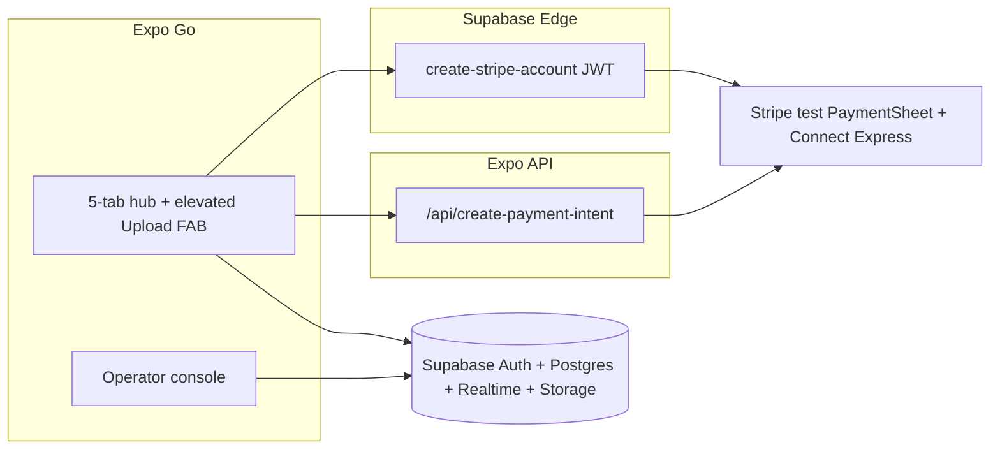

# Tapua'i — System Architecture Overview

**Product:** Tapua'i (“Back Every Athlete.”)  
**Runtime:** Expo SDK 57 · React Native · TypeScript  
**Companions:** [Onboarding](docs/ONBOARDING.md) · [Schema](docs/SCHEMA.md) · [Product facts](docs/PRODUCT_FACTS.md) · [Public one-pager](docs/PUBLIC.md) · [Investor briefing](docs/INVESTOR.md) · [Legal briefing](docs/LEGAL_BRIEFING.md) · [Troubleshooting](TROUBLESHOOTING.md) · [Changelog](CHANGELOG.md) · [Conventions](AGENTS.md) · [Audit](docs/AUDIT_REPORT.md)

---

## Executive Summary

Tapua'i is a Polynesian-inspired **Fan & Athlete Hub** for high-school game day. Continuity for this product is three loops:

1. **Watch & react** — TikTok-style Highlights ⚡ (Seki plays) tagged to athletes, with Seki 🤙, Aura ⚡, and Flex 💪.
2. **Support** — **Mālo ⚡** micro-tipping ($5 / $10 / $25 / Custom) through Stripe PaymentSheet in **test mode**.
3. **Rank & trade identity** — Dynamic **7-tier Aura Card** profiles (Slate Silver → Celestial Prism). Successful Mālo awards **10 Aura points per tip dollar**. Exclusive subscribe awards a flat **+100 Aura**. Borders and the Local Top Aura Boosters rail restyle in real time when a fan crosses a band.

UI copy uses Mālo / Seki. Persistence still uses `tips` / `useTipCheckout`. Brand surface: Midnight Obsidian `#0F1416` (base), Neon Jade `#00E676` (tips, Aura gains, active roles), Electric Gold `#FFD700` (Gold / Platinum boosters and top ranks). Springs live in `src/frontend/theme/motion.ts`.

Roles: `guest`, `fan`, `athlete`, `parent`, `operator`, `booster`, `sponsor`, `admin`. Guests and fans share the five-item fan bar.

---

## Tech Stack Specs

| Layer | Spec |
| --- | --- |
| App | **Expo (React Native)** Router, SDK 57, StyleSheet + `src/frontend/constants/theme.ts` (springs + focal colors in `src/frontend/theme/motion.ts`) |
| Video | **`expo-video` only** (do not use `expo-av` for the feed; do not set `useCaching: true`) |
| Backend | **Supabase** — Auth, Postgres, Realtime WebSockets (`games`, `game_events`, `cheer_polls`), Storage (`game_highlights`) |
| Payments | **Stripe Connect Express / PaymentSheet, test mode** (`pk_test_` / `sk_test_`). Native: `stripe.native.ts`. Web PaymentSheet is stubbed; Connect uses `expo-web-browser`. Express Account Links are minted only by Edge Function `create-stripe-account` with the session JWT — never on device. |
| API | `POST /api/create-payment-intent`, `POST /api/create-payout`, JWT `POST /api/create-stripe-account` (Metro fallback). Production Connect: `supabase.functions.invoke('create-stripe-account')`. |
| Env | Client keys must start with `EXPO_PUBLIC_`. Secrets in `.env.local`. |



### Directory map

Expo Router lives **only** in `app/`. UI, hooks, and context live under `src/frontend/` (`@/…`).

```
app/                              Expo Router
  (tabs)/                         Fan hub
    index.tsx                     Home feed (Home / All / Seki + clip/athlete search; DB / hooks still `reels`); Player of the Week `SpotlightModal`
    spotlight.tsx                 Spotlight board (reopen dismissed Player of the Week/Month/Year)
    local/                        Nested stack so match detail keeps FanTabBar
      index.tsx                   Explore search + Live Matches / School Polls / Top Boosters
      game/[id].tsx               Live match feed + rosters (same UI as public `/game/[id]`)
    drip.tsx                      Drip marketplace (shop.tsx redirects here)
    profile.tsx                   Own hub via `AthleteProfileView` (trading card + Highlights / Stats / Vault)
    receipts.tsx                  Fan Tip History & Receipts (hidden tab; fan bar stays)
    user/[id].tsx                 Public athlete sheet (hidden tab; fan bar stays)
    athlete/[id].tsx              Redirect → `/user/[id]`
  operator/                       Field portal (`index`, `[gameId]` scorekeeper, `scorer`)
  (admin)/admin                   Production control plane (`/admin`). Grouped: Ship (overview / studio / features / look / publish / qa), Content, Catalog, People & money (`/admin/money` gross / net / payouts + stream splits), Insights (`/admin/reports` graphs + health). `profiles.is_admin` or Studio unlock. Fan chrome has no Dev role bar. Heavy chrome (tabs, colors, Profile layout, Highlights rail) waits on **Publish to app**; catalog saves instantly.
  api/*+api.ts                    Stripe

  src/frontend/components/          AuraCard, AuraTradingCard, AthleteProfileView, AthleteStatsTab, VaultLockCard, PayoutSetupCard, ReceiptCard, RoleSwitcherModal, TeamSearchField, AthleteReelManager, SwipeableBannerWrapper, GearCard, ProductSheet, MaloTipModal, Local/CheerPollCard, Local/SearchResultsOverlay, Local/SponsorshipModal, TopAuraBoosters, Operator/PINClaimModal, Reels/LiveMatchBanner, Reels/ReportContentModal, Reels/ReelMoreSheet, SubscriberQnA, SubscriberCrest, ExclusivePaywall, TipCheckout, FanTabBar, HapticPressable, AnimatedPressable, Spotlight/SpotlightModal, Spotlight/SpotlightAwardCard, Spotlight/TagConfirmList, Admin/AdminShell, Admin/AdminOverview, Admin/StudioTool, Admin/PublishTool, Admin/QaTool, Admin/FeaturesTool, Admin/LookTool, Admin/ReportsTool, Admin/AdminCharts, RuntimePaused, Reels/*
src/frontend/hooks/               useTipCheckout, useFanTipHistory, useSponsorships, useStripeConnect, useAthleteSubscription, useSubscriberRequests, useSavedReel, useLocalSearch, useTeamSearch, useAthleteStats, useLiveScores, useLiveGame, useGameEventBroadcast, useRoster, useReels, useActiveSpotlight, useSpotlightBoard, usePendingPlayerTags, useAdminDashboard, useDripCatalog, …
src/frontend/context/             AuthContext, CelebrationContext, RoleGate, UploadSheetContext, AppRuntimeContext
src/frontend/lib/                 supabase.ts, stripe*.ts, aura.ts, haptics.ts, teams.ts, athleteStats.ts, vault.ts, spotlight.ts, tags.ts, finance.ts, admin.ts, adminCatalog.ts, runtime.ts
src/frontend/theme/               motion.ts (`SPRING_CARD` / `SPRING_BOUNCE` / `SPRING_FLIP`, Obsidian / Neon Jade / Electric Gold)
src/frontend/services/            TelemetryManager (batched `telemetry_logs`); OfflineQueue (AsyncStorage + NetInfo flush)

src/backend/db/schema.sql         Canonical Postgres + RLS
scripts/                          Node generators (`sync-front-docs.mjs` → product facts)
supabase/                         Incremental SQL (DROP FUNCTION before return-type changes)
supabase/functions/               Edge Functions (`create-stripe-account` JWT Connect, `create-payment-intent`)
```

The elevated **center camera uploader** is a FAB (`UploadSheetContext`), not a tab route. Root `babel.config.js` must include `babel-preset-expo`.

---

## Master Roadmap Tracker

### Phase 1 — Fan & Athlete Hub — **100% core complete**

- 5-tab navigation: **Reel · Local · (⚡ Upload) · Drip · Profile**
- Elevated center camera uploader → `game_highlights`
- TikTok-style Reel feed (`expo-video`), `@Athlete` → `/athlete/[id]` (fan bar stays). `ReelCard` records time-to-first-frame and mid-reel buffer stalls via `TelemetryManager`. Profile / athlete tagged grids open the same `ReelCard` pager (newest → oldest).
- Reel micro-interactions: `Gesture.Exclusive(doubleTap, singleTap)` (mute vs Aura ⚡ burst), chip bounce 0.88→1.15→1.0 with optimistic +1, Mālo ⚡ → `MaloTipModal` (blur backdrop, Neon Jade border glow), Share (`Share.share` deep link), Bookmark (`saved_reels`), **Report / Hide Highlight 🚩** (`ReportContentModal` → `report_reel` + per-user hide). Top-left: tagged athlete + school roster badge. Top-right: 7-tier Aura rank with `withRepeat` glow.
- Offline resilience: `OfflineQueue` persists Aura taps, cheer votes, bookmarks, and reports when `NetInfo.isConnected === false`, then flushes RPCs on reconnect (root layout starts the singleton).
- Cheer polls on Local (School Polls hub): AnimatedPressable options, `withSpring` bar from 0%→share, Medium haptic, floating **+1 Vote ⚡**, `cast_cheer_vote`
- Local **Local Team Boosters & Sponsors 🏆** rail above rivalry polls (`SponsorshipModal`: Silver $50 / Gold $150 / Platinum $500). First month via `useTipCheckout` PaymentSheet (`skipBacker`); inserts `sponsorships` and `add_user_aura` for the payer. **+ Become a Team Sponsor** uses Light `impactAsync`.
- Local hub pills: **Live Matches · School Polls · Top Boosters** (jade indicator `withSpring`s; panes stay mounted so the bar does not shift). Persistent Explore search sits above the pills; queries longer than 1 character slide up `SearchResultsOverlay` (All / Athletes / Schools / Boosters, AsyncStorage recents, `search_local_entities`). Athlete hits open `/athlete/[id]`; booster hits jade-highlight the sponsor rail; school hits filter rivalry polls. Top Boosters rail scale-on-press + 7-tier peek. `CheerPollCard` Medium haptic, bars from 0%→share, **+1 Vote ⚡** from the tap (+60px). **+ Become a Team Sponsor** opens `SponsorshipModal` with blur; **Complete Sponsorship** runs PaymentSheet.
- Live matchups, tagged 3×3 clips, slang banner, hype reactions
- `__DEV__` Aura personas on Profile
- Dual Fan/Athlete: `AuthContext` tracks `roles`, `activeRole`, `isAthlete`, `canReceiveTips`, `isVerified`. Profile **Account Capability** opens `RoleSwitcherModal` (`expo-blur`). Fan-only: unified team search (`schools_and_teams` ILIKE) then sport / jersey / position / class year — same for High School and NCAA — then `add_user_role` writes `profiles.school_id` + `athlete_division`. Dual: Fan View / Athlete Management toggle writes `active_role` with Medium haptic. **Tip History & Receipts 🧾** Light haptic → `/receipts`. Studio **Athlete** preview stays on the fan hub (`ROLE_HOME.athlete = '/'`). Dev role chips and Aura personas live only under `/admin/studio`.
- Profile 3D Aura trading card (`AuraTradingCard`): `SPRING_FLIP` `rotateY` 0↔180 with `perspective: 1000`, tap the card or **Flip Card 🔄**, Medium `impactAsync` exactly at 90°. Front is the 7-tier Aura border (active roles in Neon Jade) plus selected team name, mascot, and division badge; back highlights Season Points, Total Tipped, and the same team line.
- Drip marketplace: category pills with a sliding jade indicator, `GearCard` press 0.96 → `ProductSheet` (`expo-blur` backdrop, sliding S–2XL indicator, qty clamped to inventory, Aura banner + live total). **Buy Now** → `useTipCheckout` PaymentSheet; success grants order dollars × 10 Aura to the payer.

### Phase 2 — Field Operator Portal — **staged v2 prototype**

- PIN keypad sheet (`PINClaimModal`, test PIN `1234`) writes `games.claimed_by` and unlocks `/operator/[gameId]`
- GPS check-in
- Live scorekeeper: Home/Away **+1 Try / +3 FG / +6 TD** via RPC `update_game_score`; **Start / Pause Clock** toggles `is_clock_running` with a 1s timer
- Play-by-play callouts **⚡ Big Play / 🏆 Touchdown / 🤙 Big Hit / 🛑 Turnover** Broadcast on channel `game_events_${gameId}` (`{ type, timestamp, team }`) with `Haptics.notificationAsync`; optional `game_events` INSERT for history
- Fan `useLiveGame` Realtime: `postgres_changes` on `games` (`id=eq.{gameId}`) plus `game_events` INSERT; local `clockSeconds` + MM:SS `clockLabel`
- Fan `useGameEventBroadcast`: focused `ReelCard` joins `game_events_${gameId}` (clip `game_id`, or featured live match) and springs **⚡ BIG PLAY: Westlake Thunder!** for 3s (`withTiming` dismiss, Light haptic). Swipe up or tap ✕ dismisses early.
- Obsidian `Reels/LiveMatchBanner` on Reel + `/game/[id]`: live score spring, pulse; postgres play toast stays on `/game/[id]`. Swipe up or tap ✕ (`SwipeableBannerWrapper`) hides that game’s scoreboard for the session; it returns only when the score changes or a different game is live. Play-by-play cards on `ReelCard` are separate new notifications.
- **Socket lifecycle teardowns:** `supabase.removeChannel` on unmount; Reel tab `clearVideoCacheAsync` on mount. Realtime topics use `nextRealtimeTopic` so two hooks never `.on('postgres_changes')` after `subscribe()`. `useLiveGame` logs Realtime `CHANNEL_ERROR` / `CLOSED` / recovered `SUBSCRIBED` to `telemetry_logs` (`trackSocketReconnect`). The Reel feed shares one live snapshot with `LiveMatchBanner`.
- Sideline scorer + `/operator/console/[gameId]` redirect. **v2:** replace demo PIN + anon write RLS with authenticated operator policies

### Phase 3 — Monetization & NIL Tiers — **active engine**

- 7-tier dynamic borders (see [SCHEMA.md](docs/SCHEMA.md#7-tier-aura-palette)); Profile uses the flippable `AuraTradingCard` (identity + season sheet) with the same palette as public `AuraCard`
- `add_user_aura(target_user_id, points_to_add)` after successful Mālo (`tipAmount * 10`) **twice** (tipper Fan Aura + athlete recipient); Drip (`order dollars × 10`), exclusive subscribe (**+100**), and booster sponsorships (**500 / 2,000 / 10,000**) grant **only the payer**. Double-tap Aura on a Reel grants **+1** to the signed-in fan. Athletes may drop Mālo on any reel.
- Tipping shortcuts `$5` / `$10` / `$25` / Custom
- Athlete exclusive paywall on `/user/[id]` and the Highlights ⚡ feed: `$4.99/mo` PaymentSheet, `subscriptions` (`subscriber_id`, `athlete_id`). Clips in the Vault collection (`reels.is_vault_only`) stay behind Subscribe while `players.vault_locked` is true (default). The athlete can **Open Vault 🌐** so anyone can watch those clips, then **Lock Vault 🔒** again. +100 Aura + unlock toast.
- Vault tab + Direct Request: `subscriber_requests`, Subscriber Crest on Profile / Q&A avatars. Athlete Management (`VaultLockCard`) is the master lock; long-press (`toggle_reel_vault_status`) still moves clips between Highlights ⚡ and Vault 🔒.
- Upload FAB (`+` camera button): `UploadVideoModal` ImagePicker URI + paused expo-video thumbnail; category pills **⚡ Game Play** / **💪 Train Like Me** / **🤝 Serve Like Me (2x Aura Boost)** write `reels.category`; **Subscriber Vault 🔒** is off by default and writes `reels.is_vault_only` / `is_exclusive`; **Publish Reel** shows a Storage progress bar, Success haptic, then refreshes the active Reel feed via `UploadSheetContext`. Serve Like Me double-taps grant 2 Aura. Athlete profiles show **The Crew ⚡** / **Your Squad 🛡️** and **Join Crew ⚡** (Teammates 🤝 when mutual). Vault management can **🔓 Flash Unlock (2 Hours)** a clip for the Crew.
- Stripe Connect Express for athlete payouts: Profile **Account Settings** (`PayoutSetupCard`) when Athlete Mode is unlocked and **Athlete Management** is the active view. `useStripeConnect` → Edge Function `create-stripe-account` with `Authorization: Bearer` session JWT (`auth.uid()` owns the Express account). Hosted Account Links are never created on device. Metro `POST /api/create-stripe-account` is a JWT-gated local fallback only. Return refreshes `stripe_onboarding_complete` + `payouts_enabled` from the server write.
- Stripe **test mode** only
- Client telemetry: `TelemetryManager` batches `video_stall` / `video_first_frame` / `socket_reconnect` / `checkout_latency` into `public.telemetry_logs` every 10s or at 15 events. Incremental: `supabase/telemetry_logs.sql`.
- Local booster sponsorships: first month through PaymentSheet (same engine as exclusive subscribe / Drip). `public.sponsorships` stores `tier`, `billing_interval = month`. Incremental: `supabase/sponsorships.sql`.
- Successful Mālo (`!skipBacker`) inserts `public.tips` (`fan_id`, `player_id`, `reel_id`, `amount_cents`, `aura_points`). Profile **Tip History & Receipts** reads them via `get_fan_tip_history`. Profile **Total Tips Dropped** on the trading card is still device-local (`tapuai.maloDroppedCount`).
- Player of the Week/Month/Year spotlight: Highlights launch calls `get_active_spotlight_award(viewer_user_id)`, which refreshes auto crowns from **confirmed** Game Play Seki + Aura + Flex. Unviewed awards open `SpotlightModal` (looped Highlight, 7-tier Aura portrait, Mālo + watch, **Clip by** when a fan shot the tape). Dismiss writes AsyncStorage `tapuai.spotlightSeen.{awardId}`. The **Spotlight** fan-bar tab (`useSpotlightBoard`) lists week / month / year. Fan tags stay pending until the athlete, parent, operator, or admin confirms (`confirm_reel_player_tag`). Incremental: `supabase/spotlight_awards.sql` + `supabase/spotlight_auto.sql`.

```ts
await supabase.rpc('add_user_aura', {
  target_user_id: currentUserId, // Fan Aura
  points_to_add: tipAmount * 10,
});
await supabase.rpc('add_user_aura', {
  target_user_id: playerId, // Athlete Aura (skip if same id)
  points_to_add: tipAmount * 10,
});
```

---

## Guardrails

1. Expo 57 docs: https://docs.expo.dev/versions/v57.0.0/
2. Do not delete operator, payouts, schema, or API routes.
3. Changing RPC return types: `DROP FUNCTION …` first (`42P13`).
4. After Babel / env changes: `npx expo start --clear`.
5. After Mālo / exclusive / booster / Aura / PIN / Connect / athlete-sport constant changes: `npm run docs:sync` so PUBLIC / INVESTOR / LEGAL fact blocks match code. CI runs `npm run docs:check` (SCHEMA must name every table and RPC in `schema.sql`).
