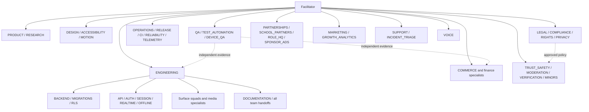

# Tapua'i — Team hierarchy & agents

**Purpose:** See who owns each critical function, where it escalates and which callable agent definition to open. **Detail:** [TEAMS.md](TEAMS.md). **Execution:** [WORK_QUEUE.md](WORK_QUEUE.md), when present. **Current product and hosted state:** [STATE.md](STATE.md).

Last aligned: 2026-10-07. Registry: `.claude/agents/registry.json`.

## How to read this

The **Facilitator** is the owner/session driver and retains business decisions. Department leads route tasks and integrate specialists. Specialists own coherent functions; independent QA/security/privacy reviewers verify evidence. Every role is callable via `CALL: NAME`. Definitions do not mean all roles are running, features are built, a human desk is staffed or a launch is approved.

## Org chart

```text
FACILITATOR — owner/session decisions and integration
├── COMMERCE (Finance)
│   ├── BILLING (Finance)
│   ├── CHECKOUT (Finance)
│   ├── CONNECT (Finance)
│   ├── CUSTODIAL (Finance)
│   ├── DONATION_THANKS (Finance)
│   ├── DRIP (Finance)
│   ├── LEDGER (Finance)
│   ├── RALLY (Finance)
│   ├── RECEIPTS (Finance)
│   ├── RECONCILIATION (Finance)
│   ├── REFUNDS (Finance)
│   ├── WISHLIST (Finance)
├── COMPLIANCE (Legal and Compliance)
│   ├── PRIVACY_ENGINEERING (Legal and Compliance)
├── DESIGN (Design)
│   ├── ACCESSIBILITY (Design)
│   ├── MOTION (Design)
├── ENGINEERING (Engineering)
│   ├── ADMIN (Engineering)
│   │   ├── CATALOGS (Engineering)
│   │   ├── RUNTIME_CONFIG (Engineering)
│   ├── API (Engineering)
│   ├── AURA (Engineering)
│   │   ├── LEADERBOARDS (Engineering)
│   ├── AUTH (Engineering)
│   │   ├── ONBOARDING (Engineering)
│   │   ├── SESSION_SECURITY (Engineering)
│   ├── BACKEND (Engineering)
│   │   ├── DATABASE_MIGRATIONS (Engineering)
│   │   ├── RLS_SECURITY (Engineering)
│   │   ├── STORAGE (Engineering)
│   ├── DOCUMENTATION (Engineering)
│   ├── FULLSTACK (Engineering)
│   ├── HIGHLIGHTS (Engineering)
│   │   ├── ACTIVITY (Engineering)
│   │   ├── FILMER_REWARDS (Engineering)
│   │   ├── PLAYBACK (Engineering)
│   │   ├── UPLOAD (Engineering)
│   │   │   ├── ACCOUNT_TAGS (Engineering)
│   ├── LOCAL (Engineering)
│   │   ├── DISCOVERY (Engineering)
│   │   ├── POLLS (Engineering)
│   │   ├── ROSTERS (Engineering)
│   ├── MOBILE_PERFORMANCE (Engineering)
│   ├── OFFLINE (Engineering)
│   ├── PROFILE (Engineering)
│   │   ├── ATHLETE_STATS (Engineering)
│   │   ├── CREW (Engineering)
│   │   │   ├── NOTIFICATIONS (Engineering)
│   │   ├── SHARING (Engineering)
│   │   ├── VAULT (Engineering)
│   ├── REALTIME (Engineering)
│   ├── SHARED_CONTRACTS (Engineering)
│   ├── SPOTLIGHT (Engineering)
├── LEGAL (Legal and Compliance)
│   ├── CONTENT_RIGHTS (Legal and Compliance)
├── MARKETING (Marketing)
│   ├── GROWTH_ANALYTICS (Marketing)
├── OPERATIONS (Operations)
│   ├── CI (Operations)
│   ├── COST_OPERATIONS (Operations)
│   ├── OPERATOR (Operations)
│   ├── RECOVERY (Operations)
│   ├── RELEASE (Operations)
│   ├── RELIABILITY (Operations)
│   ├── TELEMETRY (Operations)
├── PARTNERSHIPS (Partnerships)
│   ├── ROLE_HQ (Partnerships)
│   ├── SCHOOL_PARTNERS (Partnerships)
│   ├── SPONSOR_ADS (Partnerships)
├── PRODUCT (Product)
│   ├── RESEARCH (Product)
├── QA (Quality)
│   ├── DEVICE_QA (Quality)
│   ├── TEST_AUTOMATION (Quality)
├── SUPPORT (Support)
│   ├── INCIDENT_TRIAGE (Support)
├── TRUST_SAFETY (Trust and Safety)
│   ├── ATHLETE_VERIFICATION (Trust and Safety)
│   ├── MINOR_SAFETY (Trust and Safety)
│   ├── MODERATION (Trust and Safety)
├── VOICE (Brand)
```



## Department → accountable lead

| Department | Lead | Specialist scope |
| --- | --- | --- |
| Product | PRODUCT | Roadmap, acceptance criteria, RESEARCH |
| Design | DESIGN | ACCESSIBILITY, MOTION and visual integration |
| Engineering | ENGINEERING | Database/API, identity, realtime/offline, fan/admin surfaces, media and DOCUMENTATION |
| Finance | COMMERCE | Checkout, ledger, reconciliation, refunds, Connect, custodial, Rally, thanks, billing, Drip |
| Legal and Compliance | LEGAL / COMPLIANCE | Counsel-approved language, CONTENT_RIGHTS and PRIVACY_ENGINEERING |
| Trust and Safety | TRUST_SAFETY | MODERATION, ATHLETE_VERIFICATION, MINOR_SAFETY |
| Operations | OPERATIONS | OPERATOR, RELEASE, CI, RELIABILITY, TELEMETRY |
| Quality | QA | TEST_AUTOMATION, DEVICE_QA, independent final gate |
| Partnerships | PARTNERSHIPS | ROLE_HQ, SCHOOL_PARTNERS, SPONSOR_ADS |
| Marketing | MARKETING | GROWTH_ANALYTICS and reviewed launch planning |
| Support | SUPPORT | INCIDENT_TRIAGE and internal tester help |
| Brand | VOICE | Donation words and honest product copy |

## Pairing and escalation

- Surface owner integrates user-facing behavior; specialist owns its function. FULLSTACK integrates app/server/shared-type work.
- Every schema/RPC/Storage change includes BACKEND plus DATABASE_MIGRATIONS; RLS_SECURITY independently verifies sensitive authorization.
- Every money change includes COMMERCE and the specific financial owner. CHECKOUT success alone never proves a settled donation. LEDGER owns a single authoritative credit path; REFUNDS and RECONCILIATION verify reversals and discrepancies.
- Minor, footage, school-mark and privacy decisions include the relevant safety/privacy specialist and LEGAL/COMPLIANCE. Counsel and the owner retain legal and business decisions.
- DOCUMENTATION synchronizes every department handoff with code comments, architecture, current state and tester evidence. Feature owners supply verified facts; generated blocks and approved legal conclusions retain their owners.
- QA records actual automated and product results. DEVICE_QA records actual native/device evidence. Unrun checks and hosted prerequisites stay named.
- Definitions authorize local scoped work under the session instruction; no automatic external SQL/deployment/publication/contact, live money, marketplace activation or counsel decisions.

## Full agent index (A–Z)

| Call | Department | Reports to | Definition |
| --- | --- | --- | --- |
| `ACCESSIBILITY` | Design | `DESIGN` | [accessibility.md](../.claude/agents/accessibility.md) |
| `ACCOUNT_TAGS` | Engineering | `UPLOAD` | [account-tags.md](../.claude/agents/account-tags.md) |
| `ACTIVITY` | Engineering | `HIGHLIGHTS` | [activity.md](../.claude/agents/activity.md) |
| `ADMIN` | Engineering | `ENGINEERING` | [admin.md](../.claude/agents/admin.md) |
| `API` | Engineering | `ENGINEERING` | [api.md](../.claude/agents/api.md) |
| `ATHLETE_STATS` | Engineering | `PROFILE` | [athlete-stats.md](../.claude/agents/athlete-stats.md) |
| `ATHLETE_VERIFICATION` | Trust and Safety | `TRUST_SAFETY` | [athlete-verification.md](../.claude/agents/athlete-verification.md) |
| `AURA` | Engineering | `ENGINEERING` | [aura.md](../.claude/agents/aura.md) |
| `AUTH` | Engineering | `ENGINEERING` | [auth.md](../.claude/agents/auth.md) |
| `BACKEND` | Engineering | `ENGINEERING` | [backend.md](../.claude/agents/backend.md) |
| `BILLING` | Finance | `COMMERCE` | [billing.md](../.claude/agents/billing.md) |
| `CATALOGS` | Engineering | `ADMIN` | [catalogs.md](../.claude/agents/catalogs.md) |
| `CHECKOUT` | Finance | `COMMERCE` | [checkout.md](../.claude/agents/checkout.md) |
| `CI` | Operations | `OPERATIONS` | [ci.md](../.claude/agents/ci.md) |
| `COMMERCE` | Finance | `FACILITATOR` | [commerce.md](../.claude/agents/commerce.md) |
| `COMPLIANCE` | Legal and Compliance | `FACILITATOR` | [compliance.md](../.claude/agents/compliance.md) |
| `CONNECT` | Finance | `COMMERCE` | [connect.md](../.claude/agents/connect.md) |
| `CONTENT_RIGHTS` | Legal and Compliance | `LEGAL` | [content-rights.md](../.claude/agents/content-rights.md) |
| `COST_OPERATIONS` | Operations | `OPERATIONS` | [cost-operations.md](../.claude/agents/cost-operations.md) |
| `CREW` | Engineering | `PROFILE` | [crew.md](../.claude/agents/crew.md) |
| `CUSTODIAL` | Finance | `COMMERCE` | [custodial.md](../.claude/agents/custodial.md) |
| `DATABASE_MIGRATIONS` | Engineering | `BACKEND` | [database-migrations.md](../.claude/agents/database-migrations.md) |
| `DESIGN` | Design | `FACILITATOR` | [design.md](../.claude/agents/design.md) |
| `DEVICE_QA` | Quality | `QA` | [device-qa.md](../.claude/agents/device-qa.md) |
| `DISCOVERY` | Engineering | `LOCAL` | [discovery.md](../.claude/agents/discovery.md) |
| `DOCUMENTATION` | Engineering | `ENGINEERING` | [documentation.md](../.claude/agents/documentation.md) |
| `DONATION_THANKS` | Finance | `COMMERCE` | [donation-thanks.md](../.claude/agents/donation-thanks.md) |
| `DRIP` | Finance | `COMMERCE` | [drip.md](../.claude/agents/drip.md) |
| `ENGINEERING` | Engineering | `FACILITATOR` | [engineering.md](../.claude/agents/engineering.md) |
| `FILMER_REWARDS` | Engineering | `HIGHLIGHTS` | [filmer-rewards.md](../.claude/agents/filmer-rewards.md) |
| `FULLSTACK` | Engineering | `ENGINEERING` | [fullstack.md](../.claude/agents/fullstack.md) |
| `GROWTH_ANALYTICS` | Marketing | `MARKETING` | [growth-analytics.md](../.claude/agents/growth-analytics.md) |
| `HIGHLIGHTS` | Engineering | `ENGINEERING` | [highlights.md](../.claude/agents/highlights.md) |
| `INCIDENT_TRIAGE` | Support | `SUPPORT` | [incident-triage.md](../.claude/agents/incident-triage.md) |
| `LEADERBOARDS` | Engineering | `AURA` | [leaderboards.md](../.claude/agents/leaderboards.md) |
| `LEDGER` | Finance | `COMMERCE` | [ledger.md](../.claude/agents/ledger.md) |
| `LEGAL` | Legal and Compliance | `FACILITATOR` | [legal.md](../.claude/agents/legal.md) |
| `LOCAL` | Engineering | `ENGINEERING` | [local.md](../.claude/agents/local.md) |
| `MARKETING` | Marketing | `FACILITATOR` | [marketing.md](../.claude/agents/marketing.md) |
| `MINOR_SAFETY` | Trust and Safety | `TRUST_SAFETY` | [minor-safety.md](../.claude/agents/minor-safety.md) |
| `MOBILE_PERFORMANCE` | Engineering | `ENGINEERING` | [mobile-performance.md](../.claude/agents/mobile-performance.md) |
| `MODERATION` | Trust and Safety | `TRUST_SAFETY` | [moderation.md](../.claude/agents/moderation.md) |
| `MOTION` | Design | `DESIGN` | [motion.md](../.claude/agents/motion.md) |
| `NOTIFICATIONS` | Engineering | `CREW` | [notifications.md](../.claude/agents/notifications.md) |
| `OFFLINE` | Engineering | `ENGINEERING` | [offline.md](../.claude/agents/offline.md) |
| `ONBOARDING` | Engineering | `AUTH` | [onboarding.md](../.claude/agents/onboarding.md) |
| `OPERATIONS` | Operations | `FACILITATOR` | [operations.md](../.claude/agents/operations.md) |
| `OPERATOR` | Operations | `OPERATIONS` | [operator.md](../.claude/agents/operator.md) |
| `PARTNERSHIPS` | Partnerships | `FACILITATOR` | [partnerships.md](../.claude/agents/partnerships.md) |
| `PLAYBACK` | Engineering | `HIGHLIGHTS` | [playback.md](../.claude/agents/playback.md) |
| `POLLS` | Engineering | `LOCAL` | [polls.md](../.claude/agents/polls.md) |
| `PRIVACY_ENGINEERING` | Legal and Compliance | `COMPLIANCE` | [privacy-engineering.md](../.claude/agents/privacy-engineering.md) |
| `PRODUCT` | Product | `FACILITATOR` | [product.md](../.claude/agents/product.md) |
| `PROFILE` | Engineering | `ENGINEERING` | [profile.md](../.claude/agents/profile.md) |
| `QA` | Quality | `FACILITATOR` | [qa.md](../.claude/agents/qa.md) |
| `RALLY` | Finance | `COMMERCE` | [rally.md](../.claude/agents/rally.md) |
| `REALTIME` | Engineering | `ENGINEERING` | [realtime.md](../.claude/agents/realtime.md) |
| `RECEIPTS` | Finance | `COMMERCE` | [receipts.md](../.claude/agents/receipts.md) |
| `RECONCILIATION` | Finance | `COMMERCE` | [reconciliation.md](../.claude/agents/reconciliation.md) |
| `RECOVERY` | Operations | `OPERATIONS` | [recovery.md](../.claude/agents/recovery.md) |
| `REFUNDS` | Finance | `COMMERCE` | [refunds.md](../.claude/agents/refunds.md) |
| `RELEASE` | Operations | `OPERATIONS` | [release.md](../.claude/agents/release.md) |
| `RELIABILITY` | Operations | `OPERATIONS` | [reliability.md](../.claude/agents/reliability.md) |
| `RESEARCH` | Product | `PRODUCT` | [research.md](../.claude/agents/research.md) |
| `RLS_SECURITY` | Engineering | `BACKEND` | [rls-security.md](../.claude/agents/rls-security.md) |
| `ROLE_HQ` | Partnerships | `PARTNERSHIPS` | [role-hq.md](../.claude/agents/role-hq.md) |
| `ROSTERS` | Engineering | `LOCAL` | [rosters.md](../.claude/agents/rosters.md) |
| `RUNTIME_CONFIG` | Engineering | `ADMIN` | [runtime-config.md](../.claude/agents/runtime-config.md) |
| `SCHOOL_PARTNERS` | Partnerships | `PARTNERSHIPS` | [school-partners.md](../.claude/agents/school-partners.md) |
| `SESSION_SECURITY` | Engineering | `AUTH` | [session-security.md](../.claude/agents/session-security.md) |
| `SHARED_CONTRACTS` | Engineering | `ENGINEERING` | [shared-contracts.md](../.claude/agents/shared-contracts.md) |
| `SHARING` | Engineering | `PROFILE` | [sharing.md](../.claude/agents/sharing.md) |
| `SPONSOR_ADS` | Partnerships | `PARTNERSHIPS` | [sponsor-ads.md](../.claude/agents/sponsor-ads.md) |
| `SPOTLIGHT` | Engineering | `ENGINEERING` | [spotlight.md](../.claude/agents/spotlight.md) |
| `STORAGE` | Engineering | `BACKEND` | [storage.md](../.claude/agents/storage.md) |
| `SUPPORT` | Support | `FACILITATOR` | [support.md](../.claude/agents/support.md) |
| `TELEMETRY` | Operations | `OPERATIONS` | [telemetry.md](../.claude/agents/telemetry.md) |
| `TEST_AUTOMATION` | Quality | `QA` | [test-automation.md](../.claude/agents/test-automation.md) |
| `TRUST_SAFETY` | Trust and Safety | `FACILITATOR` | [trust-safety.md](../.claude/agents/trust-safety.md) |
| `UPLOAD` | Engineering | `HIGHLIGHTS` | [upload.md](../.claude/agents/upload.md) |
| `VAULT` | Engineering | `PROFILE` | [vault.md](../.claude/agents/vault.md) |
| `VOICE` | Brand | `FACILITATOR` | [voice.md](../.claude/agents/voice.md) |
| `WISHLIST` | Finance | `COMMERCE` | [wishlist.md](../.claude/agents/wishlist.md) |

**83 callable agents** + Facilitator (18 existing roles, 65 new roles). Responsibility is assigned to every critical function; execution and launch status are tracked separately in the work queue and STATE.

## Paste to call someone

```text
CALL: <NAME>
Task: <WORK_QUEUE task ID or concrete outcome>
Surface / files: <exact scope>
Acceptance: <observable checks>
Dependencies / pair: <owners>
Read first: docs/STATE.md · AGENTS.md · docs/TEAMS.md
Report: changes, executed checks/results, unverified dependencies, next owner
```

Keep this file, [TEAMS.md](TEAMS.md), `.claude/agents/registry.json` and the affected definition aligned in the same change. Leads validate critical functional coverage; CI's `agents:check` validates roster consistency when available.
