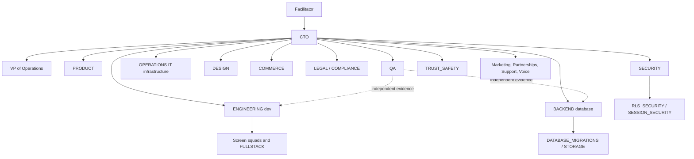

# Tapua'i — Team hierarchy & agents

**Purpose:** See who owns each critical function, where it escalates and which callable agent definition to open. **Plans:** [DEPARTMENT_PLANS.md](DEPARTMENT_PLANS.md). **Expert bar and models:** [EXPERT_STANDARDS.md](EXPERT_STANDARDS.md). **Detail:** [TEAMS.md](TEAMS.md). **Execution:** [WORK_QUEUE.md](WORK_QUEUE.md), when present. **Current product and hosted state:** [STATE.md](../STATE.md).

Last aligned: 2026-10-08. Registry: `.claude/agents/registry.json`.

## How to read this

The **Facilitator** is the owner and retains business decisions: prices, counsel, applying SQL, merging, and live money. The **CTO** assigns every app fix, reviews the evidence, and rejects a shortcut. The **VP of Operations** (`VP_OPERATIONS`) reports to the CTO and keeps roles, protocols, and priorities current in the same turn they change. Department leads take the CTO's assignment and give it to their specialists. Specialists report to their lead. Leads report the fix to the CTO, and they report role or protocol drift to the VP of Operations. Independent QA can still reject the result. Every role is callable via `CALL: NAME`. Definitions do not mean all roles are running, features are built, a human desk is staffed or a launch is approved.

## Org chart

```text
FACILITATOR — owner decisions (prices, counsel, SQL apply, merge, live money)
└── CTO — assigns every app fix
    ├── VP_OPERATIONS — roles, protocols, priorities
    ├── PRODUCT — product
    │   └── RESEARCH (Product)
    ├── ENGINEERING — dev
    │   ├── ADMIN (Engineering)
    │   │   ├── CATALOGS (Engineering)
    │   │   ├── ANALYST (Engineering)
    │   │   ├── PORTAL (Engineering)
    │   │   └── RUNTIME_CONFIG (Engineering)
    │   ├── API (Engineering)
    │   ├── AURA (Engineering)
    │   │   └── LEADERBOARDS (Engineering)
    │   ├── AUTH (Engineering)
    │   │   └── ONBOARDING (Engineering)
    │   ├── DOCUMENTATION (Engineering)
    │   ├── FULLSTACK (Engineering)
    │   ├── HIGHLIGHTS (Engineering)
    │   │   ├── ACTIVITY (Engineering)
    │   │   ├── FILMER_REWARDS (Engineering)
    │   │   ├── PHOTO_STORIES (Engineering)
    │   │   ├── PLAYBACK (Engineering)
    │   │   └── UPLOAD (Engineering)
    │   │       └── ACCOUNT_TAGS (Engineering)
    │   ├── LOCAL (Engineering)
    │   │   ├── DISCOVERY (Engineering)
    │   │   ├── POLLS (Engineering)
    │   │   └── ROSTERS (Engineering)
    │   ├── MOBILE_PERFORMANCE (Engineering)
    │   ├── OFFLINE (Engineering)
    │   ├── PROFILE (Engineering)
    │   │   ├── ATHLETE_STATS (Engineering)
    │   │   ├── CREW (Engineering)
    │   │   │   └── NOTIFICATIONS (Engineering)
    │   │   ├── SHARING (Engineering)
    │   │   └── VAULT (Engineering)
    │   ├── REALTIME (Engineering)
    │   ├── SHARED_CONTRACTS (Engineering)
    │   └── SPOTLIGHT (Engineering)
    ├── SECURITY — security
    │   ├── RLS_SECURITY (Security)
    │   └── SESSION_SECURITY (Security)
    ├── OPERATIONS — IT infrastructure
    │   ├── CI (IT infrastructure)
    │   ├── COST_OPERATIONS (IT infrastructure)
    │   ├── OPERATOR (IT infrastructure)
    │   ├── RECOVERY (IT infrastructure)
    │   ├── RELEASE (IT infrastructure)
    │   ├── RELIABILITY (IT infrastructure)
    │   └── TELEMETRY (IT infrastructure)
    ├── BACKEND — database
    │   ├── DATABASE_MIGRATIONS (Database)
    │   └── STORAGE (Database)
    ├── DESIGN — design
    │   ├── ACCESSIBILITY (Design)
    │   ├── DESIGN_TOOLING (Design)
    │   └── MOTION (Design)
    ├── COMMERCE — finance
    │   ├── BILLING (Finance)
    │   ├── CHECKOUT (Finance)
    │   ├── CONNECT (Finance)
    │   ├── CUSTODIAL (Finance)
    │   ├── DONATION_THANKS (Finance)
    │   ├── DRIP (Finance)
    │   ├── LEDGER (Finance)
    │   ├── RALLY (Finance)
    │   ├── RECEIPTS (Finance)
    │   ├── RECONCILIATION (Finance)
    │   ├── REFUNDS (Finance)
    │   └── WISHLIST (Finance)
    ├── LEGAL — legal
    │   └── CONTENT_RIGHTS (Legal and Compliance)
    ├── COMPLIANCE — compliance
    │   └── PRIVACY_ENGINEERING (Legal and Compliance)
    ├── QA — quality
    │   ├── DEVICE_QA (Quality)
    │   ├── TEST_AUTOMATION (Quality)
    │   └── VISUAL_QA (Quality)
    ├── TRUST_SAFETY — trust and safety
    │   ├── ATHLETE_VERIFICATION (Trust and Safety)
    │   ├── MINOR_SAFETY (Trust and Safety)
    │   └── MODERATION (Trust and Safety)
    ├── MARKETING — marketing
    │   ├── BRAND (Marketing)
    │   └── GROWTH_ANALYTICS (Marketing)
    ├── PARTNERSHIPS — partnerships
    │   ├── ROLE_HQ (Partnerships)
    │   ├── SCHOOL_PARTNERS (Partnerships)
    │   └── SPONSOR_ADS (Partnerships)
    ├── SUPPORT — support
    │   └── INCIDENT_TRIAGE (Support)
    └── VOICE — brand language
```



## Department → accountable lead

| Department | Lead | Specialist scope |
| --- | --- | --- |
| Office of the CTO | CTO | Assigns every app fix to one lead. Reviews evidence. Rejects shortcuts. Reports to the owner (`FACILITATOR`). |
| VP of Operations | VP_OPERATIONS | Under the CTO. Keeps roles, protocols, and priorities current the same turn they change. Checks that each team is doing the job its definition names. |
| Product | PRODUCT | Roadmap, acceptance criteria, RESEARCH. Tasks come from the CTO. |
| Dev | ENGINEERING | App, API, identity, realtime/offline, fan/admin surfaces, media (incl. PHOTO_STORIES) and DOCUMENTATION |
| Security | SECURITY | RLS_SECURITY, SESSION_SECURITY. Authorization, sessions, secrets. |
| IT infrastructure | OPERATIONS | OPERATOR, RELEASE, CI, RELIABILITY, TELEMETRY, RECOVERY, COST_OPERATIONS |
| Database | BACKEND | DATABASE_MIGRATIONS, STORAGE. Schema, RPCs, buckets. Security reviews RLS. |
| Design | DESIGN | ACCESSIBILITY, MOTION, DESIGN_TOOLING (MCP/Figma/Canva/Playwright/Expo tooling) and visual integration |
| Finance | COMMERCE | Checkout, ledger, reconciliation, refunds, Connect, custodial, Rally, thanks, billing, Drip |
| Legal and Compliance | LEGAL / COMPLIANCE | Counsel-approved language, CONTENT_RIGHTS and PRIVACY_ENGINEERING |
| Trust and Safety | TRUST_SAFETY | MODERATION, ATHLETE_VERIFICATION, MINOR_SAFETY |
| Quality | QA | TEST_AUTOMATION, DEVICE_QA (native), VISUAL_QA (browser/visual), independent final gate |
| Partnerships | PARTNERSHIPS | ROLE_HQ, SCHOOL_PARTNERS, SPONSOR_ADS |
| Marketing | MARKETING | GROWTH_ANALYTICS, BRAND (approved message) and reviewed launch planning |
| Support | SUPPORT | INCIDENT_TRIAGE and internal tester help |
| Brand | VOICE | Donation words and honest product copy |

## Current cross-team builds (2026-10-07; ADM-01 added 2026-10-11)

| Work | Primary | Pair / independent review | Lead chain |
| --- | --- | --- | --- |
| UX-05a photo story schema | DATABASE_MIGRATIONS, BACKEND | RLS_SECURITY, STORAGE | BACKEND → CTO |
| UX-05b photo story upload | PHOTO_STORIES, UPLOAD | CONTENT_RIGHTS, MINOR_SAFETY, ACCESSIBILITY | HIGHLIGHTS → ENGINEERING → CTO |
| UX-05c feed + Game Day label | HIGHLIGHTS, PLAYBACK | DESIGN, ACCESSIBILITY | ENGINEERING → CTO |
| UX-05d copy / legal / privacy | VOICE, MARKETING | LEGAL, PRIVACY_ENGINEERING | VOICE → CTO |
| UX-05e verification | QA, VISUAL_QA, DEVICE_QA | — | QA → CTO |
| BRAND-01 tagline placements | BRAND, VOICE | LEGAL | MARKETING → CTO |
| TOOL-01 MCP tooling | DESIGN_TOOLING | ENGINEERING | DESIGN → CTO |
| ADM-01a portal chart kit and tokens | DESIGN | ACCESSIBILITY (sign-off before ADM-01b–e) | DESIGN → CTO; integrated by ADMIN |
| ADM-01b Home, Audience, Health, Departments, Product, shell | PORTAL | ACCESSIBILITY, DESIGN, VOICE | PORTAL → ADMIN → ENGINEERING → CTO |
| ADM-01c Analytics (`/analytics`) | ANALYST | ACCESSIBILITY, VOICE | ANALYST → ADMIN → ENGINEERING → CTO |
| ADM-01d Trends (`/reports`) and `lib/reports.ts` | ADMIN | ANALYST (pace caption), ACCESSIBILITY, VOICE | ADMIN → ENGINEERING → CTO |
| ADM-01e Revenue (`/money`) | COMMERCE | BILLING, VOICE, ACCESSIBILITY | COMMERCE → ADMIN (integration) and CTO |
| ADM-01 Phase C independent review | QA, VISUAL_QA | ACCESSIBILITY, VOICE, DESIGN | QA → CTO |
| ADM-01f (not this pass) per-origin Revenue day chart | ADMIN (`lib/reports.ts` parse), then COMMERCE | ACCESSIBILITY, VOICE | ADMIN → ENGINEERING → CTO |
| ADM-01g docs, ADM-01h roles | DOCUMENTATION; VP_OPERATIONS | — | DOCUMENTATION → ENGINEERING → CTO; VP_OPERATIONS → CTO |

Detail and status: [WORK_QUEUE.md](WORK_QUEUE.md). Build contract: [PHOTO_STORIES_DESIGN.md](../engineering/design/PHOTO_STORIES_DESIGN.md).

## Pairing and escalation

- An app fix starts with `CTO`. The CTO assigns one lead. The lead assigns one specialist. The specialist reports to the lead. The lead reports the fix to the CTO. `VP_OPERATIONS` updates roles, protocols, and priorities in the same turn and reports team drift to the CTO. `QA` can reject the result. The owner (`FACILITATOR`) still decides prices, counsel, applying SQL, merging, and live money.
- Surface owner integrates user-facing behavior; specialist owns its function. FULLSTACK integrates app/server/shared-type work.
- Every schema/RPC/Storage change includes BACKEND plus DATABASE_MIGRATIONS; RLS_SECURITY independently verifies sensitive authorization.
- Every money change includes COMMERCE and the specific financial owner. CHECKOUT success alone never proves a settled donation. LEDGER owns a single authoritative credit path; REFUNDS and RECONCILIATION verify reversals and discrepancies.
- Minor, footage, school-mark and privacy decisions include the relevant safety/privacy specialist and LEGAL/COMPLIANCE. Counsel and the owner retain legal and business decisions.
- DOCUMENTATION synchronizes every department handoff with code comments, architecture, current state and tester evidence. Feature owners supply verified facts; generated blocks and approved legal conclusions retain their owners.
- QA records actual automated and product results. DEVICE_QA records actual native/device evidence. Unrun checks and hosted prerequisites stay named.
- Definitions authorize local scoped work under the session instruction; no automatic external SQL/deployment/publication/contact, live money, marketplace activation or counsel decisions.

## Agents by team

Every agent is listed in the team it reports to. Specialists sit under their lead. Those leads report to the CTO. The CTO reports to the owner.

### Office of the CTO

| Call | Department | Reports to | Definition |
| --- | --- | --- | --- |
| `CTO` | Office of the CTO | `FACILITATOR` | [cto.md](../../.claude/agents/cto.md) |
| `VP_OPERATIONS` | Office of the CTO | `CTO` | [vp-operations.md](../../.claude/agents/vp-operations.md) |

### Product — `PRODUCT`

| Call | Department | Reports to | Definition |
| --- | --- | --- | --- |
| `PRODUCT` | Product | `CTO` | [product.md](../../.claude/agents/product.md) |
| `RESEARCH` | Product | `PRODUCT` | [research.md](../../.claude/agents/research.md) |

### Dev — `ENGINEERING`

| Call | Department | Reports to | Definition |
| --- | --- | --- | --- |
| `ENGINEERING` | Engineering | `CTO` | [engineering.md](../../.claude/agents/engineering.md) |
| `ADMIN` | Engineering | `ENGINEERING` | [admin.md](../../.claude/agents/admin.md) |
| `ANALYST` | Engineering | `ADMIN` | [analyst.md](../../.claude/agents/analyst.md) |
| `CATALOGS` | Engineering | `ADMIN` | [catalogs.md](../../.claude/agents/catalogs.md) |
| `PORTAL` | Engineering | `ADMIN` | [portal.md](../../.claude/agents/portal.md) |
| `RUNTIME_CONFIG` | Engineering | `ADMIN` | [runtime-config.md](../../.claude/agents/runtime-config.md) |
| `API` | Engineering | `ENGINEERING` | [api.md](../../.claude/agents/api.md) |
| `AURA` | Engineering | `ENGINEERING` | [aura.md](../../.claude/agents/aura.md) |
| `LEADERBOARDS` | Engineering | `AURA` | [leaderboards.md](../../.claude/agents/leaderboards.md) |
| `AUTH` | Engineering | `ENGINEERING` | [auth.md](../../.claude/agents/auth.md) |
| `ONBOARDING` | Engineering | `AUTH` | [onboarding.md](../../.claude/agents/onboarding.md) |
| `DOCUMENTATION` | Engineering | `ENGINEERING` | [documentation.md](../../.claude/agents/documentation.md) |
| `FULLSTACK` | Engineering | `ENGINEERING` | [fullstack.md](../../.claude/agents/fullstack.md) |
| `HIGHLIGHTS` | Engineering | `ENGINEERING` | [highlights.md](../../.claude/agents/highlights.md) |
| `ACTIVITY` | Engineering | `HIGHLIGHTS` | [activity.md](../../.claude/agents/activity.md) |
| `FILMER_REWARDS` | Engineering | `HIGHLIGHTS` | [filmer-rewards.md](../../.claude/agents/filmer-rewards.md) |
| `PHOTO_STORIES` | Engineering | `HIGHLIGHTS` | [photo-stories.md](../../.claude/agents/photo-stories.md) |
| `PLAYBACK` | Engineering | `HIGHLIGHTS` | [playback.md](../../.claude/agents/playback.md) |
| `UPLOAD` | Engineering | `HIGHLIGHTS` | [upload.md](../../.claude/agents/upload.md) |
| `ACCOUNT_TAGS` | Engineering | `UPLOAD` | [account-tags.md](../../.claude/agents/account-tags.md) |
| `LOCAL` | Engineering | `ENGINEERING` | [local.md](../../.claude/agents/local.md) |
| `DISCOVERY` | Engineering | `LOCAL` | [discovery.md](../../.claude/agents/discovery.md) |
| `POLLS` | Engineering | `LOCAL` | [polls.md](../../.claude/agents/polls.md) |
| `ROSTERS` | Engineering | `LOCAL` | [rosters.md](../../.claude/agents/rosters.md) |
| `MOBILE_PERFORMANCE` | Engineering | `ENGINEERING` | [mobile-performance.md](../../.claude/agents/mobile-performance.md) |
| `OFFLINE` | Engineering | `ENGINEERING` | [offline.md](../../.claude/agents/offline.md) |
| `PROFILE` | Engineering | `ENGINEERING` | [profile.md](../../.claude/agents/profile.md) |
| `ATHLETE_STATS` | Engineering | `PROFILE` | [athlete-stats.md](../../.claude/agents/athlete-stats.md) |
| `CREW` | Engineering | `PROFILE` | [crew.md](../../.claude/agents/crew.md) |
| `NOTIFICATIONS` | Engineering | `CREW` | [notifications.md](../../.claude/agents/notifications.md) |
| `SHARING` | Engineering | `PROFILE` | [sharing.md](../../.claude/agents/sharing.md) |
| `VAULT` | Engineering | `PROFILE` | [vault.md](../../.claude/agents/vault.md) |
| `REALTIME` | Engineering | `ENGINEERING` | [realtime.md](../../.claude/agents/realtime.md) |
| `SHARED_CONTRACTS` | Engineering | `ENGINEERING` | [shared-contracts.md](../../.claude/agents/shared-contracts.md) |
| `SPOTLIGHT` | Engineering | `ENGINEERING` | [spotlight.md](../../.claude/agents/spotlight.md) |

### Security — `SECURITY`

| Call | Department | Reports to | Definition |
| --- | --- | --- | --- |
| `SECURITY` | Security | `CTO` | [security.md](../../.claude/agents/security.md) |
| `RLS_SECURITY` | Security | `SECURITY` | [rls-security.md](../../.claude/agents/rls-security.md) |
| `SESSION_SECURITY` | Security | `SECURITY` | [session-security.md](../../.claude/agents/session-security.md) |

### IT infrastructure — `OPERATIONS`

| Call | Department | Reports to | Definition |
| --- | --- | --- | --- |
| `OPERATIONS` | IT infrastructure | `CTO` | [operations.md](../../.claude/agents/operations.md) |
| `CI` | IT infrastructure | `OPERATIONS` | [ci.md](../../.claude/agents/ci.md) |
| `COST_OPERATIONS` | IT infrastructure | `OPERATIONS` | [cost-operations.md](../../.claude/agents/cost-operations.md) |
| `OPERATOR` | IT infrastructure | `OPERATIONS` | [operator.md](../../.claude/agents/operator.md) |
| `RECOVERY` | IT infrastructure | `OPERATIONS` | [recovery.md](../../.claude/agents/recovery.md) |
| `RELEASE` | IT infrastructure | `OPERATIONS` | [release.md](../../.claude/agents/release.md) |
| `RELIABILITY` | IT infrastructure | `OPERATIONS` | [reliability.md](../../.claude/agents/reliability.md) |
| `TELEMETRY` | IT infrastructure | `OPERATIONS` | [telemetry.md](../../.claude/agents/telemetry.md) |

### Database — `BACKEND`

| Call | Department | Reports to | Definition |
| --- | --- | --- | --- |
| `BACKEND` | Database | `CTO` | [backend.md](../../.claude/agents/backend.md) |
| `DATABASE_MIGRATIONS` | Database | `BACKEND` | [database-migrations.md](../../.claude/agents/database-migrations.md) |
| `STORAGE` | Database | `BACKEND` | [storage.md](../../.claude/agents/storage.md) |

### Design — `DESIGN`

| Call | Department | Reports to | Definition |
| --- | --- | --- | --- |
| `DESIGN` | Design | `CTO` | [design.md](../../.claude/agents/design.md) |
| `ACCESSIBILITY` | Design | `DESIGN` | [accessibility.md](../../.claude/agents/accessibility.md) |
| `DESIGN_TOOLING` | Design | `DESIGN` | [design-tooling.md](../../.claude/agents/design-tooling.md) |
| `MOTION` | Design | `DESIGN` | [motion.md](../../.claude/agents/motion.md) |

### Finance — `COMMERCE`

| Call | Department | Reports to | Definition |
| --- | --- | --- | --- |
| `COMMERCE` | Finance | `CTO` | [commerce.md](../../.claude/agents/commerce.md) |
| `BILLING` | Finance | `COMMERCE` | [billing.md](../../.claude/agents/billing.md) |
| `CHECKOUT` | Finance | `COMMERCE` | [checkout.md](../../.claude/agents/checkout.md) |
| `CONNECT` | Finance | `COMMERCE` | [connect.md](../../.claude/agents/connect.md) |
| `CUSTODIAL` | Finance | `COMMERCE` | [custodial.md](../../.claude/agents/custodial.md) |
| `DONATION_THANKS` | Finance | `COMMERCE` | [donation-thanks.md](../../.claude/agents/donation-thanks.md) |
| `DRIP` | Finance | `COMMERCE` | [drip.md](../../.claude/agents/drip.md) |
| `LEDGER` | Finance | `COMMERCE` | [ledger.md](../../.claude/agents/ledger.md) |
| `RALLY` | Finance | `COMMERCE` | [rally.md](../../.claude/agents/rally.md) |
| `RECEIPTS` | Finance | `COMMERCE` | [receipts.md](../../.claude/agents/receipts.md) |
| `RECONCILIATION` | Finance | `COMMERCE` | [reconciliation.md](../../.claude/agents/reconciliation.md) |
| `REFUNDS` | Finance | `COMMERCE` | [refunds.md](../../.claude/agents/refunds.md) |
| `WISHLIST` | Finance | `COMMERCE` | [wishlist.md](../../.claude/agents/wishlist.md) |

### Legal — `LEGAL`

| Call | Department | Reports to | Definition |
| --- | --- | --- | --- |
| `LEGAL` | Legal and Compliance | `CTO` | [legal.md](../../.claude/agents/legal.md) |
| `CONTENT_RIGHTS` | Legal and Compliance | `LEGAL` | [content-rights.md](../../.claude/agents/content-rights.md) |

### Compliance — `COMPLIANCE`

| Call | Department | Reports to | Definition |
| --- | --- | --- | --- |
| `COMPLIANCE` | Legal and Compliance | `CTO` | [compliance.md](../../.claude/agents/compliance.md) |
| `PRIVACY_ENGINEERING` | Legal and Compliance | `COMPLIANCE` | [privacy-engineering.md](../../.claude/agents/privacy-engineering.md) |

### Quality — `QA`

| Call | Department | Reports to | Definition |
| --- | --- | --- | --- |
| `QA` | Quality | `CTO` | [qa.md](../../.claude/agents/qa.md) |
| `DEVICE_QA` | Quality | `QA` | [device-qa.md](../../.claude/agents/device-qa.md) |
| `TEST_AUTOMATION` | Quality | `QA` | [test-automation.md](../../.claude/agents/test-automation.md) |
| `VISUAL_QA` | Quality | `QA` | [visual-qa.md](../../.claude/agents/visual-qa.md) |

### Trust and Safety — `TRUST_SAFETY`

| Call | Department | Reports to | Definition |
| --- | --- | --- | --- |
| `TRUST_SAFETY` | Trust and Safety | `CTO` | [trust-safety.md](../../.claude/agents/trust-safety.md) |
| `ATHLETE_VERIFICATION` | Trust and Safety | `TRUST_SAFETY` | [athlete-verification.md](../../.claude/agents/athlete-verification.md) |
| `MINOR_SAFETY` | Trust and Safety | `TRUST_SAFETY` | [minor-safety.md](../../.claude/agents/minor-safety.md) |
| `MODERATION` | Trust and Safety | `TRUST_SAFETY` | [moderation.md](../../.claude/agents/moderation.md) |

### Marketing — `MARKETING`

| Call | Department | Reports to | Definition |
| --- | --- | --- | --- |
| `MARKETING` | Marketing | `CTO` | [marketing.md](../../.claude/agents/marketing.md) |
| `BRAND` | Marketing | `MARKETING` | [brand.md](../../.claude/agents/brand.md) |
| `GROWTH_ANALYTICS` | Marketing | `MARKETING` | [growth-analytics.md](../../.claude/agents/growth-analytics.md) |

### Partnerships — `PARTNERSHIPS`

| Call | Department | Reports to | Definition |
| --- | --- | --- | --- |
| `PARTNERSHIPS` | Partnerships | `CTO` | [partnerships.md](../../.claude/agents/partnerships.md) |
| `ROLE_HQ` | Partnerships | `PARTNERSHIPS` | [role-hq.md](../../.claude/agents/role-hq.md) |
| `SCHOOL_PARTNERS` | Partnerships | `PARTNERSHIPS` | [school-partners.md](../../.claude/agents/school-partners.md) |
| `SPONSOR_ADS` | Partnerships | `PARTNERSHIPS` | [sponsor-ads.md](../../.claude/agents/sponsor-ads.md) |

### Support — `SUPPORT`

| Call | Department | Reports to | Definition |
| --- | --- | --- | --- |
| `SUPPORT` | Support | `CTO` | [support.md](../../.claude/agents/support.md) |
| `INCIDENT_TRIAGE` | Support | `SUPPORT` | [incident-triage.md](../../.claude/agents/incident-triage.md) |

### Brand language — `VOICE`

| Call | Department | Reports to | Definition |
| --- | --- | --- | --- |
| `VOICE` | Brand | `CTO` | [voice.md](../../.claude/agents/voice.md) |

**91 callable agents** + Facilitator. Grouped by the lead each agent reports to (2026-10-08). Responsibility is assigned to every critical function; execution and launch status are tracked separately in the work queue and STATE.

## Paste to call someone

```text
CALL: <NAME>
Task: <WORK_QUEUE task ID or concrete outcome>
Surface / files: <exact scope>
Acceptance: <observable checks>
Dependencies / pair: <owners>
Read first: docs/STATE.md · AGENTS.md · docs/agents/TEAMS.md
Report: changes, executed checks/results, unverified dependencies, next owner
```

Keep this file, [TEAMS.md](TEAMS.md), `.claude/agents/registry.json` and the affected definition aligned in the same change. Leads validate critical functional coverage; CI's `agents:check` validates roster consistency when available.
