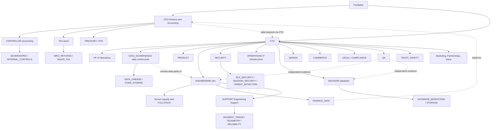

# Tapua'i — Team hierarchy & agents

**Purpose:** See who owns each critical function, where it escalates and which callable agent definition to open. **Plans:** [DEPARTMENT_PLANS.md](DEPARTMENT_PLANS.md). **Expert bar and models:** [EXPERT_STANDARDS.md](EXPERT_STANDARDS.md). **Detail:** [TEAMS.md](TEAMS.md). **Execution:** [WORK_QUEUE.md](WORK_QUEUE.md), when present. **Current product and hosted state:** [STATE.md](../STATE.md).

Last aligned: 2026-10-13 (GROWTH-01; 106 existing roles, reporting lines/model pins preserved). Registry: `.claude/agents/registry.json`.

Actual documentation/team-coordination executors, claims, dated checks and close-out are in
[COORD-01](COORD-01.md). DOCUMENTATION runs on assigned feature/fix handoffs; VP_OPERATIONS
runs on role/protocol/priority changes. Each task records executor, checked duties/documents,
changes, actual results, unresolved drift and next owner. Codex execution is recorded separately
from pinned Cursor roles. Definitions and CI do not certify continuously running workers;
no unattended scheduler is configured.

**ADM-02:** `ENGINEERING` → `ADMIN` integrates the main Expo admin, using the owner-selected
`:3033` report design and retaining every editing desk. `PORTAL` owns mobile
`components/Admin/Reports/`; `SHARED_CONTRACTS` owns `packages/shared-types/admin/`;
`ADMIN` owns authenticated report loaders/hooks and shell/navigation. `ANALYST`,
`COMMERCE`, `DESIGN`, `ACCESSIBILITY`, `QA` and `DOCUMENTATION` supply their existing
reviews and handoff. No reporting lines or model pins change. Claims/evidence:
[ADM-02.md](ADM-02.md).

**GROWTH-01:** [The Growth and Capacity Review charter](../engineering/GROWTH_CAPACITY_REVIEW.md)
assigns one packet owner, GROWTH_ANALYTICS → MARKETING → CTO → owner. ANALYST/Data,
COST_OPERATIONS, RELIABILITY and FINANCE_DATA/FPA/TREASURY contribute accepted sources and
retain their existing domain/reporting controls; QA/Security/Finance independently review as
needed. This is a cross-team working assignment, not a new node in the org chart. Actual setup,
checks, gaps and next owners are in [GROWTH-01](GROWTH-01.md). Weekly/on-receipt,
monthly-invoice and confirmed-trigger duties require dated receipts; no unattended scheduler
is configured. Current MAU, retention, hosted cost and capacity remain unknown; the initial
$50 infrastructure ceiling and review checkpoints do not authorize spending or upgrades.

**Standing joint checkpoint:** [Growth charter §9](../engineering/GROWTH_CAPACITY_REVIEW.md#9-verification-consent-and-safe-engagement)
and [the verification review](../legal/VERIFICATION_AND_SAFE_GROWTH_REVIEW.md) join existing
LEGAL/COMPLIANCE, ENGINEERING and GROWTH_ANALYTICS duties. Exchange counsel-approved rule/consent
alternatives, actual server/provider/access/recovery evidence and friction/engagement plus
safety/manual-review costs before one GROWTH_ANALYTICS → MARKETING → CTO → owner packet.
Counsel/domain acceptance precedes the affected capability; the owner decides business options.
Next standing packet: October 20, 2026. Actual execution is recorded in GROWTH-01; proposed
options do not establish deployed controls or a new reporting line.

**Per-user growth plans:** [User growth plans](../product/USER_GROWTH_PLANS.md) and [Growth charter §10](../engineering/GROWTH_CAPACITY_REVIEW.md#10-growth-plans-for-every-user-type)
assign GROWTH_ANALYTICS one card for each overlapping user segment, gated operators and internal
staff capacity. PRODUCT/RESEARCH, Upload/Filmer Rewards and existing domain owners supply
acquisition/first/repeat/contribution outcomes, capability gaps, action safeguards and loaded
costs; exchange Legal/Dev/Growth findings before MARKETING → CTO → owner decisions. Non-donating
fans and permitted casual video creators retain useful paths without athlete/payee/pro filmer
gates. October 20 is the next packet; 30/60/90 stages are authorization-relative proposals.
Retag/share/private-staging/removal/new-reward bridges and later-wave work retain separate gates.

**Family-fun standing packet:** [Playbook](../product/FAMILY_FUN_PLAYBOOK.md) and [Growth charter §11](../engineering/GROWTH_CAPACITY_REVIEW.md#11-family-fun-fan-recognition-and-voluntary-service)
add fan/family/friend fun/return and owner-selected free fan-ballot awards to existing segment cards.
GROWTH_ANALYTICS/Product refine accessible themes/newcomers; HIGHLIGHTS/UPLOAD/FILMER_REWARDS
supply media/credit/eligibility gaps; LOCAL/POLLS/LEADERBOARDS/SCHOOL_PARTNERS supply later
trusted school-scoring dependencies. Legal/Privacy/Safety/Dev/Support/Finance/QA retain their
acceptance; one MARKETING → CTO → owner packet chooses focused brainstorming next steps on
October 20, 2026. Service/posting are voluntary; badges/Aura, family donations and future paid
work/prizes are distinct models. Permission/review/appeal/pause/removal and loaded costs precede
any pilot. No role, reporting line, enrollment, award or implementation changes here.

Staff checks published entry eligibility/rights/safety; the entry with the most valid free ballots wins, with no
staff-preferred winner. PRODUCT/POLLS/LEADERBOARDS/Backend/Security/Privacy/QA retain proposed
eligible-account/window limits, idempotency/closure/tie/correction/appeal and proportionate
abuse duties without blanket Stripe KYC. Candidate publicity is per entry; declined exposure
preserves private acknowledgment without whole-profile publicity. Newcomer/school nomination
opportunities and balanced discovery do not eliminate fanbase/network advantage. Current cheers
remain unreliable for these awards; the next step is focused ballot design, not implementation.

## How to read this

The **Facilitator** is the owner and retains business decisions: prices, counsel, applying SQL, merging, and live money. The **CTO** assigns every app fix, reviews the evidence, and rejects a shortcut. The **VP of Operations** (`VP_OPERATIONS`) reports to the CTO and keeps roles, protocols, and priorities current in the same turn they change. Department leads take the CTO's assignment and give it to their specialists. Specialists report to their lead. Leads report the fix to the CTO, and they report role or protocol drift to the VP of Operations. Independent QA can still reject the result. Every role is callable via `CALL: NAME`. Definitions do not mean all roles are running, features are built, a human desk is staffed or a launch is approved.

## Org chart

```text
FACILITATOR — owner decisions (prices, counsel, SQL apply, merge, live money)
├── CFO — Finance and Accounting: books, taxes, cash, plans
│   ├── CONTROLLER (Finance and Accounting)
│   │   ├── BOOKKEEPER (Finance and Accounting)
│   │   └── INTERNAL_CONTROLS (Finance and Accounting)
│   ├── TAX (Finance and Accounting)
│   │   ├── INFO_RETURNS (Finance and Accounting)
│   │   └── SALES_TAX (Finance and Accounting)
│   ├── TREASURY (Finance and Accounting)
│   └── FPA (Finance and Accounting)
└── CTO — assigns every app fix
    ├── VP_OPERATIONS — roles, protocols, priorities
    ├── DATA_GOVERNANCE — data control point: every table, function and export owned and connected
    │   ├── DATA_LINEAGE (Data Governance)
    │   └── CODE_HYGIENE (Data Governance)
    ├── PRODUCT — product
    │   └── RESEARCH (Product)
    ├── ENGINEERING — dev
    │   ├── ADMIN (Engineering)
    │   │   ├── CATALOGS (Engineering)
    │   │   ├── ANALYST (Engineering)
    │   │   ├── PORTAL (Engineering)
    │   │   └── RUNTIME_CONFIG (Engineering)
    │   ├── API (Engineering)
    │   ├── AURA (Engineering)
    │   │   └── LEADERBOARDS (Engineering)
    │   ├── AUTH (Engineering)
    │   │   └── ONBOARDING (Engineering)
    │   ├── DOCUMENTATION (Engineering)
    │   ├── SUPPORT — Engineering Support: detection and repair
    │   │   ├── INCIDENT_TRIAGE (Engineering support)
    │   │   ├── TELEMETRY (Engineering support)
    │   │   └── RELIABILITY (Engineering support)
    │   ├── FINANCE_DATA (Engineering) — builds Finance's data; customer is the CFO
    │   ├── FULLSTACK (Engineering)
    │   ├── HIGHLIGHTS (Engineering)
    │   │   ├── ACTIVITY (Engineering)
    │   │   ├── FILMER_REWARDS (Engineering)
    │   │   ├── PHOTO_STORIES (Engineering)
    │   │   ├── PLAYBACK (Engineering)
    │   │   └── UPLOAD (Engineering)
    │   │       └── ACCOUNT_TAGS (Engineering)
    │   ├── LOCAL (Engineering)
    │   │   ├── DISCOVERY (Engineering)
    │   │   ├── POLLS (Engineering)
    │   │   └── ROSTERS (Engineering)
    │   ├── MOBILE_PERFORMANCE (Engineering)
    │   ├── OFFLINE (Engineering)
    │   ├── PROFILE (Engineering)
    │   │   ├── ATHLETE_STATS (Engineering)
    │   │   ├── CREW (Engineering)
    │   │   │   └── NOTIFICATIONS (Engineering)
    │   │   ├── SHARING (Engineering)
    │   │   └── VAULT (Engineering)
    │   ├── REALTIME (Engineering)
    │   ├── SHARED_CONTRACTS (Engineering)
    │   └── SPOTLIGHT (Engineering)
    ├── SECURITY — security
    │   ├── RLS_SECURITY (Security)
    │   ├── SESSION_SECURITY (Security)
    │   └── THREAT_DETECTION (Security)
    ├── OPERATIONS — IT infrastructure
    │   ├── CI (IT infrastructure)
    │   ├── COST_OPERATIONS (IT infrastructure)
    │   ├── OPERATOR (IT infrastructure)
    │   ├── RECOVERY (IT infrastructure)
    │   └── RELEASE (IT infrastructure)
    ├── BACKEND — database
    │   ├── DATABASE_MIGRATIONS (Database)
    │   └── STORAGE (Database)
    ├── DESIGN — design
    │   ├── ACCESSIBILITY (Design)
    │   ├── DESIGN_TOOLING (Design)
    │   └── MOTION (Design)
    ├── COMMERCE — finance
    │   ├── BILLING (Finance)
    │   ├── CHECKOUT (Finance)
    │   ├── CONNECT (Finance)
    │   ├── CUSTODIAL (Finance)
    │   ├── DONATION_THANKS (Finance)
    │   ├── DRIP (Finance)
    │   ├── LEDGER (Finance)
    │   ├── RALLY (Finance)
    │   ├── RECEIPTS (Finance)
    │   ├── RECONCILIATION (Finance)
    │   ├── REFUNDS (Finance)
    │   └── WISHLIST (Finance)
    ├── LEGAL — legal
    │   └── CONTENT_RIGHTS (Legal and Compliance)
    ├── COMPLIANCE — compliance
    │   └── PRIVACY_ENGINEERING (Legal and Compliance)
    ├── QA — quality
    │   ├── DEVICE_QA (Quality)
    │   ├── TEST_AUTOMATION (Quality)
    │   └── VISUAL_QA (Quality)
    ├── TRUST_SAFETY — trust and safety
    │   ├── ATHLETE_VERIFICATION (Trust and Safety)
    │   ├── MINOR_SAFETY (Trust and Safety)
    │   └── MODERATION (Trust and Safety)
    ├── MARKETING — marketing
    │   ├── BRAND (Marketing)
    │   └── GROWTH_ANALYTICS (Marketing)
    ├── PARTNERSHIPS — partnerships
    │   ├── ROLE_HQ (Partnerships)
    │   ├── SCHOOL_PARTNERS (Partnerships)
    │   └── SPONSOR_ADS (Partnerships)
    └── VOICE — brand language
```



## Department → accountable lead

| Department | Lead | Specialist scope |
| --- | --- | --- |
| Office of the CFO (Finance and Accounting) | CFO | Reports to the owner. Books, every tax area (`TAX`), cash held for families (`TREASURY`), plans (`FPA`). Requests data and screens through the CTO; `FINANCE_DATA` builds them. Accepts any change to how money is recorded. [FINANCE_OPERATIONS.md](../company/FINANCE_OPERATIONS.md) |
| Office of the CTO | CTO | Assigns every app fix to one lead. Reviews evidence. Rejects shortcuts. Reports to the owner (`FACILITATOR`). |
| Data Governance | DATA_GOVERNANCE | Under the CTO. The data control point: master data map ([DATA_MAP.md](../engineering/DATA_MAP.md)), every table / function / export owned and connected, reviews every new data path, routes findings, proposes archives (owner approves). DATA_LINEAGE, CODE_HYGIENE. |
| VP of Operations | VP_OPERATIONS | Under the CTO. Keeps roles, protocols, and priorities current the same turn they change. Checks that each team is doing the job its definition names. |
| Product | PRODUCT | Roadmap, acceptance criteria, RESEARCH. Tasks come from the CTO. |
| Dev | ENGINEERING | App, API, identity, realtime/offline, fan/admin surfaces, media (incl. PHOTO_STORIES) and DOCUMENTATION |
| Security | SECURITY | RLS_SECURITY, SESSION_SECURITY. Authorization, sessions, secrets. |
| IT infrastructure | OPERATIONS | OPERATOR, RELEASE, CI, RECOVERY, COST_OPERATIONS; pairs with Engineering Support |
| Database | BACKEND | DATABASE_MIGRATIONS, STORAGE. Schema, RPCs, buckets. Security reviews RLS. |
| Design | DESIGN | ACCESSIBILITY, MOTION, DESIGN_TOOLING (MCP/Figma/Canva/Playwright/Expo tooling) and visual integration |
| Finance (payments engineering) | COMMERCE | Under the CTO; CFO accepts money-recording changes. Checkout, ledger, reconciliation, refunds, Connect, custodial, Rally, thanks, billing, Drip |
| Legal and Compliance | LEGAL / COMPLIANCE | Counsel-approved language, CONTENT_RIGHTS and PRIVACY_ENGINEERING |
| Trust and Safety | TRUST_SAFETY | MODERATION, ATHLETE_VERIFICATION, MINOR_SAFETY |
| Quality | QA | TEST_AUTOMATION, DEVICE_QA (native), VISUAL_QA (browser/visual), independent final gate |
| Partnerships | PARTNERSHIPS | ROLE_HQ, SCHOOL_PARTNERS, SPONSOR_ADS |
| Marketing | MARKETING | GROWTH_ANALYTICS owns the single Growth and Capacity Review packet; BRAND (approved message) and reviewed launch planning |
| Engineering support | SUPPORT (under ENGINEERING) | INCIDENT_TRIAGE, TELEMETRY, RELIABILITY; detection and repair with Dev |
| Brand | VOICE | Donation words and honest product copy |

## Cross-team ownership and status (aligned 2026-10-13)

| Work | Primary | Pair / independent review | Lead chain |
| --- | --- | --- | --- |
| GROWTH-01 Growth and Capacity Review (charter and first gap packet; runtime values unknown) | GROWTH_ANALYTICS (sole packet/follow-up owner) | ANALYST/Data, COST_OPERATIONS, RELIABILITY, FINANCE_DATA/FPA/TREASURY; QA/Security/Finance as needed, domain controls retained | GROWTH_ANALYTICS → MARKETING → CTO → owner decision |
| UX-05a photo story schema | DATABASE_MIGRATIONS, BACKEND | RLS_SECURITY, STORAGE | BACKEND → CTO |
| UX-05b photo story upload | PHOTO_STORIES, UPLOAD | CONTENT_RIGHTS, MINOR_SAFETY, ACCESSIBILITY | HIGHLIGHTS → ENGINEERING → CTO |
| UX-05c feed + Game Day label | HIGHLIGHTS, PLAYBACK | DESIGN, ACCESSIBILITY | ENGINEERING → CTO |
| UX-05d copy / legal / privacy | VOICE, MARKETING | LEGAL, PRIVACY_ENGINEERING | VOICE → CTO |
| UX-05e verification | QA, VISUAL_QA, DEVICE_QA | — | QA → CTO |
| BRAND-01 tagline placements | BRAND, VOICE | LEGAL | MARKETING → CTO |
| TOOL-01 MCP tooling | DESIGN_TOOLING | ENGINEERING | DESIGN → CTO |
| ADM-01a portal chart kit and tokens | DESIGN | ACCESSIBILITY (sign-off before ADM-01b–e) | DESIGN → CTO; integrated by ADMIN |
| ADM-01b Home, Audience, Health, Departments, Product, shell | PORTAL | ACCESSIBILITY, DESIGN, VOICE | PORTAL → ADMIN → ENGINEERING → CTO |
| ADM-01c Analytics (`/analytics`) | ANALYST | ACCESSIBILITY, VOICE | ANALYST → ADMIN → ENGINEERING → CTO |
| ADM-01d Trends (`/reports`) and `lib/reports.ts` | ADMIN | ANALYST (pace caption), ACCESSIBILITY, VOICE | ADMIN → ENGINEERING → CTO |
| ADM-01e Revenue (`/money`) | COMMERCE | BILLING, VOICE, ACCESSIBILITY | COMMERCE → ADMIN (integration) and CTO |
| ADM-01 Phase C independent review | QA, VISUAL_QA | ACCESSIBILITY, VOICE, DESIGN | QA → CTO |
| ADM-01 fix waves 1–3 (done locally 2026-10-12, uncommitted) | PORTAL (kit, `lib/measureColors.ts`, shell, Home/Audience/Health/Departments/Product), ADMIN (`lib/reports.ts`, Trends, LoginForm), ANALYST, COMMERCE | ACCESSIBILITY, VOICE, VISUAL_QA, QA | page owner → ADMIN → ENGINEERING → CTO |
| ADM-01 shared event labels (accepted locally; shared implementation now `packages/shared-types/admin/eventLabels.ts`, Next `lib/eventLabels.ts` compatibility export) | PORTAL integrates; SHARED_CONTRACTS owns shared helpers | ADMIN, ANALYST; completed VISUAL_QA local recheck | PORTAL → ADMIN → ENGINEERING → CTO |
| ADM-01 report format, every portal page (owner decision 2026-10-12; local re-review accepted; owner-run Codex execution) | PORTAL owns shell/chart presentation (`globals.css` with ADMIN approval) | DESIGN, ACCESSIBILITY PASS, VISUAL_QA ACCEPT, VOICE and QA local gates; hosted/device remain separate | PORTAL → ADMIN → ENGINEERING → CTO |
| ADM-01f (not this pass) per-origin Revenue day chart | ADMIN (`lib/reports.ts` parse), then COMMERCE | ACCESSIBILITY, VOICE | ADMIN → ENGINEERING → CTO |
| ADM-01g docs, ADM-01h roles | DOCUMENTATION; VP_OPERATIONS | — | DOCUMENTATION → ENGINEERING → CTO; VP_OPERATIONS → CTO |
| ADM-02 main Expo admin (built locally 2026-10-12 by owner-authorized Codex sessions) | ADMIN (routes, access, adapters and navigation); PORTAL (universal report UI); SHARED_CONTRACTS (pure report models and Next facades) | ANALYST, COMMERCE, DESIGN, ACCESSIBILITY, QA; DOCUMENTATION synchronizes the handoff | specialist → ADMIN → ENGINEERING → CTO; claims and evidence in ADM-02 |
| BOOKS-01/02 Finance & Books (implemented locally, SQL replay 72/72; staging/QuickBooks pending) | FINANCE_DATA; ADMIN integrates; CONTROLLER owns accounting rules | INTERNAL_CONTROLS, TAX, COMMERCE, BACKEND/RLS_SECURITY, QA; CFO accepts finance rules | CFO → CTO → ENGINEERING → FINANCE_DATA; requesting finance role accepts |
| DATA-01 closures/archive (completed locally, latest replay 46/46; migration unapplied) | DATA_GOVERNANCE, DATA_LINEAGE, CODE_HYGIENE and each functional owner | PRIVACY_ENGINEERING, FINANCE_DATA, BACKEND/RLS_SECURITY, QA; owner-approved archive | DATA_GOVERNANCE → CTO; domain owners retain authority |
| DETECT-02 main-admin Support/cybersecurity/recovery (admin-ready before app-ready; accepted locally) | SUPPORT and Dev; ADMIN integrates; THREAT_DETECTION reviews; RECOVERY owns capsules | SESSION_SECURITY, RLS_SECURITY, BACKEND, DATA_GOVERNANCE, finance owners and independent QA | SUPPORT → ENGINEERING → CTO; THREAT_DETECTION → SECURITY → CTO; RECOVERY → OPERATIONS → CTO |
| STANDARD-01 innovation/handoff (documented and accepted locally; outside walkthroughs pending) | ENGINEERING; DOCUMENTATION with feature owner | PRODUCT/RESEARCH, SUPPORT and domain reviewers | ENGINEERING → CTO; authorized audience/owner gates remain |
| COORD-01 documentation and team reconciliation (actual Codex execution/receipts in ledger) | Codex documentation_sync and team_coordination perform existing functions; root integrates shared status | Dated evidence/structural checks; unresolved scope goes to named owner | DOCUMENTATION → ENGINEERING → CTO; VP_OPERATIONS → CTO; root records outside-session evidence |

Detail and status: [WORK_QUEUE.md](WORK_QUEUE.md). Build contract: [PHOTO_STORIES_DESIGN.md](../engineering/design/PHOTO_STORIES_DESIGN.md).

## Pairing and escalation

- Finance and accounting work starts with `CFO`: owner → CFO → CONTROLLER / TAX / TREASURY / FPA → specialist. Data and screens Finance needs go CFO → CTO → ENGINEERING → `FINANCE_DATA`; the requesting finance role accepts the result and QA verifies. Any change to splits, the revenue log, posting rules, payouts or tax wording needs CFO acceptance and CONTROLLER review.
- A new or changed table, column, view, database function, export or Storage path is reviewed by `DATA_GOVERNANCE` (the data control point) before it lands; `pnpm data:map:check` enforces the registry. Suspected dead data or code goes to DATA_GOVERNANCE; only the owner approves archiving.
- An app fix starts with `CTO`. The CTO assigns one lead. The lead assigns one specialist. The specialist reports to the lead. The lead reports the fix to the CTO. `VP_OPERATIONS` updates roles, protocols, and priorities in the same turn and reports team drift to the CTO. `QA` can reject the result. The owner (`FACILITATOR`) still decides prices, counsel, applying SQL, merging, and live money.
- Surface owner integrates user-facing behavior; specialist owns its function. FULLSTACK integrates app/server/shared-type work.
- Every schema/RPC/Storage change includes BACKEND plus DATABASE_MIGRATIONS; RLS_SECURITY independently verifies sensitive authorization.
- Every money change includes COMMERCE and the specific financial owner. CHECKOUT success alone never proves a settled donation. LEDGER owns a single authoritative credit path; REFUNDS and RECONCILIATION verify reversals and discrepancies.
- Minor, footage, school-mark and privacy decisions include the relevant safety/privacy specialist and LEGAL/COMPLIANCE. Counsel and the owner retain legal and business decisions.
- DOCUMENTATION receives an assigned handoff from each active feature/fix owner; VP_OPERATIONS receives role/protocol/priority changes, including completed work changing next duties. Record actual executor, checked documents/roles/priorities, changed paths, check command/result/date, unresolved drift and next owner in the existing task ledger. COORD-01 records actual Codex execution. Feature owners supply verified facts; generated blocks and approved legal conclusions retain their owners.
- QA records actual automated and product results. DEVICE_QA records actual native/device evidence. Unrun checks and hosted prerequisites stay named.
- Concurrent sessions (Codex, Cursor, a person) claim shared files in the task tracker's Status table, check file times before each edit, and never revert another session's work without the owner. Conflicting owner instructions go back to the owner. An outside session's edit to a specialist-owned file still needs that owner's review. Full rule: TEAMS.md, Specialist operating contract, item 10.
- Definitions authorize local scoped work under the session instruction; no automatic external SQL/deployment/publication/contact, live money, marketplace activation or counsel decisions.

## Agents by team

Every agent is listed in the team it reports to. Specialists sit under their lead. App leads report to the CTO and Finance and Accounting leads report to the CFO. The CTO and the CFO report to the owner.

### Office of the CFO — `CFO`

| Call | Department | Reports to | Definition |
| --- | --- | --- | --- |
| `CFO` | Finance and Accounting | `FACILITATOR` | [cfo.md](../../.claude/agents/cfo.md) |
| `CONTROLLER` | Finance and Accounting | `CFO` | [controller.md](../../.claude/agents/controller.md) |
| `BOOKKEEPER` | Finance and Accounting | `CONTROLLER` | [bookkeeper.md](../../.claude/agents/bookkeeper.md) |
| `INTERNAL_CONTROLS` | Finance and Accounting | `CONTROLLER` | [internal-controls.md](../../.claude/agents/internal-controls.md) |
| `TAX` | Finance and Accounting | `CFO` | [tax.md](../../.claude/agents/tax.md) |
| `INFO_RETURNS` | Finance and Accounting | `TAX` | [info-returns.md](../../.claude/agents/info-returns.md) |
| `SALES_TAX` | Finance and Accounting | `TAX` | [sales-tax.md](../../.claude/agents/sales-tax.md) |
| `TREASURY` | Finance and Accounting | `CFO` | [treasury.md](../../.claude/agents/treasury.md) |
| `FPA` | Finance and Accounting | `CFO` | [fpa.md](../../.claude/agents/fpa.md) |

### Office of the CTO

| Call | Department | Reports to | Definition |
| --- | --- | --- | --- |
| `CTO` | Office of the CTO | `FACILITATOR` | [cto.md](../../.claude/agents/cto.md) |
| `VP_OPERATIONS` | Office of the CTO | `CTO` | [vp-operations.md](../../.claude/agents/vp-operations.md) |

### Data Governance — `DATA_GOVERNANCE`

| Call | Department | Reports to | Definition |
| --- | --- | --- | --- |
| `DATA_GOVERNANCE` | Data Governance | `CTO` | [data-governance.md](../../.claude/agents/data-governance.md) |
| `DATA_LINEAGE` | Data Governance | `DATA_GOVERNANCE` | [data-lineage.md](../../.claude/agents/data-lineage.md) |
| `CODE_HYGIENE` | Data Governance | `DATA_GOVERNANCE` | [code-hygiene.md](../../.claude/agents/code-hygiene.md) |

### Product — `PRODUCT`

| Call | Department | Reports to | Definition |
| --- | --- | --- | --- |
| `PRODUCT` | Product | `CTO` | [product.md](../../.claude/agents/product.md) |
| `RESEARCH` | Product | `PRODUCT` | [research.md](../../.claude/agents/research.md) |

### Dev — `ENGINEERING`

| Call | Department | Reports to | Definition |
| --- | --- | --- | --- |
| `ENGINEERING` | Engineering | `CTO` | [engineering.md](../../.claude/agents/engineering.md) |
| `ADMIN` | Engineering | `ENGINEERING` | [admin.md](../../.claude/agents/admin.md) |
| `ANALYST` | Engineering | `ADMIN` | [analyst.md](../../.claude/agents/analyst.md) |
| `CATALOGS` | Engineering | `ADMIN` | [catalogs.md](../../.claude/agents/catalogs.md) |
| `PORTAL` | Engineering | `ADMIN` | [portal.md](../../.claude/agents/portal.md) |
| `RUNTIME_CONFIG` | Engineering | `ADMIN` | [runtime-config.md](../../.claude/agents/runtime-config.md) |
| `API` | Engineering | `ENGINEERING` | [api.md](../../.claude/agents/api.md) |
| `AURA` | Engineering | `ENGINEERING` | [aura.md](../../.claude/agents/aura.md) |
| `LEADERBOARDS` | Engineering | `AURA` | [leaderboards.md](../../.claude/agents/leaderboards.md) |
| `AUTH` | Engineering | `ENGINEERING` | [auth.md](../../.claude/agents/auth.md) |
| `ONBOARDING` | Engineering | `AUTH` | [onboarding.md](../../.claude/agents/onboarding.md) |
| `DOCUMENTATION` | Engineering | `ENGINEERING` | [documentation.md](../../.claude/agents/documentation.md) |
| `FINANCE_DATA` | Engineering | `ENGINEERING` | [finance-data.md](../../.claude/agents/finance-data.md) |
| `FULLSTACK` | Engineering | `ENGINEERING` | [fullstack.md](../../.claude/agents/fullstack.md) |
| `HIGHLIGHTS` | Engineering | `ENGINEERING` | [highlights.md](../../.claude/agents/highlights.md) |
| `ACTIVITY` | Engineering | `HIGHLIGHTS` | [activity.md](../../.claude/agents/activity.md) |
| `FILMER_REWARDS` | Engineering | `HIGHLIGHTS` | [filmer-rewards.md](../../.claude/agents/filmer-rewards.md) |
| `PHOTO_STORIES` | Engineering | `HIGHLIGHTS` | [photo-stories.md](../../.claude/agents/photo-stories.md) |
| `PLAYBACK` | Engineering | `HIGHLIGHTS` | [playback.md](../../.claude/agents/playback.md) |
| `UPLOAD` | Engineering | `HIGHLIGHTS` | [upload.md](../../.claude/agents/upload.md) |
| `ACCOUNT_TAGS` | Engineering | `UPLOAD` | [account-tags.md](../../.claude/agents/account-tags.md) |
| `LOCAL` | Engineering | `ENGINEERING` | [local.md](../../.claude/agents/local.md) |
| `DISCOVERY` | Engineering | `LOCAL` | [discovery.md](../../.claude/agents/discovery.md) |
| `POLLS` | Engineering | `LOCAL` | [polls.md](../../.claude/agents/polls.md) |
| `ROSTERS` | Engineering | `LOCAL` | [rosters.md](../../.claude/agents/rosters.md) |
| `MOBILE_PERFORMANCE` | Engineering | `ENGINEERING` | [mobile-performance.md](../../.claude/agents/mobile-performance.md) |
| `OFFLINE` | Engineering | `ENGINEERING` | [offline.md](../../.claude/agents/offline.md) |
| `PROFILE` | Engineering | `ENGINEERING` | [profile.md](../../.claude/agents/profile.md) |
| `ATHLETE_STATS` | Engineering | `PROFILE` | [athlete-stats.md](../../.claude/agents/athlete-stats.md) |
| `CREW` | Engineering | `PROFILE` | [crew.md](../../.claude/agents/crew.md) |
| `NOTIFICATIONS` | Engineering | `CREW` | [notifications.md](../../.claude/agents/notifications.md) |
| `SHARING` | Engineering | `PROFILE` | [sharing.md](../../.claude/agents/sharing.md) |
| `VAULT` | Engineering | `PROFILE` | [vault.md](../../.claude/agents/vault.md) |
| `REALTIME` | Engineering | `ENGINEERING` | [realtime.md](../../.claude/agents/realtime.md) |
| `SHARED_CONTRACTS` | Engineering | `ENGINEERING` | [shared-contracts.md](../../.claude/agents/shared-contracts.md) |
| `SPOTLIGHT` | Engineering | `ENGINEERING` | [spotlight.md](../../.claude/agents/spotlight.md) |

### Security — `SECURITY`

| Call | Department | Reports to | Definition |
| --- | --- | --- | --- |
| `SECURITY` | Security | `CTO` | [security.md](../../.claude/agents/security.md) |
| `RLS_SECURITY` | Security | `SECURITY` | [rls-security.md](../../.claude/agents/rls-security.md) |
| `SESSION_SECURITY` | Security | `SECURITY` | [session-security.md](../../.claude/agents/session-security.md) |
| `THREAT_DETECTION` | Security | `SECURITY` | [threat-detection.md](../../.claude/agents/threat-detection.md) |

### IT infrastructure — `OPERATIONS`

| Call | Department | Reports to | Definition |
| --- | --- | --- | --- |
| `OPERATIONS` | IT infrastructure | `CTO` | [operations.md](../../.claude/agents/operations.md) |
| `CI` | IT infrastructure | `OPERATIONS` | [ci.md](../../.claude/agents/ci.md) |
| `COST_OPERATIONS` | IT infrastructure | `OPERATIONS` | [cost-operations.md](../../.claude/agents/cost-operations.md) |
| `OPERATOR` | IT infrastructure | `OPERATIONS` | [operator.md](../../.claude/agents/operator.md) |
| `RECOVERY` | IT infrastructure | `OPERATIONS` | [recovery.md](../../.claude/agents/recovery.md) |
| `RELEASE` | IT infrastructure | `OPERATIONS` | [release.md](../../.claude/agents/release.md) |

### Database — `BACKEND`

| Call | Department | Reports to | Definition |
| --- | --- | --- | --- |
| `BACKEND` | Database | `CTO` | [backend.md](../../.claude/agents/backend.md) |
| `DATABASE_MIGRATIONS` | Database | `BACKEND` | [database-migrations.md](../../.claude/agents/database-migrations.md) |
| `STORAGE` | Database | `BACKEND` | [storage.md](../../.claude/agents/storage.md) |

### Design — `DESIGN`

| Call | Department | Reports to | Definition |
| --- | --- | --- | --- |
| `DESIGN` | Design | `CTO` | [design.md](../../.claude/agents/design.md) |
| `ACCESSIBILITY` | Design | `DESIGN` | [accessibility.md](../../.claude/agents/accessibility.md) |
| `DESIGN_TOOLING` | Design | `DESIGN` | [design-tooling.md](../../.claude/agents/design-tooling.md) |
| `MOTION` | Design | `DESIGN` | [motion.md](../../.claude/agents/motion.md) |

### Finance — `COMMERCE`

| Call | Department | Reports to | Definition |
| --- | --- | --- | --- |
| `COMMERCE` | Finance | `CTO` | [commerce.md](../../.claude/agents/commerce.md) |
| `BILLING` | Finance | `COMMERCE` | [billing.md](../../.claude/agents/billing.md) |
| `CHECKOUT` | Finance | `COMMERCE` | [checkout.md](../../.claude/agents/checkout.md) |
| `CONNECT` | Finance | `COMMERCE` | [connect.md](../../.claude/agents/connect.md) |
| `CUSTODIAL` | Finance | `COMMERCE` | [custodial.md](../../.claude/agents/custodial.md) |
| `DONATION_THANKS` | Finance | `COMMERCE` | [donation-thanks.md](../../.claude/agents/donation-thanks.md) |
| `DRIP` | Finance | `COMMERCE` | [drip.md](../../.claude/agents/drip.md) |
| `LEDGER` | Finance | `COMMERCE` | [ledger.md](../../.claude/agents/ledger.md) |
| `RALLY` | Finance | `COMMERCE` | [rally.md](../../.claude/agents/rally.md) |
| `RECEIPTS` | Finance | `COMMERCE` | [receipts.md](../../.claude/agents/receipts.md) |
| `RECONCILIATION` | Finance | `COMMERCE` | [reconciliation.md](../../.claude/agents/reconciliation.md) |
| `REFUNDS` | Finance | `COMMERCE` | [refunds.md](../../.claude/agents/refunds.md) |
| `WISHLIST` | Finance | `COMMERCE` | [wishlist.md](../../.claude/agents/wishlist.md) |

### Legal — `LEGAL`

| Call | Department | Reports to | Definition |
| --- | --- | --- | --- |
| `LEGAL` | Legal and Compliance | `CTO` | [legal.md](../../.claude/agents/legal.md) |
| `CONTENT_RIGHTS` | Legal and Compliance | `LEGAL` | [content-rights.md](../../.claude/agents/content-rights.md) |

### Compliance — `COMPLIANCE`

| Call | Department | Reports to | Definition |
| --- | --- | --- | --- |
| `COMPLIANCE` | Legal and Compliance | `CTO` | [compliance.md](../../.claude/agents/compliance.md) |
| `PRIVACY_ENGINEERING` | Legal and Compliance | `COMPLIANCE` | [privacy-engineering.md](../../.claude/agents/privacy-engineering.md) |

### Quality — `QA`

| Call | Department | Reports to | Definition |
| --- | --- | --- | --- |
| `QA` | Quality | `CTO` | [qa.md](../../.claude/agents/qa.md) |
| `DEVICE_QA` | Quality | `QA` | [device-qa.md](../../.claude/agents/device-qa.md) |
| `TEST_AUTOMATION` | Quality | `QA` | [test-automation.md](../../.claude/agents/test-automation.md) |
| `VISUAL_QA` | Quality | `QA` | [visual-qa.md](../../.claude/agents/visual-qa.md) |

### Trust and Safety — `TRUST_SAFETY`

| Call | Department | Reports to | Definition |
| --- | --- | --- | --- |
| `TRUST_SAFETY` | Trust and Safety | `CTO` | [trust-safety.md](../../.claude/agents/trust-safety.md) |
| `ATHLETE_VERIFICATION` | Trust and Safety | `TRUST_SAFETY` | [athlete-verification.md](../../.claude/agents/athlete-verification.md) |
| `MINOR_SAFETY` | Trust and Safety | `TRUST_SAFETY` | [minor-safety.md](../../.claude/agents/minor-safety.md) |
| `MODERATION` | Trust and Safety | `TRUST_SAFETY` | [moderation.md](../../.claude/agents/moderation.md) |

### Marketing — `MARKETING`

| Call | Department | Reports to | Definition |
| --- | --- | --- | --- |
| `MARKETING` | Marketing | `CTO` | [marketing.md](../../.claude/agents/marketing.md) |
| `BRAND` | Marketing | `MARKETING` | [brand.md](../../.claude/agents/brand.md) |
| `GROWTH_ANALYTICS` | Marketing | `MARKETING` | [growth-analytics.md](../../.claude/agents/growth-analytics.md) |

### Partnerships — `PARTNERSHIPS`

| Call | Department | Reports to | Definition |
| --- | --- | --- | --- |
| `PARTNERSHIPS` | Partnerships | `CTO` | [partnerships.md](../../.claude/agents/partnerships.md) |
| `ROLE_HQ` | Partnerships | `PARTNERSHIPS` | [role-hq.md](../../.claude/agents/role-hq.md) |
| `SCHOOL_PARTNERS` | Partnerships | `PARTNERSHIPS` | [school-partners.md](../../.claude/agents/school-partners.md) |
| `SPONSOR_ADS` | Partnerships | `PARTNERSHIPS` | [sponsor-ads.md](../../.claude/agents/sponsor-ads.md) |

### Engineering support — `SUPPORT`

| Call | Department | Reports to | Definition |
| --- | --- | --- | --- |
| `SUPPORT` | Engineering support | `ENGINEERING` | [support.md](../../.claude/agents/support.md) |
| `INCIDENT_TRIAGE` | Engineering support | `SUPPORT` | [incident-triage.md](../../.claude/agents/incident-triage.md) |
| `RELIABILITY` | Engineering support | `SUPPORT` | [reliability.md](../../.claude/agents/reliability.md) |
| `TELEMETRY` | Engineering support | `SUPPORT` | [telemetry.md](../../.claude/agents/telemetry.md) |

### Brand language — `VOICE`

| Call | Department | Reports to | Definition |
| --- | --- | --- | --- |
| `VOICE` | Brand | `CTO` | [voice.md](../../.claude/agents/voice.md) |

**106 callable agents** + Facilitator. Grouped by the lead each agent reports to (2026-10-08; Office of the CFO and Data Governance added 2026-10-13). Responsibility is assigned to every critical function; execution and launch status are tracked separately in the work queue and STATE.

## Paste to call someone

```text
CALL: <NAME>
Task: <WORK_QUEUE task ID or concrete outcome>
Surface / files: <exact scope>
Acceptance: <observable checks>
Dependencies / pair: <owners>
Read first: docs/STATE.md · AGENTS.md · docs/agents/TEAMS.md
Report: changes, executed checks/results, unverified dependencies, next owner
```

Keep this file, [TEAMS.md](TEAMS.md), `.claude/agents/registry.json` and the affected definition aligned in the same change. Leads validate critical functional coverage; CI's `agents:check` validates roster consistency when available.

## Future feature build order

All future feature assignments follow [FEATURE_ADMIN_WORKFLOW](../engineering/FEATURE_ADMIN_WORKFLOW.md).
Enroll with [FEATURE_ADMIN_TEMPLATE](FEATURE_ADMIN_TEMPLATE.md), assign one owner and
reviewers, and reuse canonical admin/report surfaces. Source, admin actions, reporting,
access/privacy and disable/repair handling are verified before app implementation. The
selected `admin-ready` gate precedes app work; `app-ready` follows app verification with
the earlier checkpoint preserved. Presentation-only exemptions need the recorded reason,
reviewer and evidence. Ordinary repairs keep the fix process unless adding a capability.
`pnpm check` validates registered contracts and workflow tests; leads must catch missing
enrollment and review actual evidence. These local checks do not apply SQL or certify
hosted/device/release readiness. Existing role/model pins and release owners are unchanged.

## Engineering Support reporting and detection (2026-10-13)

`CTO` → `ENGINEERING` → `SUPPORT` → `INCIDENT_TRIAGE`, `TELEMETRY`, `RELIABILITY`.
SUPPORT integrates detection and repair evidence with the functional developer; ENGINEERING
reports to the CTO. TELEMETRY and RELIABILITY moved from OPERATIONS; QA remains independent.
Use [ENGINEERING_SUPPORT.md](../engineering/ENGINEERING_SUPPORT.md) for the shared incident lifecycle,
scan, safe logs and domain review boundaries. SUPPORT reviews future-feature detection/repair
coverage before admin-ready. New tables/fields/exports still go through DATA_GOVERNANCE.

## Cybersecurity collaboration in main admin (2026-10-13)

`THREAT_DETECTION` reports to `SECURITY`, alongside RLS_SECURITY and SESSION_SECURITY.
Engineering Support under Dev owns the issue/repair workflow; Security independently reviews
suspicious evidence, false-positive safeguards, audit integrity and safe recovery.
Definition: [.claude/agents/threat-detection.md](../../.claude/agents/threat-detection.md).
Operating design: [ENGINEERING_SUPPORT_CONSOLE.md](../engineering/design/ENGINEERING_SUPPORT_CONSOLE.md).


## Current FUN-01 / QUIZ-01 / QUIZ-02 implementation handoff — 2026-10-14

Owner authorized the recommended local build and added weekly Sport Pop Quiz. Earlier
brainstorming sections remain dated history. Current source and actual evidence are in
[FUN-01](FUN-01.md), historical [QUIZ-01](QUIZ-01.md) and current [QUIZ-02](QUIZ-02.md), in the isolated codex/fan-zone checkout.
Corrected Fan admin has actual admin-ready at 2026-10-14T13:42:36Z and Quiz at 2026-10-14T06:09:57Z, both before participant source. Fan caller correction 070a58b independently passes specification/quality and local Data/Safety/SUPPORT with 35 focused tests; separate private video has 13. Quiz participant/discovery reviews pass with 23 and 44 focused tests. Shared Fan integration 8179b7b preserves private guardian recovery independently of participation dismissal; final affected checks pass 53 tests plus one coverage test and mobile typecheck. Shared Fan consumer review independently passes at 8179b7b; full check passes 148 suites/1,146 assertions and all guards; independent whole-branch/Data/Safety/SUPPORT and actual Documentation/VP scope reviews PASS; selected local Fan app-ready passes at metadata date 2026-10-14T14:49:04Z, after admin. Final status continuation is retained. Owner approved optional30/90-second timed trivia. [QUIZ-02](QUIZ-02.md) backend/admin source and independent Data/Privacy/Safety/SUPPORT acceptance pass; root canonical105/Fan154/historical34/timed50 exit0. New local admin checkpoint2026-10-14T16:53:17Z and selected admin-ready gate exit0 precede Task3 participant source. Timed participant scoped acceptance and current root full150suites/1,210tests/all guards pass; whole-phase/Documentation/VP/app-ready handoff remains pending. Prior Quiz evidence above is historical. [Approved timed design](../engineering/design/TIMED_TRIVIA_PROPOSAL.md).

POLLS with ADMIN/UPLOAD/BACKEND owns operational source; Content/VOICE verifies sport facts
and contextual wording. Data/Safety/SUPPORT independently checks ownership, privacy,
corrections, removal and stop controls before expansion; QA reviews visible behavior and
actual gates. PRODUCT/RESEARCH and Growth include casual fans, filmers, athletes, families,
friends, guardians and optional personal learning by donor/booster/sponsor/staff/operator
accounts, without institutional privileges. Private historical Sport Learner and new Trivia Explorer completion badges are
separate from Aura, earnings, public ranking, fan ballots and voluntary service.

GROWTH_ANALYTICS gathers the October20 evidence packet: optional engagement/return,
onboarding friction, corrections/support burden and operational capacity; unknown real
measurements stay unknown. DOCUMENTATION/VP_OPERATIONS records actual executors, source
checks and next owners. Wider audience, hosted release, money/service expansion and counsel
decisions retain their existing gates; no new spending, scheduler or external outreach.
