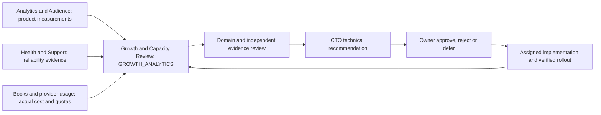

<!-- One accountable growth/capacity recommendation process using existing measured sources. -->
# Growth and Capacity Review

**Established by owner instruction:** 2026-10-13. **Accountable agent:** `GROWTH_ANALYTICS`.
**Task and actual execution:** [GROWTH-01](../agents/GROWTH-01.md).
This establishes the operating team, evidence requirements, review triggers and first gap
assessment. It does not start a background agent, collect new user identity, create hosted
usage/billing integrations or implement a new admin screen.

## 1. One accountable team and decision path

The Growth and Capacity Review working group joins growth measurement with service cost and
operational capacity. GROWTH_ANALYTICS owns the single review packet and its follow-up record.
Existing reporting stays GROWTH_ANALYTICS → MARKETING → CTO → owner. Cross-team membership
is a working assignment; Finance, Security, Data and Engineering retain their own authority.

| Function | Responsible member | Contribution to the one packet |
| --- | --- | --- |
| Accountable recommendation | GROWTH_ANALYTICS | Product goals, measured outcomes, phase assessment, recommendation, gaps and next review |
| Definition/source consistency | ANALYST, DATA_GOVERNANCE | Reuse measure catalog; units, provenance, deduplication, environment/cohort/window and privacy |
| Infrastructure awareness (standing dev member, owner 2026-10-14) | INFRASTRUCTURE | What we run and how deeply the app is integrated with it ([INFRASTRUCTURE_REGISTER](INFRASTRUCTURE_REGISTER.md)), the exits and their engineering effort ([PORTABILITY](PORTABILITY.md)), technical options per bottleneck; coordinates BACKEND, STORAGE, REALTIME, PLAYBACK, CONNECT and CI as needed |
| Service economics | COST_OPERATIONS | Actual invoice/usage/quotas, quote evidence, 30/90-day forecast, loaded operations and migration costs |
| Capacity and recovery | RELIABILITY, BACKEND, STORAGE, REALTIME | Game-night load, failures/limits, bottleneck diagnosis, backup/restore and safe component options |
| Financial acceptance | FINANCE_DATA, FPA, TREASURY with CFO | Reconciled costs, business runway/approved budgets; distinguish gross donations from company income |
| Independent validation | QA, SECURITY/PRIVACY_ENGINEERING, Finance domain reviewer | Evidence/negative tests, privacy, entitlement and money/recovery requirements for the proposed change |
| Technical disposition | CTO | Keep, investigate, request experiment, revise or recommend a specific change |
| Final business/spending decision | Owner | Approve/reject/defer vendor, plan, spending, data movement and release |
| Continuity | DOCUMENTATION, VP_OPERATIONS | Actual evidence/status/owner receipts and roster/protocol reconciliation |

GROWTH_ANALYTICS gathers expert recommendations; one packet prevents competing unexplained
plans. A member can flag an issue directly to its incident/domain lead, but the growth packet
cannot declare an incident resolved or bypass a release/Finance/Security gate.

## 2. Start with the existing sources

Use existing reports as their measurement homes. The packet links to a dated source or stores
an authorized aggregate snapshot with its provenance; it does not copy competing live dashboards.
Current report schema and missing-value behavior are in
`packages/shared-types/admin/analytics.ts`; operational triage rules in
`apps/mobile/src/frontend/components/Admin/Reports/reportHealthChecks.ts`.

| Question | Measurement home and present meaning | Gaps the responsible member must close |
| --- | --- | --- |
| Account/athlete/school adoption | `/admin/audience` and `/admin/analytics`: profiles, athletes, schools, verification counts | These are record counts, not active people, retention or recruitment success; add valid targets only after accepted definitions/data |
| Useful content and activity | Analytics/Trends: clips 24h/7d, feature taps, tab time, Crew follows | Tab opens/events are not users. Clip rows may be fixture/test data; approved environment filters and denominators needed |
| Product success | Proposed unique active people, successful upload funnel, D7/D30 cohort retention, verified family activation | Not currently measurable as defined from the existing catalog. GROWTH_ANALYTICS/TELEMETRY/Data/Privacy design minimally necessary consented measurement before collecting identity |
| Money and economic health | `/admin/revenue` and `/admin/books`: recorded journal, reconciliation, company share and costs | Donation rows/test gross are not settled revenue, profit or runway. FINANCE_DATA verifies mode, settlement, refunds and cost completeness |
| Playback, UI and service trouble | `/admin/health`, `/admin/support`, `/admin/qa`: existing thresholds, fixed observations, device delivery/loss | Current counts/mean steps do not supply p95 latency, crash-free user/session rates or fleet capacity; RELIABILITY supplies accepted denominators and deployed measurements |
| Hosting and media capacity | Dated authorized provider usage/limits: DB/storage/egress, peak realtime connections, API/jobs, logs/backups, media minutes | No hosted billing/usage collector or live capacity measurement is established by this setup. COST_OPERATIONS obtains authorized read-only evidence; do not assume quotas from memory |

New metrics/collectors or admin presentation must use the existing admin-first feature workflow,
Data Governance and privacy review. Add a source once; readers reuse the accepted contract.
Future main-admin presentation belongs in Analytics for measurement, Health for operational
failures and Books for actual costs; Departments/Team flow links ownership. Building that
presentation and scheduled collectors is distinct work, not claimed complete here.

## 3. Metric and goal contract

Every packet metric needs an ID/name, source version or authorized export reference, responsible
owner, unit, environment/payment mode, exact UTC window and observed-at time, numerator and
denominator where relevant, coverage/exclusions, freshness and quality disposition. Preserve
unknown/unread/stale/partial as separate states. A verified zero is a measurement, not a missing value.

Business goals and available service capacity are separate. PRODUCT/GROWTH_ANALYTICS propose
adoption/content/retention goals to the CTO/owner; domain leads propose technical targets and
Finance accepts economic definitions. Do not silently invent a success threshold from a provider's
quota. Target changes record rationale, reviewer, effective date and source; old comparisons
retain the target/version used at that time.

Initial proposed planning checkpoints are **100, 1,000 and 10,000 verified MAU**. They prompt a
new forecast/load-test packet; they do not assert supported capacity, forecast success or force
an upgrade. The current MAU value is unknown. No adoption/retention/revenue goal has been accepted
by the owner in this setup; first measure a valid baseline, then propose a named target/date.
Unique 30-day active people needs an agreed qualifying action and lawful deduplication; total
profiles, anonymous events and tab opens cannot substitute. D7/D30 needs observed eligible
cohorts and actual returning members; cohort age must permit the observation window.

### Department outcomes in the same packet

GROWTH_ANALYTICS also records each contributing department's agreed outcome, current evidence,
accepted target/date, gap and next action. Domain leads accept their own definitions; counts of
completed tasks or passing local tests cannot substitute for customer outcomes or deployed recovery.
These rows are measurement assignments, not newly collected or calculated live scores.

| Department | Outcome to measure and authoritative home | Present limitation |
| --- | --- | --- |
| Growth / Product | Accepted activation/adoption/content and cohort goals; existing Analytics for its supported record/event measures | MAU/retention/conversion need accepted source/denominator; no invented success rate |
| Engineering / Quality | Accepted fixes, escaped regressions and release recovery; existing task/CI/release evidence | Local test pass is source evidence; deployment frequency/change-failure rates require real release records |
| Support / Reliability | Confirmed incident recurrence, time-to-verified-recovery and reviewed false-positive share; Support incident/review records | Require original incidents, detection/recovery timestamps and reviewed-sample denominator; no quiet-sensor health claim |
| Finance / Accounting | Reconciliation exceptions, Suspense/close readiness and accepted plan-vs-actual service spend; Books and approved invoice records | Test-mode journal and unread costs cannot establish profit, available cash or a live completed close |
| Data / Documentation | Ownership/drift checks and completed same-turn handoffs with actual checks/next owners; master map and existing task receipts | Structural checks do not prove complete semantic documentation or all hosted data |
| Security / Recovery | Validated finding state, deployed-fix evidence and restore/control acceptance; existing finding/incident/recovery records | Raw alerts are not confirmed attacks, a local fix is not deployed, source restore is not database recovery |

Each team is accountable for supplying its evidence. The one Growth packet links that source,
explains business/service consequences and asks for decisions; it does not create a competing
ledger, incident queue, employee ranking or definition of technical acceptance.

Use complete 7-day windows and comparable prior 7-day windows for weekly operational/product
comparisons; record which measures actually provide that comparison. Only clip and donation
value pairs exist in the current Analytics prior-week contract. Billing uses invoice periods,
not an assumed week. Monthly targets/MAU use complete 30-day windows or explicitly label partial
month-to-date estimates. Daily peaks remain peaks, not averages over a day.

## 4. Service review triggers

The following are **initial review policy**, not capacity/SLA promises or automatic spending
rules. GROWTH_ANALYTICS starts a packet/diagnosis when credible evidence crosses a rule.
The CTO/domain owners refine thresholds after accepted load tests and the owner approves budget
changes. Existing Health thresholds remain owned by Health; this protocol does not alter them.

| Area | Watch / prepare evidence | Recommendation review | Options to compare |
| --- | --- | --- | --- |
| Total infrastructure budget | Actual/credible monthly forecast ≥80% of approved budget: at current $50, ≥$40 | Forecast≥100% ($50) or an unexpected billing spike; include unpaid/annual/support/build/credit-expiry charges | Reduce avoidable usage, optimize, constrain pilot scope or propose a budget change |
| Database/storage capacity | Valid peak/usage ≥70% of a verified purchased limit | ≥85% sustained across two representative windows, or expected game-night demand exceeds tested headroom | Query/index/pooling changes, retention, compute resize, replica; migrate only with a separate case |
| Realtime/API capacity | Peak ≥70% of verified quota or persistent retries/throttles | ≥85% in two representative game windows or observed hard-limit failure; diagnose cause | Filter/batch topics, cache, jobs, tune connections/plan; optional AWS/Azure worker |
| Video/storage delivery | Media forecast ≥80% of its approved allocation or playback diagnosis shows delivery bottleneck | Verified unit-cost comparison beats current service at the same workload/quality, or entitlement/performance requirement unmet | Compression/adaptive playback, retention, CDN or dedicated video provider without DB migration |
| Product growth | Verified MAU reaches 100/1,000/10,000 checkpoints or a valid owner-approved goal is missed | Explain measured outcome, 30/90-day forecast and resource consequences; product weakness does not prove more compute is needed | Improve feature/funnel/reliability, investigate discovery/consent; costed service change only if justified |
| Reliability/user reports | Use existing Health/Support rules; sample quality and failure/loss are visible | Repeated verified incidents or a technical target miss requires a domain investigation; urgent incidents use Support immediately | Fix/reproduce first, compare service changes after diagnosis and recovery evidence |
| Financial/safety recovery | Mandatory approved audit/recovery/entitlement control missing | Domain reviewer raises it immediately, independent of user count and budget; owner cannot infer controls from cheap hosting | Scoped remediation or paid controls, safer pilot scope; gated financial/public launch |
| Optional host exit | Current service cannot meet an accepted requirement, or a full-cost alternative shows sustained advantage | CTO sees current quotes, migration/operations costs, post-credit pricing, payback, parity and tested rollback | Self-hosted Supabase, AWS managed stack, Azure managed stack or another provider |

A quota percentage is valid only with a known limit, units and measurement interval for the
chosen SKU/project/region; distinguish instantaneous concurrency from monthly cumulative usage.
“Two representative windows” means separate completed comparable observations appropriate to
that service, not re-reading the same screenshot. A hard failure or urgent incident does not wait
for two windows. An aggregate approved budget can cover multiple services; sub-allocations must
be explicit rather than pretending each service can independently spend $50.

## 5. Avoid false positives and weak recommendations

Before a recommendation: exclude fixtures/bots/duplicate events where lawfully measurable;
separate dev/staging/prod and test/live money; check stale/partial/missing reads, ingestion loss,
invoice timing/credits and telemetry sampling. Compare similar weekday/game-night demand,
version, region and time window. Do not use a one-user rate change as reliable population evidence.
Rates show numerator/denominator and uncertainty; low sample or missing identity blocks the claim.
A count threshold is a triage observation, not an error rate or proof of user impact.

For a nonurgent trend, confirm a second comparable source/window when available and record the
confidence/rationale. Keep issue originals and link duplicates; independent reviewers can label
an observation expected, false positive, insufficient evidence or confirmed. Record the reason,
reviewer and time. Finance reconciles money; Security decides attack evidence, not Growth.
Failures of the collector/source create a measurement-gap task, never a “keep/healthy” conclusion.

## 6. One decision packet and cadence

When the owner chooses a provider/plan, COST_OPERATIONS adds its dated baseline to the packet:
service and environment, provider/region/SKU, current quoted price and billing period, verified
quota units/limits, credits/expiry, recovery/support terms, approved total/sub-allocation,
owner approval reference and next renewal/review. A provider has no assessed headroom until
both its actual measured usage and purchased limit are known. Keep price/plan changes versioned.
The existing hosting options remain proposals until this selection evidence exists.

Cadence is a **standing assignment**, not an installed scheduler: weekly growth/capacity review,
monthly review after provider invoices/Books close, and event-driven review on confirmed rules,
planned game nights, vendor changes or new release/region/financial scope. The lead records
execution/date/result/missing sources and next owner. While metrics are unavailable, the weekly
packet is a gap/recovery report. No claim a role file runs itself continuously.
The next standing review is due **2026-10-20 (America/Denver)**. GROWTH_ANALYTICS records
completed, overdue or blocked with the actual dependency; if source data is still absent,
report that absence and the outstanding source owner rather than skipping the review.

A packet contains:

1. ID/version, actual executor/date, environment/source windows and current operating phase.
2. Current observed values vs accepted targets and verified limits; unknown values remain unknown.
3. Product outcome and service diagnosis; confidence, exclusions, false-positive checks and gaps.
4. Per-service 30/90-day forecast with baseline/low/high assumptions and game-night peaks.
5. Compare **keep/optimize**, **resize/add one service**, and **change provider** when relevant.
   Each includes equivalent service quality, current quoted totals, labor, credit expiry, risk,
   migration/rollback and payback; reusing another cloud does not require moving every service.
6. Domain reviews and CTO disposition with user-impact/acceptance checks.
7. Owner decision/approved ceiling/date; implementation owner, actual verification and follow-up.
8. After-action outcome vs forecast and next review date; keep old packet versions/decisions.

Do not write application-user identities, raw payment payloads or secret credentials into a
packet. Store authorized aggregate references privately and use the existing task/decision
record for reviewer/decision/change attribution. The local record is versioned source, not a
new tamper-proof hosted user audit. Any later hosted decision audit uses existing restricted
Support/Finance patterns and server actor/time with independent protected review.

## 7. Phases and service choices

Use [HOSTING_DECISION_BRIEF §10](HOSTING_DECISION_BRIEF.md#10-owner-budget-follow-up--50month-and-phased-expansion)
and [ENVIRONMENTS_AND_HOSTING](ENVIRONMENTS_AND_HOSTING.md) as the option/phase homes.
Current internal stage aims to stay within the selected $50 infrastructure ceiling; the pilot,
financial launch, growth and optional-exit steps remain dependent on measured evidence and
owner approval. Database, media, realtime/jobs, monitoring and recovery can be at different
service steps. The packet names each component's present provider/plan and next justified option;
there is no single “all services move to AWS at 1,000 users” phase.

## 8. First review packet — actual baseline 2026-10-13

| Evidence | Actual result | Disposition / next owner |
| --- | --- | --- |
| Operating stage | STATE/ROADMAP record internal Wave 0, Stripe test mode and blocked payouts; no production project evidenced | Current operating stage is internal testing, not inferred from MAU |
| Selected budget | Owner selected initial infrastructure ≤$50/month; no host/paid-plan choice or new spending approved | COST_OPERATIONS/TREASURY obtain actual invoice/usage/quotes; missing financial input |
| Owner-reported expense follow-up | [Finance baseline](../company/FINANCE_OPERATIONS.md#61-owner-reported-monthly-expense-baseline--2026-10-13) records AI spending, current Free Supabase and undecided video; AI is separate from the infrastructure ceiling | FPA/COST_OPERATIONS verify invoices and project allocation; TREASURY obtains cash/obligations. Reported subtotal is not reconciled total burn or runway |
| Product measurements | Existing source defines record/event counts and clip/donation prior-week pairs | ANALYST/GROWTH_ANALYTICS can reuse these authorized reads; current hosted values not fetched here |
| Active users, retention, conversion | MAU/cohort/qualifying-action and identity/denominator contracts missing for these claims | GROWTH_ANALYTICS/TELEMETRY/DATA_GOVERNANCE/Privacy prepare admin-first measurement scope; values unknown |
| Capacity/cost/load | No live provider usage/invoice, quota or representative concurrency measurement in this packet | COST_OPERATIONS and RELIABILITY supply authorized evidence; cannot infer headroom or cloud savings |
| Local code health | Prior latest root `pnpm check` passed 118 suites/861 tests; 17 declared sensors/14 partial-gaps | Historical local gate, not uptime or production capacity; run fresh setup checks in GROWTH-01 |
| Vendor comparison | Existing options are hypotheses; fresh official price pages and Claude reply blocked | CTO can review options/gaps; no vendor change justified from current evidence |

**Current recommendation:** retain the present internal-testing setup while closing source and
measurement gaps; do not declare an MAU planning band, supported user count, production capacity
or cost-based vendor winner. Next packet owners: COST_OPERATIONS for invoiced cost/quotas,
GROWTH_ANALYTICS/ANALYST for accepted growth definitions/targets, RELIABILITY for scoped runtime
measurements, Finance/Security for launch/recovery acceptance. Actual setup and receipts are in
[GROWTH-01](../agents/GROWTH-01.md).

## 9. Verification, consent and safe engagement

**Owner instruction:** 2026-10-13. Every Growth packet and proposed change affecting young
users, guardians, verification, school affiliation, money, public visibility or data collection
includes a joint Legal/Growth/Engineering review. The initial source review and proposed owner
decisions are [Verification, consent and safe growth](../legal/VERIFICATION_AND_SAFE_GROWTH_REVIEW.md).
GROWTH_ANALYTICS owns this section within the existing packet, through MARKETING → CTO → owner.

| Contributor | Required input before a recommendation |
| --- | --- |
| LEGAL / COMPLIANCE, with counsel | Applicable ages/jurisdictions; classify each check as legal obligation, processor condition, school/association rule or company choice; permissible alternatives and policy/notice decisions |
| PRIVACY_ENGINEERING / MINOR_SAFETY / CONTENT_RIGHTS | Actual public exposure, lawful basis, consent authority/version/withdrawal, adult contact, content rights, retention/deletion and exception safeguards |
| GROWTH_ANALYTICS / PRODUCT / ANALYST | Where eligible people struggle, accepted funnel definitions and observed evidence, proposed user benefit and safe alternatives; unknown values remain unknown |
| ENGINEERING / BACKEND / SECURITY | Actual client/server/provider behavior; denied-access and failure/retry evidence; feasibility, support handling and compatible rollout/rollback |
| COMMERCE / CONNECT / CUSTODIAL with Finance | Correct payee and guardian money authority, provider eligibility, settlement/payout/held-money/refund states, costs and financial acceptance |
| ATHLETE_VERIFICATION / SCHOOL_PARTNERS | What affiliation checks prove, approved alternative routes, authorized confirmer capacity and school/NIL/marks requirements routed to counsel |
| SUPPORT / RELIABILITY / COST_OPERATIONS | Verification/moderation queue demand, handling/rework/backlog, failure/recovery evidence and 30/90-day loaded labor/provider costs |
| QA and domain reviewers | Independent acceptance of applicable authorization, consent, money, exposure, age, recovery and measurement evidence |

Contributors exchange findings before the packet is sent to the CTO. Growth records a common
recommendation or explicit disagreement with its rule, evidence and alternatives. A company's
optional check can be simplified after review; a mandatory requirement is addressed through a
lawful alternative or narrower scope. Business approval cannot substitute for counsel/domain
acceptance of a required control. Urgent safety/security/payment issues follow existing domain
escalation immediately.

### Required decision record

For each proposed change include:

1. Affected action, ages/places, data/provider, source/version and current implementation state.
2. Rule classification and reviewer; separate account age, legal relationship, public consent,
   content rights, school affiliation, provider account readiness and payout authority.
3. Actual struggle and its cause: delivery/UI/provider/server failure, optional friction,
   unmet requirement, refusal or dispute. Missing measurements have a named source owner.
4. At least two feasible options with safety/privacy, permitted engagement, loaded support and
   infrastructure cost, failure/recovery, evidence gaps and the preferred option.
5. Legal/Privacy/Safety, Engineering and Growth dispositions plus relevant Finance/School/QA
   review. Record disagreement; unresolved mandatory controls block the affected capability.
6. CTO recommendation; owner approve/reject/defer, date and conditions; implementation lead,
   existing task/feature ID, acceptance/rollback and next review.

New implementation follows the existing admin-first and Data Governance workflows. User-facing
policy and consent text is counsel-approved and versioned before real-family release. A planned
control or written migration is not hosted evidence. The first review found unapplied minor/privacy
work and incomplete age onboarding; it does not change any approved product age/payment policy.

### Engagement, safety and workload evidence together

Use separate proposed funnels for permitted engagement and optional guardian/public/payee
setup. School-badge completion is measured independently. Accepted stages need authoritative
state transitions, numerator/denominator, window, coverage, exclusions and missing-value states.
Assess elapsed time, technical failures, abandonment, expiry/retry, disputed links, manual review,
reviewed false rejection, revocation/exposure mismatch and cost per eligible family alongside
permitted retention/content outcomes. Do not count legal refusals as bugs or declare a growth
gain from account rows. Current funnel rates and review/support costs remain unknown.

Use existing restricted sources first. New identity/cohort measurements require reviewed lawful
basis, purpose, retention and access. Avoid raw DOB, signatures, invitation codes, tokens,
payment documents and relationship graphs in Growth reports; suppress identifying small cohorts.
Signing guardian consent does not automatically authorize analytics or marketing processing.

Experiments may improve approved wording, navigation, save/resume and verification channels.
They cannot remove required age/consent/payee controls or hide important notices. Record success
and stop criteria before execution. Unauthorized exposure, wrong payee, ineffective revocation,
unsafe adult contact, confirmed fraud, overwhelmed review capacity or unreliable instrumentation
requires domain diagnosis and a recorded stop/revise decision for the affected experiment/scope.

This checkpoint uses the existing weekly/monthly/event review cadence and the next **October 20,
2026** packet. Review new regions/ages, processor configuration, earning models, school claims,
public visibility, data collection and material verification complaints before expansion.
Actual execution and next owners stay in GROWTH-01; these standing duties do not start workers
or collectors automatically.

## 10. Growth plans for every user type

**Owner follow-up:** 2026-10-13. GROWTH_ANALYTICS maintains the
[plans by user segment](../product/USER_GROWTH_PLANS.md) within the existing single packet.
Cover guests, fans, young fans, casual uploaders, repeat filmers, donors, athletes, guardians,
school/authorized staff, booster/community organizations and sponsors. Gated game-day operators
retain their later-wave scope; internal staff/admin/moderation need an operating-capacity plan.
These are overlapping needs/capabilities, not new mutually exclusive account types.

Every segment's plan card records:

1. User job/value, current supported capability and acquisition channel with readiness/dependencies.
2. First useful action, repeat/value loop and contribution to other users; donating is optional
   for fans and uploading does not automatically require athlete claim or payee onboarding.
3. Accepted activation/return/contribution definitions, source/window/denominators/coverage,
   observed baseline or explicit missing evidence, accepted goal/date and next source owner.
4. Current barrier; action/age/content/identity/payment obligations and approved alternatives
   from §9; stage: proposed, ready for scoped test, tested, expand, revise or blocked on a dependency.
5. One proposed experiment or next mitigation with success/stop criteria, support/review workload,
   service/labor costs, responsible lead/domain review, actual result and next review/decision.

PRODUCT/RESEARCH, ONBOARDING/DISCOVERY/SHARING/CREW/ACTIVITY, Upload/Filmer Rewards/Highlights,
family/Finance/School/Partner owners and Support supply the relevant source/workflow evidence.
Legal/Privacy/Minor Safety reviews actions for every role, including young fans and filmed
non-users. Dev/Security/QA proves publication/access, recovery, attribution and payment behavior;
Finance accepts economics. Growth integrates their exchanged findings through MARKETING/CTO.

Measure meaningful non-donating fan use separately from optional donation/payee setup and
creator/tag/reward states. Do not sum overlapping segments into unique people, count a tap as
settlement, infer original filming from uploader identity, or advertise rewards for ineligible
clips. Proposed metrics/collectors need accepted lawful basis and the existing admin-first/Data
reviews. Current segment rates and loaded review/capacity costs remain unknown.

Use the plan's proposed 30/60/90-day stages from authorized starts; existing release waves and
public/privacy/money/partner gates control each capability. External recruitment/campaigns,
new features, cash rewards and spending require recorded approval. This operating plan sends
no messages and starts no scheduled campaign/worker. The October 20 packet must show a plan
status, gap/next owner and proposed decision for every segment; preserve earlier decisions and
do not silently omit fans because athlete/payee data is easier to count.
## 11. Family fun, fan recognition and voluntary service

The owner's clarified concept is open to eligible account holders submitting fun fan videos,
with Fan of the Game/Week/Month/Year, awesome-fan badges and optional service. The owner confirmed
both badge/Aura recognition and money earnings, with separate paths, and requests continued
brainstorming. The latest owner choice is **fan voting chooses the winner**; staff enforce
published eligibility/rights/safety rules and fans' valid free ballots choose the award.
[FAMILY_FUN_PLAYBOOK](../product/FAMILY_FUN_PLAYBOOK.md), especially §12, is the proposal home.

GROWTH_ANALYTICS with Product includes a fun/return plan for fans, families and friends in the
same packet: theme, free useful actions, newcomer/accessibility path, selected recognition
criteria, source/control gaps, consent, staffed review, stop/removal and cost evidence. Upload/
Highlights/Filmer owners supply actual content/credit behavior; Local/Polls/Leaderboards and
School Partners supply school authority and fair-participation options. Legal/Privacy/Minor
Safety/Content Rights, Security/Data, Support, Finance and independent QA review the relevant
scope before MARKETING → CTO → owner chooses a focused pilot.

Use curated content for a noncompetitive showcase/rehearsal, and design the selected fan-voted
award separately. Staff do not substitute their preferred winner. Respectful conduct,
creativity, inclusion and community contribution guide themes and the voting invitation;
count valid award ballots, with no extra points for donation amounts, purchases, appearance,
follower counts or athlete statistics. Recognition windows
allow direct newcomer entry rather than accumulated engagement qualification. Public identity,
minor/subject permissions and marketing reuse are separate from submission/account status.
Public candidate permission is specific to the entry; do not require the whole profile to
become public. Declining that exposure preserves private acknowledgment and other permitted
activities, without a competing staff-picked winner for the same award. One account/window
ballot is not proof of one unique human; Data/Privacy/Security review proportionate abuse
controls, retry/windows/pause/recounts and fair discovery. Larger fan networks can still
have an advantage. No current guest/device poll counter certifies the selected award method.

Keep service and posting voluntary before/after either kind of earning. No service or public
proof is required to release family money. Generic fan badges do not establish payee status
or qualify automatically for existing filmer Aura. Paid creator/service work, prizes and
school scoring are separate proposed capabilities with explicit financial/counsel decisions.

Existing school votes lack trusted deduplication/closure and athlete Spotlight is not a generic
fan-award workflow. New capabilities need an enrolled admin-first contract before app work;
do not claim a proposed queue, badge, award, service activity or fair winner is already live.
Measure meaningful return, accepted/repeat contributions, permission/refusal/removal outcomes,
appeals/abuse, backlog and handling costs; keep settled optional support separate. Unknown
baselines remain unknown and new participant tracking needs Data/Privacy acceptance.

Include the focused next design choices and actual review evidence in GROWTH-01 and the
October20 packet. This duty establishes no automated campaign or public contest.
