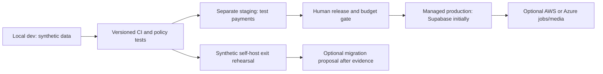

# Hosting decision brief — every engineer's recommendation (2026-10-13)

**Owner request:** before choosing between staying on Supabase and hosting on AWS (EC2) or Azure, get every engineer's
recommendation and research what is cost-effective, what "future-proof" means for our code, and how well each option
lets us expand.

**How this was produced:** 49 engineering roles under the CTO, in five panels (platform & data; security, privacy &
identity; operations & reliability; media, realtime & mobile; product engineering, commerce & quality), plus
`COST_OPERATIONS` market research. Each panel read its role files and the repo. The CTO then checked the brief
against the panel notes (fidelity issues found and corrected the same day) and gave the final recommendation (§9). The plan this informs is
[ENVIRONMENTS_AND_HOSTING.md](ENVIRONMENTS_AND_HOSTING.md).

> **Prices are unverified.** Web access ("internet mode") is off in these sessions, so every outside price, limit,
> certification and law reference comes from model knowledge (mid-2025 to mid-2026), not a page read today. Repo
> facts were measured on 2026-10-13. Turn on internet mode and re-run the research before buying; the sources to check
> are listed in §8.

**Budget follow-up (owner, 2026-10-13): initial infrastructure ceiling $50/month.**
The current proposal, phase budgets, self-host experiment and Claude follow-up are in
[§10](#10-owner-budget-follow-up--50month-and-phased-expansion).
Earlier price estimates and dollar crossover thresholds remain unverified scenarios;
they are not accepted spending limits, measured capacity or approved purchases.

**Ongoing recommendation owner:** [Growth and Capacity Review](GROWTH_CAPACITY_REVIEW.md),
led by GROWTH_ANALYTICS with cost/reliability/data/finance evidence. It reviews each service's
actual usage, accepted targets and verified costs/limits and brings one packet to CTO/owner.
The initial review reports missing live metrics; setup does not establish scheduled collection,
a paid plan or automatic migration. Actual setup: [GROWTH-01](../agents/GROWTH-01.md).

Options compared: **A** managed Supabase (dev / staging / prod) · **B** self-hosted Supabase on AWS EC2 or an Azure VM
· **C** AWS or Azure managed services (RDS/Aurora or Azure Postgres + Cognito/Entra + S3/Blob + our own API) · also
considered: Neon or another Postgres + Clerk/Firebase Auth (a "C-lite" rewrite; does not change the answer).

Scale used throughout: **S0** Wave 0, ≈50 testers · **S1** one state, ≈5k monthly active users, ≈200 clips/day ·
**S2** multi-state, ≈50k MAU, ≈2k clips/day, Friday-night game-day spikes · **S3** national, ≈500k MAU.

---

## 1. Bottom line

**Every role recommends A** (two are neutral and lean A): managed Supabase for the database, sign-in, live updates
and photos; **video on a dedicated streaming host** behind one adapter; self-hosted Supabase on AWS (B) kept as a
quarterly-tested exit. **No role backs B as the way we operate** (it makes a tiny team on call for minors' data and
money) and **no role backs C now** (it rewrites the security model: 182 `auth.uid()` uses, 101 policies, 174 security
definer functions, Storage and Realtime; 600–1,000 hours).

The deciding facts:
1. **People time decides cost, not server prices.** Counting engineer time at $100/h, S2 costs about **$1k/mo on A,
   $3k on C, $4k on B** (operations panel). B only looks cheaper on servers.
2. **Video and payments are the real bills, not the database host.** At S2 video is ≈$2–3k/mo on Mux or Cloudflare;
   Stripe Connect fees overtake hosting; the database host is a few hundred dollars.
3. **Two lines, not one.** Start a hosting *review* if the bill stays above **≈$3k/mo for three months** or a
   residency / contract demand appears (operations panel). Leaving only *pays* around a sustained Supabase bill of
   **$10–15k/mo**, beyond S3 (market research). Before that, cheaper levers exist: a CDN in front of public files, a
   Supabase commitment / Enterprise quote, read replicas.
4. **Future-proofing is about our code, not the host.** Our security already lives in portable Postgres; the lock-in is
   a short, known list (§4) that we can shrink now on any host.

## 2. Cost

### Total cost of ownership (infra $/mo, then our hours/mo; video excluded; unverified)

| | A — managed Supabase | B — self-host on EC2 / VM | C — AWS / Azure managed |
| --- | --- | --- | --- |
| S0 (≈50) | $0–25 · 1–2 h | $30–80 · 8–12 h | $15–150 · ≈10 h **+ 3–6 months to build** |
| S1 (≈5k) | ≈$65 without point-in-time recovery, ≈$165–250 with (Pro $25, Small compute, PITR ≈$100, dev/staging, SMTP, monitoring) · 3–5 h | $95–300 (one or two VMs, backups to S3, load balancer) · 12–20 h | $60–350 (RDS Multi-AZ, NAT ≈$33, API compute) · 10–15 h |
| S2 (≈50k) | $400–800 · 8–15 h; ≈$1–1.4k if the Team plan ($599) is needed for a SOC 2 report | $600–1,200 · 30–50 h + an on-call rotation | $1–1.8k (Cognito ≈$600 because magic link needs its Essentials tier) · 20–40 h |
| S3 (≈500k) | $3–8k (≈$5.3k with a zero-egress CDN for public files) · 20–40 h | $2–5k **+ 1–2 reliability engineers** + ≈$15–20k one-time move | $3–13k **+ 1 engineer + a $60–100k rewrite** |

Sign-in at S3 alone: Supabase ≈$1.3k/mo (≈$0.00325 per user above 100k), Cognito ≈$7k (its Essentials tier, needed for
magic link; ≈$2.3k on Lite without it), Clerk ≈$10k; Entra's price above 50k free users must be checked.

Payments outgrow hosting: Stripe Connect is roughly $2 per active connected account plus a fee per payout (batch payouts
monthly), and multi-state sales brings a sales-tax nexus review at S2 (product panel; unverified).

### What option C genuinely does better (for balance)

- **Contractual uptime:** RDS Multi-AZ ≈99.95%, Aurora ≈99.99%, Azure zone-redundant ≈99.99%; Supabase Pro has no
  contractual SLA (Team / Enterprise do — verify).
- **Backups kept longer:** RDS up to 35 days vs Supabase Pro 7 / Team 14.
- **Autoscaling database:** Aurora Serverless scales on game nights; Supabase compute is resized by hand (restart).
- **Certifications and borders:** the path to FedRAMP / StateRAMP and in-country data if a state contract or another
  country demands it.
These are the triggers that would change the answer; none applies today.

### Video (monthly, list prices, unverified; 30 s clips viewed ≈40 times; storage at month 12)

| Host | S1 | S2 | S3 | Notes |
| --- | --- | --- | --- | --- |
| **Mux (Basic)** | ≈$130 | ≈$2.2k | ≈$23k | ≈100k free delivery minutes/mo (covers S0 and most of S1); signed playback; resumable uploads; live on the same API |
| Cloudflare Stream | ≈$300 | ≈$3k | ≈$30k | Simple per-minute pricing; live ≈$1 per 1k viewer-minutes |
| **Bunny Stream** | ≈$40 | ≈$250–360 | ≈$2.5–3.6k | Per-GB pricing, 5–10× cheaper delivery at scale; fewer features |
| AWS S3 + MediaConvert + CloudFront | ≈$220 | ≈$2.9k | ≈$24k | Most control, most work |
| Supabase Storage + CDN (one MP4, no adaptive bitrate) | ≈$70–190 | ≈$0.8–2.2k | ≈$8–21k | No adaptive streaming; poor on stadium cellular |
| Azure Blob + Front Door | ≈$250 | $2k+ | ≈$15k + our time | We build encoding ourselves (Azure Media Services retired) |

Media panel: **Mux Basic for Wave 1** (cheapest of the two hosts already shortlisted in STATE §6 item 2 at S0–S1),
Cloudflare Stream second; **re-price at S2** when video passes ≈$1.5k/mo and send new uploads to Bunny or CloudFront.
Because storage accumulates on per-minute hosts, a retention / cold-storage policy is the second-biggest video lever.
Two bandwidth assumptions appear in this brief: the media panel's ≈2.25 TB/mo at S1 (each clip viewed ≈40 times) and
STORAGE's ≈4 TB/mo (≈100 plays per user a month, ≈$350/mo from Supabase Storage). Real viewing will decide; both say
video should not be served from Supabase Storage at S1.

### Credits worth applying for (unverified)

AWS Activate (≈$1k self-funded, up to ≈$100k through an accelerator or investor; can fund media and exit drills, not a
Supabase bill), Microsoft for Startups (≈$5k to ≈$150k; only if Azure is chosen), Google for Startups ($2k–$200k+),
Supabase partner and accelerator perks (amount unconfirmed).

## 3. Every role's recommendation

**Platform & data**

| Role | Recommends | Reason / biggest risk |
| --- | --- | --- |
| CTO | A + hybrid video | Engineers ship features instead of running Postgres. Risk: treating "stay" as done; prod, CI migrations and the exit drill do not exist yet |
| BACKEND | A; reject C | RLS *is* the authorization layer. Risk: policies call `auth.uid()` bare (0 cached `(select auth.uid())` forms), slow at S2 |
| DATABASE_MIGRATIONS | A; any host only after the E1 baseline | The schema already rebuilds on plain Postgres with ≈12 stub lines. Risk: hand-pasted SQL means prod drifts on day one |
| STORAGE | Hybrid: video off Supabase Storage before S1 | Supabase egress ≈$350/mo at S1, ≈10× at S2. Risk: full `<project>.supabase.co` URLs stored in `reels.video_url`; public buckets bypass Vault |
| API | A; Stripe logic stays in portable handlers | The 3 Deno handlers run anywhere. Risk: 174 database functions act as an unversioned API that old app builds keep calling |
| SHARED_CONTRACTS | Host-neutral; generate types | `types/database.ts` is 1,470 hand-kept lines that drift |
| FULLSTACK | A | Screens use `lib/`. Risk: 17 hooks, 4 services and 7 operator calls still use the client directly, so C would rewrite hooks too |
| DATA_GOVERNANCE | A, US region, one prod project | One data map, one processor. B/C add processors for minors' data |
| FINANCE_DATA | A + point-in-time recovery from the first live dollar | Protects the books. Risk: no currency column on 274 money columns blocks other countries |

**Security, privacy & identity**

| Role | Recommends | Reason / biggest risk |
| --- | --- | --- |
| SECURITY | A, prod in its own org, B as drilled exit | Our holes are ours, not the host's: three security migrations unapplied, anon bypass on 8+ tables |
| RLS_SECURITY | A; B acceptable; against C | A rewrite is where authorization bugs come from. Risk: default grants differ per host, each needs its own replay |
| SESSION_SECURITY | A | B forces everyone to sign in again; C changes user IDs. Risk: **no MFA anywhere** for admins who control money and verification |
| THREAT_DETECTION | A now; Team plan or log drains by S1 | Risk: short audit-log retention on Pro (≈7 days) — cannot investigate a minor-safety or money incident |
| PRIVACY_ENGINEERING | A, US region, signed DPA; C only for in-country data rules | Risk: deleted data lingers in backups, and Storage files are not removed when a clip or story is deleted |
| MINOR_SAFETY | A | B puts minors' clips on a machine we patch. Risk: public buckets with no owner-folder write check (Wave 1 blocker) |
| AUTH | A | Supabase sign-in is the cheapest per user at S3; Cognito / Entra lack native magic link, so C changes how users sign in. Risk: production magic links need our own SMTP |
| ATHLETE_VERIFICATION | Neutral, lean A | The verification ladder is Postgres and moves with it; school staff sign-in (Google / Microsoft) works on every option |

**Operations & reliability**

| Role | Recommends | Reason / biggest risk |
| --- | --- | --- |
| OPERATIONS | A+ (video and error monitoring off the database) | One owner can run it; Pro → Team → Enterprise without moving. Risk: no prod project, SQL still pasted |
| CI | A; build the E1 pipeline now | Replays are already in CI. Risk: the first automated push could re-run pasted SQL |
| RELEASE | A; EAS Starter (≈$19) at Wave 1 | Free tier's 30 builds/month run out; `fingerprint` + OTA avoids rebuilds. Risk: old builds call the database for weeks |
| COST_OPERATIONS | A; dev in a Free org | Under ≈$250/mo to S1. Risk: game-night overage (users, egress, Realtime) |
| RECOVERY | A + point-in-time recovery from the first real family data | A managed restore drill is ≈2 h a quarter. Risk: no restore has ever been rehearsed |
| SUPPORT | A | The vendor's status page and support are a second pair of hands at 2 a.m. Risk: 13 of 17 detection sensors partial; parents would report an outage first |
| RELIABILITY | A; B only as the drill | A single VM is a single point of failure; self-hosting with failover ≈20–40 h/mo. Risk: Supabase compute does not autoscale (resize restarts the database) |
| INCIDENT_TRIAGE | A | One person cannot also own OS, Postgres and auth incidents |
| TELEMETRY | A+; telemetry off the main database by S2 | ≈1k inserts/s from 10k clients. Risk: the app cannot see its own health when the database is down |

**Media, realtime & mobile**

| Role | Recommends | Reason / biggest risk |
| --- | --- | --- |
| HIGHLIGHTS | Mux Basic now | Free delivery tier covers S0–S1; live later on the same API. Risk: per-minute billing × preloads |
| PLAYBACK | Any HLS host behind `resolvePlaybackUrl`; signed playback | `expo-video` plays HLS natively, so a host change is a URL change. Risk: web HLS (PLAY-01) and repeat fetches |
| UPLOAD | Direct, resumable uploads to the host | Today the whole file is loaded into memory and sent in one shot (fails on stadium cellular). Risk: a new processor for minors' video |
| PHOTO_STORIES | Photos stay on Supabase Storage | Small and cheap; `reel_photos.image_path` already stores a path (the right pattern) |
| REALTIME | Stay on Supabase Realtime; per-game Broadcast | Cheapest. Risk: **`useLiveScores` refetches every game for every fan on every score change** — breaks PostgREST at S2 long before plan limits |
| NOTIFICATIONS | Expo Push (free) on FCM / APNs | Host-independent. Risk: `expo-notifications` is not installed, so Crew alerts are queued but never sent; ≈14 min to fan out to 500k |
| MOBILE_PERFORMANCE | Adaptive-bitrate HLS, not one MP4 | Fewer bytes on weak signal, faster start |
| OFFLINE | A host with resumable uploads; queue intents, not bytes | Idempotency keys stop duplicate clips. Risk: one-hour signed URLs expire mid-session |

**Product engineering, commerce & quality**

| Role | Recommends | Reason / biggest risk |
| --- | --- | --- |
| ENGINEERING | A+: one portable TypeScript API layer | Handlers are already Request → Response. Risk: two server runtimes (Edge + Metro) doing the same work |
| COMMERCE | A+ | Hosting is a rounding error next to Stripe fees. Risk: live money before server-side crediting |
| CHECKOUT | A | PaymentSheet is host-independent. Risk: `EXPO_PUBLIC_API_ORIGIN` unset, so the Metro payment routes have nowhere to run |
| CONNECT | A+ | Express onboarding is portable. Risk: payout exists only as a Metro route |
| LEDGER | A+ | One idempotent credit path works anywhere. Risk: the app still inserts `tips` itself |
| RECONCILIATION | A; reporting export by S2 | Journal + Stripe IDs reconcile anywhere. Risk: per-charge fees need the webhook |
| ADMIN | A; host the Next portal on Vercel or Amplify | Read-only, no lock-in. Risk: the portal host becomes a processor of minors' data |
| PORTAL | A | Risk: guest-executable admin functions until `20261013210000` is applied |
| ANALYST | A; replica / rollups at S2; warehouse at S3 | Dashboards read versioned contracts. Risk: reports scan raw `telemetry_logs` and `tips` |
| LOCAL | A | Realtime game day is the main reason to stay |
| SPOTLIGHT | A | Risk: full URLs in `reels.video_url` |
| QA | A; never SQL Editor changes | Release gates assume CI-applied migrations |
| TEST_AUTOMATION | A | `supabase start` in CI makes tests repeatable. Risk: PGlite only imitates Supabase |
| DEVICE_QA | Neutral, lean A | B or C forces everyone to sign in again; no side-by-side builds yet |
| DOCUMENTATION | A | Fewest new concepts. Onboarding is slowed more by process (106 roles, 66 docs) than by the host |

## 4. What "future-proof" means for our code

Future-proof does not mean "on the biggest cloud". It means **any future move or growth step is plumbing, not a
rewrite**. For Tapua'i that is eight concrete properties:

1. **Authorization stays in portable Postgres.** RLS and guards are plain SQL; the only host-specific pieces are
   `auth.uid()`, `auth.role()`, the `auth.users` trigger, `storage.objects` and `realtime.messages` policies. Keep
   extensions to `pgcrypto`. Wrap identity in one helper layer (`is_trusted_server()` exists; add a current-user helper).
2. **Store references, never host URLs.** `reels.video_url` holds full `<project>.supabase.co` URLs; replace with a
   `media_ref` + `media_host` (for example `mux:<id>`, `sb:<bucket>/<path>`) resolved in `lib/`. Story photos and Vault clips
   already store a path; `profiles.avatar_url` and booster logos store full URLs too (corrected 2026-10-14). First slice:
   `lib/media.ts` (PORT-01); the full picture is in [PORTABILITY.md](PORTABILITY.md).
3. **One client boundary.** Screens, hooks and services call `lib/`; move the remaining direct client calls there, so a
   host change rewrites one folder.
4. **One server runtime for money.** Collapse the duplicated Edge Function and Metro route logic into the
   `src/backend/api/*` handlers with thin adapters (they already run on Deno, Node, Lambda or Vercel); webhook-
   authoritative crediting.
5. **A rebuildable, typed database.** The E1 baseline, CI-applied migrations, generated types, a synthetic seed;
   expand-then-contract changes so old app builds keep working.
6. **Versioned contracts for reporting.** Dashboards read shared-types contracts, not tables, so a replica or
   warehouse later is a pipe.
7. **Expansion-ready data model.** Add `state_code` / `country_code` beside `schools_and_teams.region`, a `currency`
   on money rows, and use `school_id` as the tenancy key. One database, not one per state.
8. **A rehearsed exit.** The quarterly self-host drill (E3) on synthetic data proves the move works.

## 5. Expansion: what breaks first, and the fix (any host)

| Stage | Breaks first | Fix |
| --- | --- | --- |
| S0 | Drift and hand-pasted SQL, not load | E1 baseline + CI deploys |
| S1 | **Video bandwidth bill**; whole-file uploads failing on stadium cellular; counter rows (`reels.seki_count`, player hype) contending on a viral clip; **Realtime connections** (Pro includes ≈500 and the spend cap refuses the rest, so a big game night can hit it) | Streaming host + resumable uploads; batched counters; decide the spend cap and pre-buy connections for big games |
| S2 | **`useLiveScores` refetch storm** on game night; telemetry and unlimited guest votes on the main database; `reel_views` (≈750k rows/day); reports scanning live tables; Realtime connection caps | Per-game Broadcast with diffs; telemetry off the main DB and guest rate limits; partition `reel_views` / `telemetry_logs`; `(select auth.uid())` in policies; read replica and nightly rollups; pre-scale compute on Friday |
| S3 | Egress and sign-in volume; push fan-out (≈14 min to 500k through Expo); multi-year reporting | CDN for public files, Team / Enterprise quotas, direct FCM / APNs topics, a warehouse; first point where the cost trigger could favour B (or C for sign-in alone) |

Compliance grows with us on **every** option: school districts ask for Tapua'i's own controls (a signed data
processing agreement, security questionnaire, breach terms, US data residency, deletion on request) and, around S2,
our own SOC 2. The amended COPPA rule expects a written security program and retention policy; under-13s are
currently kept out by a checkbox only. These are owner and counsel items, not hosting choices.

## 6. Where engineers disagree (owner calls)

| Question | Positions |
| --- | --- |
| When video leaves Supabase Storage | STORAGE: before Wave 1. CTO: on the cost trigger. *Brief's view: before S1 bills (choose the host now, move at launch).* |
| Staging plan | COST_OPERATIONS: Free org ($0). RECOVERY / RELIABILITY: Pro (≈$10–25), because staging holds real testers' and minors' clips. |
| When point-in-time recovery starts | COST_OPERATIONS: at live money. RECOVERY / FINANCE_DATA: at the first real family data. |
| Audit logs | Both want an append-only audit log kept off the database host now. THREAT_DETECTION also wants the Team plan's longer log retention or log drains by S1; SECURITY would buy Team (or our own SOC 2 program) when the first district asks. |
| Self-hosting effort | The plan said 4–8 h/mo; RELIABILITY says 10–20 h for one node, 20–40 h with failover. *Plan updated to the higher range.* |
| Order of work | COMMERCE / CONNECT: the money API layer in Wave 1. QA / DEVICE_QA: finish E1 first. BACKEND: the RLS performance pass before S1; DATABASE_MIGRATIONS: baseline first. |
| Analytics | ANALYST: rollup tables now. RECONCILIATION: at S2. |

## 7. Do now, on any host (merged across panels, in order)

1. **Apply the written security fixes on staging** (owner): `20261013210000_function_access_hardening`,
   `20261007231000_reels_storage_owner_folder`, `20261013220000_disbursements_guardian_scope`; then hosted negative tests.
2. **MFA for admins** (`aal2` on admin desks; MFA on the Supabase dashboard, GitHub and Expo accounts), bot accounts
   with least privilege, the service-role key never in CI, an append-only audit log kept off the database host; retire
   the `auth.role() = 'anon'` bypasses on 8+ tables before public beta.
3. **E1:** baseline, `migration repair`, CI-applied migrations behind owner approval, generated types, synthetic seed.
4. **Media references and one signer:** `media_ref` / `media_host` replacing stored URLs; one batched server-side
   signer behind `resolvePlaybackUrl`; private buckets; resumable uploads with an idempotency key.
5. **Fix the game-night storm:** `useLiveScores` onto a filtered per-game Broadcast topic carrying the change only.
6. **One server runtime for money** and webhook-authoritative crediting (retire the client `tips` insert); set up
   `EXPO_PUBLIC_API_ORIGIN` or move payout into the shared handlers.
7. **Scale-safe schema pass** (one expand-only migration, replayed in CI): `(select auth.uid())` in policies,
   partitioned `reel_views` / `telemetry_logs`, `state_code` / `country_code` / `currency`.
8. **Recovery and alerting:** one restore drill into an isolated project; error monitoring, an uptime check and the
   vendor status feed to a named phone; a game-day runbook (pre-scale, spend cap, guest rate limits).
9. **Push that actually sends:** install `expo-notifications`, store native tokens beside Expo tokens.
10. **Reporting boundary:** append-only journal / event export and daily rollups so a replica or warehouse is a pipe.
11. **Deletion that really deletes:** remove Storage files when a clip or story is deleted; disclose backup retention.
12. **Counsel before S1** (owner): the COPPA written security program and retention policy, and the processor list.

## 8. Before choosing: verify these (internet mode needed)

supabase.com/pricing (Pro, compute sizes, PITR, egress, MAU, Realtime quotas, Team / SOC 2) · mux.com/pricing ·
developers.cloudflare.com/stream/pricing · bunny.net/pricing/stream · aws.amazon.com (EC2, EBS, S3, CloudFront, RDS,
Aurora, Cognito, VPC / NAT, Activate) · azure.microsoft.com (PostgreSQL Flexible Server, Entra External ID, Blob,
Front Door, Container Apps, Founders Hub) · expo.dev/pricing · github.com/pricing (environments and required reviewers
on private repos) · stripe.com/connect/pricing · clerk.com/pricing · firebase.google.com/pricing · neon.com/pricing.

## 9. CTO final recommendation (2026-10-13)

Stay on managed Supabase for development, staging and production through Wave 1; keep self-hosting on AWS as an exit
rehearsed each quarter, not a plan. Change course only if a district, counsel or insurer needs what Supabase cannot
give (a contractual uptime guarantee, in-country data, StateRAMP), the bill stays above the owner's line for three
months, or a hard limit appears that a higher plan does not fix. Video for Wave 1: **Mux Basic** behind the adapter,
Cloudflare Stream as the fallback; re-price at ≈$1.5k/mo. Verify prices before signing up.

Next five pieces of work (owner → CTO → lead → specialist; QA verifies each):
1. **Security fixes on staging** — owner applies; `SECURITY` with `RLS_SECURITY` prepares and runs hosted negative tests.
2. **Admin account protection** (MFA, least-privilege bots, off-host audit log) — `SECURITY` with `SESSION_SECURITY`,
   `THREAT_DETECTION` (WORK_QUEUE SCALE-01).
3. **Automatic database changes** (E1 baseline, CI migrations, generated types, seed) — `BACKEND` with
   `DATABASE_MIGRATIONS`; `OPERATIONS` (`CI`) builds the pipeline (R2-01…03, R3-03).
4. **Media references, one signer, private buckets, resumable uploads, Mux wired in** — `BACKEND` with `STORAGE`;
   `ENGINEERING` with `UPLOAD`, `PLAYBACK`; `DATA_GOVERNANCE` reviews (SCALE-02).
5. **One payment path on the server** (webhook crediting, retire the client tips insert) — `ENGINEERING` with `API`;
   `COMMERCE` with `LEDGER`; waits on STATE §6 item 8 (SCALE-04).
Then the game-night live-scores fix (`ENGINEERING`, `REALTIME`; SCALE-03) and a restore drill plus alerting
(`OPERATIONS`, `RECOVERY`; SCALE-06).

Owner decisions:
1. Stay on managed Supabase for Wave 0–1, and review if the bill stays above ≈$3k/mo for three months? (yes / no)
2. Video: Mux or Cloudflare Stream for Wave 1 — and move video off Supabase at launch, or wait for the cost trigger?
3. Point-in-time backups (≈$100/mo) and staging on the paid plan: from the first real family data, or from the first
   live dollar?

## 10. Owner budget follow-up — $50/month and phased expansion

### 10.1 Decision scope and actual review status

Owner asked to follow up with Claude, compare Supabase with AWS/Azure and a small server we
operate, and use affordable phases. Owner selected **$50/month or less** for the initial
infrastructure budget. This is an options/research follow-up, not a host selection or permission
to create accounts, provision servers, migrate data or raise spending. Existing R2/R3/SCALE
work remains governed by its acceptance and owner gates.

Actual executor: outside-session Codex root. The earlier 49-role/CTO panels above are retained
as their prior report, not newly executed by this follow-up. A fresh Claude CLI attempt failed
before reaching a model: `claude --version` and `claude --help` returned 71 with
`sandbox-exec: sandbox_apply: Operation not permitted`; an approved `claude --help` escalation
also failed 71. No new Claude answer exists. The ready follow-up request is below; the private
copy is `.smoke/support/hosting-claude-followup.md`. No sandbox or input-filter bypass was used.

Official-page search found AWS/Azure/Mux pointers, but the page loader rejected external bodies
because input filtering is enabled. The direct Supabase HTTPS attempt was also blocked. Thus
**no current provider price, quota, SLA or certification was verified**. All dollar figures below
are planning assumptions/reference figures from the earlier brief. Re-price for the chosen
region, exact configurations and billing terms before a purchase; search result titles alone
are not price evidence.

### 10.2 Recommended direction and equivalent options

**Keep managed Supabase for the present backend; keep development inexpensive; test a small
self-hosted copy with synthetic data when the reset environment is available.** Add AWS or Azure
for particular jobs when that improves cost or capability. A later database move is optional.
Supabase already supplies PostgreSQL, sign-in, row authorization, Storage, Realtime and functions.
Moving only the database to RDS/Azure PostgreSQL does not replace those other services.

| Option | Cost planning under this budget | Work and growth path | Assessment |
| --- | --- | --- | --- |
| Managed Supabase | Free can serve bounded development/test use; earlier Pro base reference approximately $25/month, extras additional | Existing auth/RLS/RPC/client contracts remain. Tune queries and limits, resize compute, add specialized media/jobs/reporting as needed | Best initial fit; no rewrite solely to change host |
| Existing own computer/server | Incremental operating cost can be small if hardware exists; power, backups, UPS/network and depreciation still count | Run PostgreSQL or full Supabase in containers. We own OS/DB patching, TLS, backup/restore, access and downtime. A single box has no failover | Useful synthetic development/exit experiment; production requires an operations owner and verified recovery |
| Rented VPS, including AWS Lightsail/EC2 or Azure VM | Earlier one-node reference $30–80/month before our time; an under-$50 setup needs a verified VM+disk+backup+egress bill | Full self-hosted Supabase preserves more of the app contract. A bare PostgreSQL server needs an API/auth/storage/realtime replacement. Moving a container later does not create HA | Cost-controlled experiment possible; modest VM pricing alone does not prove lower total cost |
| AWS managed stack | DB-only entry prices can be low; there is no verified equivalent all-in quote within $50 here | RDS/Aurora + API/compute + identity + S3/CDN + secrets/logs/backups. Multi-AZ, networking, logs and media add charges; requires compatibility work | Strong later option for specific scaling/control requirements; compare complete stack and engineering time |
| Azure managed stack | Same need for an actual regional all-in quote; DB-only price omits the rest | Flexible Server PostgreSQL + app/container/functions + External ID + Blob/CDN + secrets/logs/backups; identity/app contracts change | Strong when Microsoft integration, credits or contracts favor it; no demonstrated present savings |
| Other managed PostgreSQL, such as Neon | Cheap/free database entry can suit a new prototype; auth/storage/realtime are separate | SQL remains PostgreSQL, but current direct SDK, identity, Storage and Realtime contracts still need replacement | Keep on the comparison list; not a drop-in backend for this app |

“Build our own server” means operate standard software on our hardware/VM. A custom database
engine or custom authentication system is unnecessary for this goal. Cloud provider choice
and operational model are separate: self-hosted Supabase could run on AWS/Azure, and the app/API
could run there while the database stays managed by Supabase.

### 10.3 Proposed phases, budget gates and environments

These are proposed budgets and milestones, not measured user capacity. Keep the existing
product/release waves; this table adds infrastructure decisions rather than inventing another
release sequence. A promotion never runs automatically just because an MAU count was crossed.

| Infrastructure step | Proposed approach | Monthly budget treatment | Evidence before progressing |
| --- | --- | --- | --- |
| A — current internal testing | Prefer local synthetic dev plus current low-cost hosted staging. Keep Stripe test mode. Finish the R2 reproducible reset and baseline | $0–50 ceiling. Use the lowest cost that satisfies actual testing; no purchase is required by the plan | Reset from repo, exact environment/build mapping, actual quota/invoice baseline and isolated restore |
| B — small external pilot | One managed production backend when approved, separate staging, local dev; reuse one versioned config/migration pipeline | Try to stay within $50. Illustrative envelope: backend $25, email/ops $5, media/backup reserve $10, contingency $10. Reservations are not vendor quotes or proof that recovery fits | Current quotes including all projects/media; real auth/RLS/device/load tests and approved recovery target. Public/live-money gates remain in ROADMAP/STATE |
| C — financial or heavier-data launch | Paid recovery/retention appropriate to Finance/Security requirements; managed DB stays; choose video delivery from measured GB/minutes | Re-approve budget if required controls exceed $50. Earlier planning allowance $150–300+ may cover a small paid stack; video can push it higher. PITR alone was estimated around $100 additional in the earlier brief, unverified | Finance/Recovery-approved maximum data loss and restore time, actual restore/payment replay tests, protected audit, independent security acceptance; spend forecast within approved allowance |
| D — growth within existing backend | Optimize game-night subscriptions/queries, media encoding/CDN, retention and reporting. Add a worker/service on AWS or Azure only where needed | Set from measured workload and quotes. Increase compute or media budget separately; avoid buying an entire new stack to fix one bottleneck | Game-night test, per-service utilization/latency, traffic/storage forecast, actual cost per active user and per viewing minute |
| E — optional host migration | Costed self-hosted Supabase, RDS/Aurora or Azure PostgreSQL proposal; migration rehearsal first | Approve only if quantified recurring benefit or a requirement justifies migration and staffing | Complete auth/data/Storage/Realtime parity, stable user IDs, media references, old app compatibility, payment integrity, backup/rollback and an accountable on-call team |

The $50 ceiling is a good constraint for development and a limited pilot. It is not proof that
required recovery, moderation, audit or live financial operations can fit. If approved controls
cost more, reduce the pilot's scope or obtain a higher budget before launch. Source capsules do
not replace PostgreSQL/Storage backups.

**Do not assume three paid environments fit a $25 base.** Verify organization-level vs per-project
compute charges and credits. Use local development plus separate staging/production datasets,
credentials, keys and payment modes. Prefer synthetic data in dev; use approved minimization for
any shared test data. A laptop dev instance is not the only shared staging environment.
A free staging service may pause or offer different backup/performance features; final acceptance
must exercise production-equivalent policies/config and the same pinned database/extensions.

This is a proposed flow. The diagram does not say the deploy jobs, environments or exit drill
already exist; current implementation/gaps are in [ENVIRONMENTS_AND_HOSTING](ENVIRONMENTS_AND_HOSTING.md).

### 10.4 Measure the bill before choosing the next phase

The owner has supplied a partial current expense baseline, recorded in
[Finance operations §6.1](../company/FINANCE_OPERATIONS.md#61-owner-reported-monthly-expense-baseline--2026-10-13).
The infrastructure ceiling is separate from existing AI spending. Supabase is currently
reported Free; video hosting is undecided. Use that dated report as the starting point,
then reconcile invoices and quote missing services. It does not establish total burn,
available cash, provider headroom or runway.

Use monthly total cost = vendor baseline + additional environment compute + storage/egress +
auth/email + API/jobs + logs/audit + backup/restore + network/IPv4/NAT + expected operations hours
at an agreed internal rate. Include applicable domain/DNS, build/CI (EAS/GitHub), paid support
and taxes; distinguish annual fixed charges and already-paid accounts from new monthly costs.
The illustrative $50 pilot assumes no new paid build/CI plan; reallocate or re-approve if needed.
Add migration effort amortized over the evaluation period. Credits
are temporary; quote the first month, expected year-one cost and the bill after credits expire.

Video workload matters even at small MAU. For an illustrative fully viewed 30-second clip at
2 Mbit/s, payload is about 7.5 MB. With 100 views per active user per month:

| Monthly active users | Monthly plays | Viewer minutes | Approximate delivered video GB |
| --- | --- | --- | --- |
| 100 | 10,000 | 5,000 | 75 |
| 1,000 | 100,000 | 50,000 | 750 |
| 10,000 | 1,000,000 | 500,000 | 7,500 |

These are workload calculations, not observed usage or a provider quote. Partial viewing,
adaptive bitrates, prefetch/replays, retained originals, encoded renditions and caching change
the outcome. GB and minute providers must be compared against the same measured workload.
Delivery, storage and encoding are distinct charges. Increasing users does not automatically
require moving the relational database when video delivery is the costly component.

Proposed spend review: forecast against the approved ceiling weekly, discuss at 80% of budget,
and review immediately for an unexpected spike. Alerts/spend caps have provider-specific behavior
and are not universal hard dollar limits. Confirm whether a cap stops delivery, limits quotas or
merely alerts; document the user impact. No new automatic spending/feature shutdown is implemented.

For migration savings, use actual loaded costs rather than the earlier fixed $3k review/$10–15k
crossover claims. Example assumptions: current total $250/month, alternative vendors $100/month,
extra operations 4h/month at $75/h gives alternative total $400/month before migration. That move
increases cost. Conversely, one-off move cost $6,000 with verified net saving $500/month gives a
12-month payback, before risk/contingency. A move for availability, residency or integration may
be justified even without savings; record that requirement explicitly.

### 10.5 Small-server experiment and safe expansion

A proposed bounded experiment starts **after R2** on an existing capable Docker/CI host using
synthetic data only. No new paid server is required to learn first. Pin PostgreSQL/Supabase
versions and run the full Supabase stack if evaluating backend portability, not just a bare DB.
Measure memory/CPU/storage and recovery; then choose any temporary VPS specification from results.

Test sign-in/user identity, role/RLS/RPC denials, upload/private playback, scoped realtime,
admin reports and test-payment idempotency. Exercise backup+restore of both DB and objects;
restart the host and interrupt a dependency. A proposed workload ladder of 20/100/500 concurrent
clients is a test input, not a promised capacity. Use synthetic events and a bounded load duration;
accept only measured latency/error/recovery results against targets the lead agrees before running.

If it works, preserve container configuration, versioned migrations, storage references and
runbook; then compare a quoted VPS on AWS/Azure with managed hosting. For production, add private
DB access, TLS/secrets rotation, off-host backups, patches, audit and recovery ownership.
Failover needs replication and tested promotion; simply moving the one node to a cloud does
not provide it. Payment recovery must not replay an uncertain mutation or activate both client
and webhook crediting. This experiment is **not built or run** in this follow-up.

### 10.6 Ready Claude follow-up and assigned next checks

> Review the existing hosting brief under an initial infrastructure ceiling of $50/month. Compare
> managed Supabase, our own small Docker server, a rented VPS/self-hosted Supabase, AWS managed
> PostgreSQL plus supporting services, Azure managed PostgreSQL plus supporting services, and
> another managed Postgres provider. Keep current Supabase Auth/RLS/RPC/Storage/Realtime and Stripe
> dependencies explicit. Separate dev/staging/prod and test-mode vs live-money recovery needs.
> Show cheap initial phases, evidence-based expansion triggers, a synthetic small-server trial,
> video workload costs, operations labor and migration payback. Challenge the earlier fixed
> price/capacity/crossover claims. Use current official regional prices only if the pages were
> actually read; otherwise label estimates. Recommend a path without provisioning, changing
> policy/code, purchasing or migrating data. Report findings and disagreements for owner review.

- **CTO / COST_OPERATIONS / TREASURY:** obtain permitted official quotes/invoices and budget
  approval; record region, exact SKUs, included quotas, backups, media/email, shared build/CI/domain/support/taxes
  and post-credit cost.
- **BACKEND / DATABASE_MIGRATIONS / CI:** existing R2-01–03 reset/baseline before any server trial.
- **RECOVERY / SECURITY / FINANCE_DATA:** agreed recovery/audit targets and actual restore tests
  before a financial launch; do not accept an under-$50 quote that omits mandatory controls.
- **PLAYBACK / STORAGE / REALTIME:** measured video and game-night workload before picking media
  or compute upgrades; reuse SCALE-02/03/06 rather than duplicate projects.
- **Claude:** fresh review remains pending because the launcher is blocked in this session.
  The owner-authorized follow-up prompt is ready. A role definition or prior panel report is
  not proof this fresh review ran.
- **Documentation / root:** integrate this proposal into the existing environment plan and
  current receipt; preserve the earlier panels, prices labeled unverified and unimplemented gates.

### 10.7 Actual follow-up handoff

Documentation review by Codex `/root/documentation_sync` accepted the new §10 budget proposal
and environment link at **2026-10-14T01:43:04Z** (2026-10-13 America/Denver), with no Important
contradiction in the additions. The review checked links/anchor, budget/video/payback arithmetic,
proposal status and the recovery/credit-path limits. Its quote-completeness suggestion for
build/CI/domain/support/taxes was incorporated. Private receipt:
`.smoke/support/hosting-documentation-review.md`. This is not a fresh Claude/provider review.

Root full **`pnpm check` passed**, exit 0, with **118 app suites /861 tests**, 184 active Markdown
files, 106 roles, 2 feature contracts and all existing data/credential/copy/boundary/scanner/recovery
checks. Completion observed at **2026-10-14T01:44:18.432494Z**; retained output:
`.smoke/support/hosting-followup-check.log`. The added source test counts belong to concurrent
shared-tree work; root changed only the hosting documentation/handoff. No new Next/browser/
native/load/restore/price check is claimed by this follow-up.

Root synchronized the existing docs index, environment-plan cross-reference, changelog and
STATE; listed documentation claims are released after integration. Final local links and scoped
whitespace checks pass. Current quotes and the fresh Claude answer remain blocked/pending;
R2 reset, server experiment, hosted settings, higher budget and production/migration approval
remain with the named owners. Prices/limits and provisional budgets do not authorize spending.

## 11. Video scalability team review — 2026-10-13

### 11.1 Integrated recommendation for CTO and owner review

Owner requested an actual scalability review of the proposed Mux pilot. The technical media/
reliability and cost/operations reviews agree: **Mux is the provisional first managed-video
experiment; compare Bunny Stream and Cloudflare Stream in the same initial quote and capability
review.** Either alternative can become the initial provider if verified full cost and accepted
tests favor it. Keep Supabase for database/auth/photos and the current internal video bridge.

This revises the earlier advice to defer Bunny until growth or call Cloudflare inherently a
fallback. No current quote establishes Mux as cheapest or any plan as free/adequate. Earlier
panel dollar figures, free-minute claims and $1.5k/$3k crossover advice remain attributed
unverified history; current decisions use the owner's budget, actual workload and current terms.
An alternative provider is a comparison candidate, not configured automatic failover.

Actual review executors: outside-session Codex `telemetry_delivery_repair` (media/reliability)
and `team_coordination` (cost/FPA and VP coordination functions); root integrates the single
GROWTH_ANALYTICS packet function. Repository pinned specialists did not run on another model.
Existing reporting, model pins and owner/domain authority remain intact. Claims, review
receipts and next owners: [GROWTH-01 video follow-up](../agents/GROWTH-01.md#video-scalability-recommendation-follow-up--2026-10-13).

### 11.2 Current source facts and integration conditions

The reviews checked current source, not a hosted media or device experiment:

- The client Highlight flow declares a 45-second cap. Native compression targets a 1080
  longest edge /2.5 Mbit/s when linked;
  web/Expo Go or compression failure can upload the original. The upload path buffers the
  whole file, uses MP4 storage uploads, then publishes a reel; a host change needs a new
  resumable/processing-state workflow rather than only replacing a URL.
- Free uploads currently use public `reels` URLs; new Vault/Exclusive uploads store private
  `reelvault:` references. `resolvePlaybackUrl` passes public URLs through and signs individual
  private objects for one hour. SCALE-02's provider references and batched server signer are
  future work, not implemented by this review.
- Current source permits visibility/lock changes without moving or revoking an already public
  object, and the Vault read helper lacks a removed-state check. These are source-backed access/
  deletion caveats for RLS_SECURITY and STORAGE to validate and remediate; no hosted exploit,
  completed security fix or production denial test is claimed. A future signer must enforce
  current actor entitlement, visibility, removal and expiry independently of client flags.
- Mounted offscreen video starts without a source; the active card loads playback. Previously
  loaded inactive cards pause without necessarily unloading, so device memory/transfer behavior
  remains to measure. Current
  web code assigns a video element source directly. Native and target-browser HLS/codec,
  manifest/token-refresh and weak-network behavior require actual verification; native SDK
  support or a provider feature list does not prove this app works on each target.
- Existing first-frame/stall events and view counts are not complete billable transfer, accepted
  p95/error denominators or provider capacity. No streaming host, usage collector or load test
  was implemented/run in this review.

For any candidate: verify the actual plan's upload/processing limits, authorized playback,
ready/failed states, origin/region/processor terms, deletion of originals/renditions/cache,
permitted export/recovery, retention and support. Costs for these requirements enter the same
comparison. Security/Privacy/Data/QA/Recovery acceptance stays open with the responsible owners.

### 11.3 Equal provider comparison and budget

The authoritative reported costs and cash gaps remain in
[Finance operations §6.1](../company/FINANCE_OPERATIONS.md#61-owner-reported-monthly-expense-baseline--2026-10-13).
Existing AI spending is separate from the infrastructure ceiling. The proposed **$10–15/month
video allocation** must fit inside the aggregate **$50/month** with required other infrastructure
and contingency; it is not an approved purchase, quote, enforced cap or capacity promise.

| Candidate | Reason to evaluate | What would justify choosing it |
| --- | --- | --- |
| Mux | Provisional first technical experiment based on managed-video workflow and prior technical shortlist | Verified current plan/quality/allowance terms plus accepted upload, playback, access, deletion and recovery results; full cost within allocation |
| Bunny Stream | Initial cost/capability co-finalist, including for a small pilot | Equal accepted service and lower loaded cost at measured bitrate/region/catalog/usage; do not assume headline GB rates win |
| Cloudflare Stream | Initial cost/capability co-finalist | Equal accepted service and favorable verified inclusive charges/operating effort; no automatic fallback or second paid host |

Obtain one dated equivalent quote sheet: encoding/input/output minutes and quality, originals/
renditions/replicas and storage meter/retention, delivery meter/region/segment rounding, billable
preload/replay/retries, applicable credits/free eligibility/expiry and minimums, support/taxes,
backup/export, required cash operations and integration/maintenance effort. An app view count
is not the provider meter. Compare first-month, third-month, 90-day and post-credit costs.
External price bodies remain unavailable in this session; model memory and search titles are
not quote evidence. No current unit rate, supported user count or dollar vendor winner exists.

Cash cost and loaded cost are separate: owner time has opportunity cost even if unpaid; paid
labor belongs in the applicable cash budget. A later switch needs verified positive recurring
loaded savings or an accepted requirement, plus one-time move cost and tested parity/rollback.
For savings alone, payback = move cost /positive monthly loaded savings; nonpositive savings
have no cost payback. AWS/Azure DIY encoding/CDN requires the full managed-video replacement
and operating work; the reviews do not recommend it as the initial default.

### 11.4 Workload sensitivity, not observed adoption or provider pricing

The cost reviewer modeled three hypothetical 30-day workloads. Average new clip is 30 seconds,
starting catalog zero, uniform uploads and no deletion over the first 90 days; none is an
accepted retention policy, user target, real usage forecast or measured capacity.

| Input / derived workload | Low | Base | High |
| --- | ---: | ---: | ---: |
| New uploads/day | 5 | 20 | 100 |
| Plays/30 days | 4,000 | 25,000 | 150,000 |
| Mean watched seconds/play | 12 | 20 | 30 |
| Mean delivered Mbit/s | 1 | 2 | 4 |
| Extra served factor: hypothetical overhead/retry/replay | 1.10 | 1.25 | 1.50 |
| Served-equivalent minutes/30 days | 880 | 10,416.67 | 112,500 |
| Delivered decimal GB/30 days | 6.6 | 156.25 | 3,375 |
| Retained asset duration minutes at day 30 /90 | 75 /225 | 300 /900 | 1,500 /4,500 |

Minutes = plays ×watched seconds ×extra factor /60. Decimal GB = the same served seconds
×Mbit/s /8,000. A provider's actual billable meter/rounding replaces this approximation.
With constant traffic, 90-day delivery is three times monthly delivery; retained catalog is
a growing stock, not a monthly flow. Bill stored duration/GB over time using actual provider
rules, including existing originals/renditions/replicas and recovery copies. The private cost
receipt calculates 30/90-day stock and integrated storage time separately; do not bill three
times day-90 stock or multiply logical asset minutes by rendition count without verified terms.
No vendor unit rate or free allowance was inserted. This shows why user count alone cannot
choose a provider or guarantee the proposed allocation.

### 11.5 Proposed admin-first experiment and rollout

These are next acceptance requirements, not built screens or completed tests. Reuse existing
Content/moderation for asset lifecycle, Health/Support for issues and reviewed incidents,
Analytics for accepted measurements and Books/provider evidence for expenses. Avoid duplicate
dashboards or a parallel incident ledger. Any SCALE-02 implementation must enroll in the
existing admin-first workflow and expose/verify handling before enabling its fan experience.

1. Define provider-neutral references, legacy URL/token reads and authorization contracts.
   Accept upload/processing/quality/access/recovery targets and a representative sample before
   testing. BACKEND/STORAGE/Data/Privacy review schema, processor scope and source ownership.
2. On an authorized synthetic experiment, use scoped resumable upload sessions and durable
   idempotency. Verify provider event authenticity, correlate asset/job references, deduplicate
   duplicate/out-of-order events and publish only after ready/allowed state. Reconcile an
   uncertain operation before retrying; do not create another paid asset blindly.
3. Show pending/ready/failed/unknown/deleting states and source provenance in the appropriate
   main-admin home. Safe action records name server actor/time and reviewed changes; privileged
   keys remain server-side. Intake/provider gaps are explicit, never a healthy or zero-cost state.
4. Exercise denied actors, expired/revoked tokens, locked/removed/public legacy clips, slow or
   interrupted uploads, duplicate/delayed provider events, failed processing, old-client reads,
   native and target web playback, interruption, deletion/cache expiry and permitted asset export.
   Test the chosen provider's meters with agreed quality/region/retention and operational effort.
5. Preserve existing videos/references during staged new-upload enablement. A rollback pauses
   new sessions/jobs, reconciles in-flight work and restores the prior compatible adapter/route
   without exposing locked content, duplicating records or replaying payments. No unsafe public
   URL fallback. Prove media export/restore and database compatibility separately; source packages
   alone do not restore provider assets or database contents.

Compare all three candidates with the same acceptance. The CTO/domain leads review results;
owner selects plan/allocation/service movement and any live rollout. QA/Device/Security/Privacy/
Data/Recovery verification and existing financial/public release gates remain required.

### 11.6 Growth reviews and actual handoff

Use [Growth service rules](GROWTH_CAPACITY_REVIEW.md#4-service-review-triggers): total infrastructure
watch at $40/review at $50; media watch at 80% of its explicit approved allocation; known quota
watch at 70%/review at 85% across representative windows. Urgent failures or mandatory control
gaps escalate immediately. Check source freshness, mode, meter units, credit expiry and sampled
coverage before treating a signal as confirmed. Missing collector or rate evidence is a gap task.

Recompare on a verified full-cost advantage, failed accepted quality/access/recovery requirement
or a changed workload/retained catalog/region. There is no automatic switch at 1,000 users or
old dollar crossover, and no provider cap/alert is assumed to enforce a hard spending limit.

Next owners: COST_OPERATIONS/FPA for dated all-three quotes, actual usage and loaded forecasts;
PLAYBACK/UPLOAD/STORAGE/RELIABILITY for media workload and the SCALE-02 experiment; RLS_SECURITY/
Privacy/Data/Recovery for access/deletion/processor/restore acceptance; GROWTH_ANALYTICS for one
versioned packet through MARKETING to CTO and owner. SCALE-03 realtime and SCALE-06 recovery
remain distinct work; changing video does not require moving the database or financial pipeline.

Actual private technical/cost reports, independent Documentation acceptance, local full-gate
results, source hashes and claims release are recorded in the GROWTH-01 follow-up. Current
review is source/arithmetic/documentation evidence only; provider prices, native/browser media,
hosted entitlement/load/deletion/export/recovery and financial rollout are not verified here.
