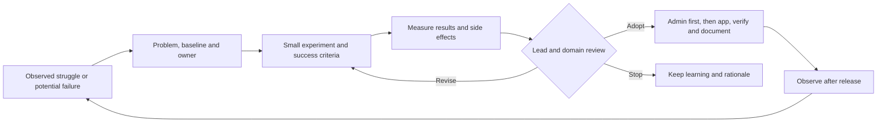

<!-- Owner-requested operating standard: tested improvements, familiar engineering contracts and evidence for outside reviewers. -->
# Innovation and outside handoff

**Owner direction:** 2026-10-13. **Accountable lead:** ENGINEERING. DOCUMENTATION keeps the
record with the feature owner; PRODUCT/RESEARCH, SUPPORT and the relevant domain reviewers
contribute evidence through their existing teams. This standard applies to new work. It does
not certify existing code, hosted security, legal compliance or investment readiness.

## Working principle

Create better ways to solve real struggles, and make each solution understandable to someone
joining the project. Start with the family's, operator's or team's problem. Use familiar
interfaces, names and evidence so another engineer can maintain the result. Record what was
learned even when an experiment fails or a simpler existing solution wins.

For tooling or operating changes with no app experience, use the existing change/review process
at the adoption step. App capabilities follow [the admin-first workflow](FEATURE_ADMIN_WORKFLOW.md).
Production observation requires actual activation; a written monitoring plan is a remaining task.

## 1. Find struggles before and after failures

At existing planning and Support reviews, examine user reports, repeated incidents, slow or
confusing workflows, unread data, provider dependencies and recurring manual effort. Ask what
would happen during offline use, role/account changes, duplicate submissions, missing schema,
an unavailable sensor, a bad release or an attempted abuse of access or money.

Label each concern **observed** or **hypothesized**. Preserve original evidence and distinguish
expected events, false positives and suspected attacks. A hypothetical failure is a planning
input; it is not an incident count or proof of an attack. Link the existing issue, source owner
and [incident record](../agents/INCIDENT_TEMPLATE.md) rather than create a duplicate queue.

## 2. Test the smallest useful improvement

The assigned lead and owner record this in the existing task, design or incident document:

| Field | Required meaning |
| --- | --- |
| Problem and affected people | The struggle, context and observed evidence or explicit hypothesis. |
| Baseline | Current behavior, source, time window and known uncertainty. State when no measurement exists. |
| Options | Existing solution, proposed improvement and relevant cost/maintenance trade-offs. Explain why custom code is needed when proposed. |
| Experiment | Small scope, synthetic or authorized data, owner, time/cost bounds and reversible setup. |
| Success and stop criteria | Define the useful outcome and unacceptable side effects before running it. |
| Results | Actual procedure/command, code version, environment, measurements, failures and limitations. |
| Decision | Adopt, revise or stop; reviewer, date, reasoning and follow-up owner. |

Measure outcomes that match the problem: task completion, time to diagnose/repair, failed reads,
false-positive rates, latency, resource cost or correctness. Specify population, numerator,
denominator and window for rates. A smaller sample or a local synthetic test has that scope;
it cannot establish production performance or customer adoption.

Use existing safe-read, role, payment and privacy contracts during experiments. External
research, spending, production traffic, publication and live money retain their existing
authorization requirements. A useful idea does not change those boundaries.

## 3. Make successful ideas maintainable

Keep shared practices in [CONVENTIONS](CONVENTIONS.md), ownership in [DATA_MAP](DATA_MAP.md),
and current readiness/gaps in [STATE](../STATE.md). The adoption review checks:

- One clear purpose per module; ordinary features stay in process. Introduce boundaries where
  responsibility, failure handling, permissions or provider behavior require them. Measure
  latency/resource effects when changing those boundaries.
- Familiar project naming, TypeScript contracts and SQL migrations. Document public inputs,
  outputs, fixed error codes, side effects, allowed roles and compatibility assumptions.
  HTTP integrations describe method, path, request/response and authentication; use OpenAPI
  when it helps an actual integration. Do not claim an API specification exists until written.
- Provider-specific details stay behind the established SDK/service adapters. Document actual
  Supabase, Stripe and Expo dependencies so a replacement can be planned from real behavior.
- An architecture decision records context, alternatives, chosen approach, consequences,
  owner/date, affected paths and evidence when interfaces, dependencies or shared standards
  change. Keep it in the existing design/task document; a separate architecture decision record
  (ADR) is optional.
- Source headers explain purpose and important rules; [GLOSSARY](../GLOSSARY.md) explains
  product/code terminology. Changed diagrams and comments travel with the implementation.
- Verification covers success, denied access and relevant failure/recovery scenarios. Record
  performance effects where relevant. Preserve independent QA and finance/security/legal review.
- Rollback names a compatible source version, data implications and safe repair path. Follow
  [RECOVERY_RUNBOOK](RECOVERY_RUNBOOK.md); a source package does not restore a financial ledger.

For new app features, link the problem/decision record from the existing feature evidence;
the admin contract, detection, reporting and repair handling precede app implementation.
Small repairs can use a short rationale and regression result in their existing record.

## 4. One evidence record, useful reading paths for each audience

Every handoff names its code version/commit or source manifest, record date, environment,
accountable owner, actual checks, known gaps and next actions. Label claims **proposed**,
**implemented locally**, **verified in the named hosted/device environment**, or **known gap**.
Keep exact supporting evidence in one home; summaries link to it instead of copying metrics.

| Reviewer | Reading path and material to prepare |
| --- | --- |
| Outside engineers or engineering company | [ONBOARDING](../ONBOARDING.md), [ARCHITECTURE](ARCHITECTURE.md), [CONVENTIONS](CONVENTIONS.md), [SCHEMA](SCHEMA.md), [DATA_MAP](DATA_MAP.md), feature contracts/decision records and current STATE. Include Node/package-manager/lockfile setup, required configuration names without secrets, source version, migration dependencies and actual applied-state evidence, reproducible checks, failure signals and recovery instructions. |
| Legal/privacy/security reviewers | Authorized access to [LEGAL_BRIEFING](../legal/LEGAL_BRIEFING.md), [DATA_PRIVACY_MAP](DATA_PRIVACY_MAP.md), actual money/access/consent/rights flows, collection/retention/deletion rules, security controls and their evidence. Identify minors, payment responsibilities, third-party providers, dependency/asset licenses and unresolved questions. Link rights/consent provenance or mark it missing. Counsel/domain owners decide conclusions; engineering describes implemented behavior and gaps. |
| Investors or business partners | Authorized [INVESTOR](../company/INVESTOR.md) and [PUBLIC](../product/PUBLIC.md) summaries, product journey/demo, sourced outcome metrics with periods and populations, costs, risks and next milestones. Label synthetic demos and proposed features. Product novelty, customer benefit and business claims each need their own supporting evidence. |

Diagrams use plain labels and show system boundaries, sources, roles and money/access flows
where relevant. Context/container/component views (C4) can explain engineering boundaries;
the main admin's Team flow shows registered source ownership. State whether a diagram is a
static model or observed runtime traffic. Retain a text/table alternative and version/date.

The docs index is internal navigation, not an access grant. Outside engineers receive the
approved technical subset; legal and investor material follows the owner's sharing decision.
The private home for `docs/legal/` and `docs/company/` remains pending in
[CODE_ORGANIZATION_PLAN](CODE_ORGANIZATION_PLAN.md). Source recovery capsules may contain
internal documents and must be scoped/reviewed before external distribution. Exclude credentials,
customer data and unnecessary personal information from every review package.

## 5. Test whether an outsider can understand the work

During handoff, the reviewer should be able to follow one feature from UI to hook/SDK to
server/data source, identify its owner and permissions, run the documented checks using an
approved environment, explain a failure and its recovery, and distinguish built behavior from
plans. Record where the walkthrough failed and repair the documentation or interface.
Preparing a checklist is not evidence that an outside company completed this walkthrough.

Example: [DETECT-02](../agents/DETECT-02.md) combines feature containment and bounded read
recovery inside the existing app, records distinct error evidence and keeps protected review.
Its [local evidence](evidence/DETECT-02-app.md) explains the SDK offline/cancellation correction
and the remaining durable/hosted monitoring work. Use that evidence pattern for later solutions.

## Implementation and verification record

| Session | Claimed files | Status |
| --- | --- | --- |
| Root Codex, STANDARD-01 | This standard; AGENTS, conventions, onboarding, expert standards, feature workflow/template, Support handbook, docs index, WORK_QUEUE, STATE and CHANGELOG additions | Complete locally; claims released, preserving existing work |

2026-10-13 verification:

- `pnpm check` passed: both TypeScript projects, 115 app suites /827 tests, documentation,
  ownership, feature-registry, recovery/detection, role and client-key gates. Retained output:
  `.smoke/support/standard-01-check.log`. No runtime source changed for STANDARD-01.
- `pnpm docs:links` passed for 180 active Markdown files; `pnpm docs:check`,
  `pnpm agents:check` (106 roles), `pnpm feature-admin:check` (2 features) and scoped
  `git diff --check` passed.
- Outside-session Codex documentation review accepts the additions with no Important findings.
  It checked the existing registry and all 3 JSON examples; the planned template still validates
  with existing fields. No pinned specialist model was dispatched for this review.

This change documents a workflow. No external review, research recruitment, legal conclusion,
investor claim, hosted activation or new runtime capability is established by this document.
