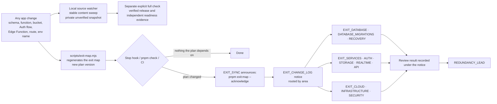

<!-- REDUNDANCY-02 charter: the standing team that keeps the move-off-Supabase plan current with every app change. -->
# Redundancy & Exit team — charter and change protocol

**Task:** [REDUNDANCY-02](../agents/REDUNDANCY-02.md). **Set up:** 2026-10-19 (owner request). **Lead:** `REDUNDANCY_LEAD`, reporting to
`ENGINEERING` → `CTO` → owner. **Status:** team, documents and automatic change tracking are in place locally; no cloud account,
provisioning, hosted restore or cutover has happened. The local detached source watcher was observed running
for the current login; LaunchAgent login-start installation failed, so automatic restart/login persistence is
not active. [REDUNDANCY-04](../agents/REDUNDANCY-04.md) records the observed runtime scope.

## 1. Purpose

Tapua'i runs on managed Supabase and plans to stay there (owner decision 2026-10-14, [PORTABILITY](PORTABILITY.md)). This team
makes sure that leaving stays possible at any time: if Supabase must be replaced by a different database on AWS or Azure,
there is a current backup, a current map of everything to rebuild, a team that knows each part, and a record of every app
change since the plan was last checked.

The owner's standing rule (2026-10-19): **any change to the app updates the backup version and the redundant database plan
automatically, and the team is told what changed.**

## 2. The documents

| Document | What it holds | Kept current by |
| --- | --- | --- |
| [EXIT_INFRASTRUCTURE_MAP](EXIT_INFRASTRUCTURE_MAP.md) | **Generated.** Every Supabase capability the app uses today → its AWS / Azure replacement for exit A (self-hosted Supabase) and exit B (cloud-native), owners, build order, detected inventory, plan version, unannounced changes | `scripts/exit-map.mjs` (Stop hook, `pnpm check`, CI) |
| [exit-map.json](exit-map.json) | Hand-kept half of the map: component mapping, Auth capability names, excluded Edge Functions, build order | `REDUNDANCY_LEAD` accepts; component owners edit |
| [EXIT_CHANGE_LOG](../agents/EXIT_CHANGE_LOG.md) | Dated, routed notices of app changes the exit plan depends on, with each agent's review result | `EXIT_SYNC` (tool-written), reviewers append |
| [REDUNDANCY_PLAN](REDUNDANCY_PLAN.md) | Architecture, recovery targets (proposed RPO/RTO), consistency and limits | `REDUNDANCY_LEAD` with `RECOVERY` |
| [CLOUD_MIGRATION_RUNBOOK](CLOUD_MIGRATION_RUNBOOK.md) | Operator commands: backup, verify, restore list, restore, grant-sync, parity, acceptance, cutover | `RECOVERY`, `EXIT_DATABASE` |
| [BACKUP_OPERATIONS](BACKUP_OPERATIONS.md) | Scheduled encrypted backups, independent copies, monitoring | `RECOVERY` |
| [EXIT_READY_RUNBOOK](EXIT_READY_RUNBOOK.md) | Exact current source/image preparation and original evidence for an unproven180-minute warm cutover | `EXIT_SYNC`, `RECOVERY`, component owners |
| [MIGRATION_FAILURES_AND_CONTROLS](MIGRATION_FAILURES_AND_CONTROLS.md) | Local failures, controls and historical reference limits | `RECOVERY`, `DOCUMENTATION` |
| [infrastructure/](../../infrastructure/README.md) | Backup, migration, self-hosted Supabase, containers, AWS / Azure Terraform | owners in §3 |
| [INFRASTRUCTURE_REGISTER](INFRASTRUCTURE_REGISTER.md) | What we run **today** and how deeply the app is integrated | `INFRASTRUCTURE` |
| [INFRASTRUCTURE_SECURITY](INFRASTRUCTURE_SECURITY.md) | Security role ownership, source coverage/report checks and independent finding/revalidation protocol | `SECURITY` with Security specialists and Engineering component owners |

## 3. Team and responsibilities

| Agent | Responsible for | Owns in the repo |
| --- | --- | --- |
| `REDUNDANCY_LEAD` | The plan as a whole; accepts mapping changes; drill readiness; reports exit readiness to the CTO and the Growth packet | this charter, REDUNDANCY_PLAN, implementation plan |
| `EXIT_SYNC` | **Keeps source snapshots and the plan version in step with the app.** Runs the local source updater and map, announces changes, chases reviews | `infrastructure/exit/` source updater/release, `scripts/exit-map.mjs`, `scripts/exit-map-guard.sh`, baseline, change log |
| `EXIT_DATABASE` | The different database: target PostgreSQL (self-hosted or RDS / Aurora / Azure Flexible Server), restore list, parity, privilege reconciliation | `infrastructure/migration/` |
| `EXIT_SERVICES` | Replacements for Auth, Data API, Storage, Realtime, functions and email; the `lib/` adapter seam | `infrastructure/supabase/` |
| `EXIT_CLOUD` | AWS / Azure infrastructure as code, hosts, containers, network, TLS, secrets, monitoring | `infrastructure/terraform/`, `infrastructure/containers/` |

**Standing partners** (existing roles, unchanged reporting): `INFRASTRUCTURE` (today's hosting and integration depth),
`RECOVERY` (encrypted backups, restore tool, source capsule), `DATABASE_MIGRATIONS`, `RLS_SECURITY`, `BACKEND`, `AUTH`,
`SESSION_SECURITY`, `STORAGE`, `REALTIME`, `API`, `COMMERCE`, `CONNECT`, `RELEASE`, `CI`, `RELIABILITY`, `SECURITY`,
`COST_OPERATIONS` (dated quotes), `QA`. The generated map lists every one of them with its definition file.

Decisions stay where they were: the **owner** approves provider, region, spend, use of real data in a drill and any cutover;
the **CTO** recommends; `DATA_GOVERNANCE` remains the data control point; `QA` can reject.

## 4. Change protocol — how every app change reaches the plan

1. **Automatic regeneration.** `scripts/exit-map.mjs` reads the code (schema, migrations, functions, policies, triggers, the app's
   policies/triggers on Supabase tables, extensions, realtime tables, buckets, Edge Functions, API routes, Auth methods, OAuth
   providers, Realtime features, environment names, toolkit files). It also hashes complete safe
   source/configuration contents: unchanged-name function bodies, policies and application
   changes produce a new **plan version**. SDK call locations expose unresolved targets for review.
   - Claude sessions: the project Stop hook (`scripts/exit-map-guard.sh`) regenerates the map at the end of every session and,
     when the plan changed, asks once for the announcement.
   - Every session and tool (Codex, Cursor, people): `pnpm check` and CI run `pnpm exit:map:check`, which fails on a stale map,
     a broken coverage rule or an unannounced change.
   - After all check guards pass, `pnpm check` runs `exit:sync ensure`; the Claude Stop guard calls it after
     derived-map refresh on every stop pass. This catches up current source while the watcher is absent.
     A valid concurrent-capture lock returns deferred/sourceCurrent null/readiness false, without claiming
     capture success. Other errors fail the check or push back once at Stop; an active stop cycle may exit
     after the warning. Source catch-up does not acknowledge notices or complete reviews.
2. **Announcement.** Review §2 of the map, then `pnpm exit:map --acknowledge --by "<session>"`. The notice lands in the change log
   with the areas, items and the agents to notify; the baseline moves to the new plan version.
3. **Routing.** Database objects and migrations → `EXIT_DATABASE`, `DATABASE_MIGRATIONS`, `RECOVERY` (policies also `RLS_SECURITY`);
   app attachments on Supabase tables → `EXIT_DATABASE`, `EXIT_SERVICES`, `RLS_SECURITY`, `STORAGE`; Auth methods/providers →
   `EXIT_SERVICES`, `AUTH`, `SESSION_SECURITY`; buckets → `EXIT_SERVICES`, `STORAGE`, `RECOVERY`; Realtime → `EXIT_SERVICES`, `REALTIME`;
   Edge Functions / API routes → `EXIT_SERVICES`, `EXIT_CLOUD`, `API`; environment names → `EXIT_CLOUD`, `INFRASTRUCTURE` (+`RELEASE` /
   `SECURITY`); toolkit → `REDUNDANCY_LEAD`, `RECOVERY`. `REDUNDANCY_LEAD` sees every notice.
4. **Review.** Each named agent checks its part against the map in its next task and records the result under the notice.
   `EXIT_SYNC` chases open notices; `REDUNDANCY_LEAD` closes them.

**Coverage rules enforced on every change:** each Edge Function is in the self-host allowlist or excluded with a reason; each Auth
method the app calls has a capability entry (so the cloud-native mapping stays complete); each owner is a registry agent; each
mapped repo path exists.

## 5. What "the backup version updates automatically" means here

- **Automatic local source cache:** `pnpm exit:sync watch` sweeps all governed safe source contents every
  30 seconds by default, plus capture latency, and performs an initial sync on each restart. Stable uncommitted
  app/SQL/infrastructure/docs edits become private integrity-checked source releases. This is polling,
  not a native event or every-save guarantee. Default snapshots do not run full code verification.
  The generated map is refreshed without acknowledging notices or completing reviews. Unchanged packages
  are verified/reused without resetting capture time. `latest.json` records original capture time/path/version/code verification; `status` verifies source
  currency/package integrity and last failed attempt. Failed captures preserve a historical prior pointer.
  Keep three updater-owned cache releases by default; arbitrary manual exports/backups are not pruned.
  A semantic map validation failure may preserve a current raw draft with failed map-validation metadata;
  explicit full checks and readiness still reject it. Hard capture/privacy/path failures retain old evidence.
  Exact sync/watch/install/uninstall commands and prepared-versus-observed installation evidence are in
  [EXIT_READY_RUNBOOK](EXIT_READY_RUNBOOK.md) and [REDUNDANCY-04](../agents/REDUNDANCY-04.md).
  Normal persistent installation encountered OS `EPERM` writing LaunchAgents in this session.
  The additional `--session-only` private-plist bootstrap failed with launchctl error 5 (`EIO`); no LaunchAgent
  was loaded. The managed detached `exit:sync start` fallback was observed running (initial PID `29080`,
  `2026-10-20T05:29:15.995Z`), with 30-second sweeps and `loginAutoStart: false`. Use `start` / `stop` with
  original settings; stop checks the captured exact process command and preserves snapshots. Repeat start
  after logout/restart/process loss until normal OS startup installation is available.
- **Data:** `infrastructure/backup` dumps the *whole* database and *every* Storage object each run, so new tables, columns, functions
  and buckets are included without editing the backup. Restore coverage is automatic too: the restore list and parity check discover
  application schemas and tables themselves.
- **Source and plan:** the recovery source capsule carries the code, `schema.sql`, every migration, this charter, the generated map,
  `exit-map.json` and the baseline, so each backup records which plan version it belongs to.
- **Expanded exit source:** `infrastructure/exit/release.mjs` copies the exact verified source and
  inventory into a new private release folder. The prepared source-only CI workflow captures raw source,
  attempts full checks and retains a 30-day artifact on all branch pushes, PR targets, manual dispatch and
  a daily default-branch sweep. Failed checks may retain a raw artifact while the job/status stays failed;
  verification is read from original metadata, not inferred from artifact existence. Separate unsigned
  provenance binds actual input/checkout commits, PR refs and workflow run/attempt to source/package hashes.
  The `.tar.gz` plus checksum preserves private/executable modes during artifact transport; recovered
  releases use portable `exit:release verify`, not adoption of runner-bound CI sync state. Unsigned
  checksums and 30-day CI retention are not durable independent backup or readiness evidence.
  No actual GitHub run/push happened in this session. Operational retention, current
  data and runtime image caching require their separate installed jobs. Explicit local
  `exit:sync sync --verify-code` runs `pnpm check`; an unverified watcher snapshot never inherits a
  previous check or replaces a durable reviewed source release.
  Verified capture on macOS uses command-scoped `/usr/bin/caffeinate -i pnpm check`; Linux keeps direct
  `pnpm check`, with the same 600-second deadline. A recorded 693-second idle sleep caused a wrapped
  deadline failure despite passing tests; a separate awake check passed in 115 seconds. Forced lid sleep
  or power loss still fails closed. Raw source watching does not inhibit normal sleep.
- **Readiness:** `exit:preflight --evidence-config PRIVATE_CONFIG` runs strict final-cutover checks
  against the current content hash, prepared target, original artifacts and timed evidence.
  Legacy readiness notes are informational; they cannot grant a GO.
- **What still needs a person:** things a dump cannot express — a new Auth flow, a new bucket rule, a function the exit stack must
  run, a new provider setting. That is what the routed notice is for.
- **Separate actions:** the local updater does not acknowledge exit-map notices, write Git index/commits, complete partner
  reviews, capture runtime secrets/images/provider state or synchronize/restore hosted SQL and Storage.
  A current local source cache does not establish an operational standby or grant cutover GO.
- **Not automatic (owner gates):** scheduling the hosted backup job, cloud accounts, any restore into a hosted target, cutover.

## 6. Cadence

| When | Who | What |
| --- | --- | --- |
| Every change | Stop hook, `pnpm check`, CI → `EXIT_SYNC` | Regenerate; announce; route |
| Every stable safe-source change (default 30-second sweep plus capture) | Installed local source watcher → `EXIT_SYNC` | Keep private source cache current; record actual capture/failure status; full checks and reviews remain separate |
| Start of each team task | Each team member | Review open notices for its area; record results |
| Monthly | `RECOVERY` with `EXIT_DATABASE` | Archive decrypt/integrity check (once hosted backups run); rerun local parity proofs |
| Quarterly | `REDUNDANCY_LEAD` | Isolated full restore drill once approved ([EXIT_DRILL](EXIT_DRILL.md)); review RPO/RTO with measured times |
| Each Growth packet | `INFRASTRUCTURE` with `REDUNDANCY_LEAD` | Exit readiness, gaps and effort; `COST_OPERATIONS` supplies quotes |

Definitions do not start background agents. Hooks, CI and the separately installed local source watcher provide
bounded automation; each actual partner review is recorded when a person or agent session performs it. A local
LaunchAgent is not a standing reviewer, hosted backup job or running self-hosted cloud database.

## 7. Security partners and the infrastructure report (REDUNDANCY-07)

The expanded Security team independently reviews the current infrastructure and migration materials:

| Security partner | Reviews with the exit team |
| --- | --- |
| `INFRA_SECURITY` | Network/IAM/TLS/host boundaries and complete scoped control/report coverage, including missing evidence. |
| `SUPPLY_CHAIN_SECURITY` | Locked dependencies, upstream image/CI trust and prepared offline materials. |
| `RECOVERY_SECURITY` | Backup isolation/integrity, guarded restore, key rotation and independent custody. |

These specialists report to **`SECURITY` → `CTO`**. `REDUNDANCY_LEAD` remains the Engineering migration
coordinator; implementation stays with `RECOVERY` / `EXIT_*` and the existing component owners.
`RLS_SECURITY` retains SQL/grant/policy review, `SESSION_SECURITY` retains JWT/OAuth/identity review and
`THREAT_DETECTION` retains trusted-signal/false-positive/audit judgments. Joint work creates no dual reporting
line or new access authority.

Run `pnpm security:infra` to regenerate the deterministic public source report,
`pnpm security:infra:check` for source drift/coverage, `pnpm security:infra:test` for scoped tests and
`pnpm security:infra:report` for read-only local JSON observations. The report maps every registered service
to its Engineering coordinator and every exit component to its owner, with mapped Security reviewers and
governed source fingerprints.
It separates structural source checks from operational IAM/network/TLS/Auth/RLS/Storage/incident/offsite
restore requirements. It contains no private env, credentials or customer data and grants no security or
cutover approval. Full checks integrate tests/coverage; source-watcher regeneration is bookkeeping only.

On changes, route the same source-bound packet to the applicable Security specialists through `SECURITY`
and to the Engineering owners. Record actual executor/model/tools/date/source/environment, findings,
commands/results, limits and next owner. Security's independent recommendation goes to the CTO;
`REDUNDANCY_LEAD` coordinates implementation and exit notices. Closing an exit notice cannot close a
Security finding. Weekly assigned reviews and predeployment/cutover reviews require actual execution
receipts; no reviewer daemon or alert delivery is installed by these definitions.
Follow [INFRASTRUCTURE_SECURITY](INFRASTRUCTURE_SECURITY.md) for triage, repair and independent revalidation.
