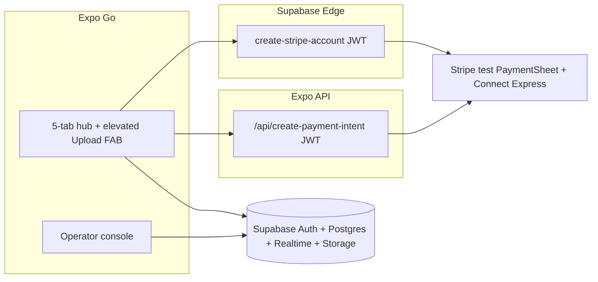

# Tapua'i — System Architecture Overview

**Product:** Tapua'i (“Back Every Athlete.”)  
**Repo:** pnpm monorepo — `@tapuai/mobile` (Expo, the only place admin data changes) · `@tapuai/admin-portal` (Next, read-only oversight) · `@tapuai/shared-types`
**Runtime:** Expo SDK 57 · React Native · TypeScript (fan app); Next.js Soft-Wall / Profile / Features / People oversight for web admin
**Start here:** [docs/STATE.md](../STATE.md) (current state + hand-off) · [Voice](../product/VOICE.md) (money words)  
**Companions:** [Architecture](ARCHITECTURE.md) · [Onboarding](../ONBOARDING.md) · [Schema](SCHEMA.md) · [Teams / departments](../agents/TEAMS.md) · [ALA brief](../company/ALA_TEAM_BRIEF.md) · [Product facts](../product/PRODUCT_FACTS.md) · [Public one-pager](../product/PUBLIC.md) · [Investor briefing](../company/INVESTOR.md) · [Legal briefing](../legal/LEGAL_BRIEFING.md) · [Data privacy map](DATA_PRIVACY_MAP.md) · [Company phases](../company/COMPANY_PHASES.md) · [Troubleshooting](TROUBLESHOOTING.md) · [Changelog](../../CHANGELOG.md) · [Conventions](../../AGENTS.md) · [Audit](AUDIT_REPORT.md) · [Roadmap](../product/ROADMAP.md) · [Story](../product/STORY.md) · [Staging runbook](STAGING_RUNBOOK.md) · [Tester script](TESTER_SCRIPT.md)

---

## Executive Summary

Tapua'i is a Polynesian-inspired **Fan & Athlete Hub** for high-school game day. Continuity for this product is three loops:

1. **Watch & react** — TikTok-style Highlights ⚡ (Seki plays) tagged to athletes, with Seki 🤙, Aura ⚡, and Flex 💪. Views, leaderboards and school-vs-school boards rank by hype and views, never money.
2. **Donate** — the GoFundMe replacement for families. Fans **donate** ($5 / $10 / $25 / Custom) through Stripe PaymentSheet in **test mode**, straight from a highlight, a gift link, a gear goal or a **Rally** (a named sports cost with a goal). The donate sheet discloses 90% to the athlete's family account / 10% to Tapua'i, and offers an optional tip for Tapua'i (default No tip). Athletes **say thanks** with preset messages. Guardians hold a minor's money in a custodial account the athlete can see.
3. **Rank & trade identity** — Dynamic **7-tier Aura Card** profiles (Slate Silver → Celestial Prism). A donation awards **10 Aura points per donated dollar**. Exclusive subscribe awards a flat **+100 Aura**. Borders and the Local Top Aura Boosters rail restyle in real time when a fan crosses a band.

**Mission:** make donations and highlights easy for families to promote their kid and hopefully get them recruited — kids encourage good workouts with fans and serve like their favorite player. Read `docs/STATE.md` first (§0 is the hand-off); money words follow `docs/product/VOICE.md`.

UI money copy is **Donate / donation** ("Mālo!" only means thank you); persistence still uses `tips` / `useTipCheckout` / `malo*`. Shipping canvas is **Daylight** (`#F3FAF6` / jade ink `#00733C`). Standard Island scheme: Jade (Donate / Home) · Cyan (Local / Seki) · Gold (kickers / Spotlight / ranks) · Ember (LIVE / Drip heat) · Violet (Profile). Collectible cards use per-tier `mist*` washes; Highlights ⚡ video chrome stays Midnight Obsidian `#0F1416`. Fan-bar accents live in `TAB_ACCENTS` (`apps/mobile/src/frontend/theme/motion.ts`).

Roles: `guest`, `fan`, `athlete`, `parent`, `operator`, `booster`, `sponsor`, `admin`. Guests and fans share the five-item fan bar.

---

## Tech Stack Specs

| Layer | Spec |
| --- | --- |
| Mobile | **Expo (React Native)** Router in `apps/mobile/`, SDK 57, StyleSheet + `apps/mobile/src/frontend/constants/theme.ts` (Daylight default; springs + focal colors in `apps/mobile/src/frontend/theme/motion.ts`) |
| Admin portal | **Next web admin** in `apps/admin-portal/` — **read-only oversight**: Overview / **Reports** / **Money** / Soft-Wall / Profile / Features / People at `pnpm admin` (`http://localhost:3001`). Reports = `get_admin_reports` (behavior). Money = `get_company_revenue_summary`. Features/Profile pages display `app_runtime_config` state, no toggle affordance. Every write — Features/Look flags, Games, Drip SKUs, Catalogs, everything — happens only in Expo `/admin` |
| Shared | `@tapuai/shared-types` — Profile / Soft-Wall gates / Profile chrome / Spotlight / common RPC shapes |
| Graphics | **`@shopify/react-native-skia`** 2.6.2 — `Effects/GlowingNeonBorder` SweepGradient + BlurMask on the Aura trading card (Expo web loads CanvasKit via `WithSkiaWeb` + `apps/mobile/public/canvaskit.wasm`) |
| Video | **`expo-video` only** (do not use `expo-av` for the feed; do not set `useCaching: true`) |
| Backend | **Supabase** — Auth, Postgres, Realtime WebSockets (`games`, `game_events`, `cheer_polls`), Storage (`game_highlights`, `reels`, `avatars`) |
| Payments | **Stripe Connect Express / PaymentSheet, test mode** (`pk_test_` / `sk_test_`). Native: `stripe.native.ts`. Web PaymentSheet is stubbed; Connect uses `expo-web-browser`. Express Account Links are minted only by Edge Function `create-stripe-account` with the session JWT — never on device. |
| API | JWT `POST /api/create-payment-intent`, JWT `POST /api/create-payout` (destination from `profiles.stripe_connect_id`, never the request body), JWT `POST /api/create-stripe-account` (Metro fallback). Production Connect: `supabase.functions.invoke('create-stripe-account')`. Server secret is `STRIPE_SECRET_KEY` only. |
| Env | Mobile: `EXPO_PUBLIC_*` in `apps/mobile/.env.local`. Admin portal: `NEXT_PUBLIC_*` in `apps/admin-portal/.env.local`. |
| Workspace | `pnpm install` at repo root. `pnpm mobile` / `pnpm admin` / `pnpm docs:sync`. |



### Directory map

Expo Router lives **only** in `apps/mobile/app/`. UI, hooks, and context live under `apps/mobile/src/frontend/` (`@/…`).

```
apps/mobile/app/                  Expo Router
  (tabs)/                         Fan hub
    index.tsx                     Home feed (Home / All / Seki + clip/athlete search; DB / hooks still `reels`); Player of the Week `SpotlightModal`
    spotlight.tsx                 Spotlight board (reopen dismissed Player of the Week/Month/Year)
    local/                        Nested stack so match detail keeps FanTabBar
      index.tsx                   Explore search + Live Matches / School Polls / Top Boosters
      game/[id].tsx               Live match feed + rosters (same UI as public `/game/[id]`)
    drip.tsx                      Drip marketplace (shop.tsx redirects here)
    profile.tsx                   Own hub via the same `AthleteProfileView` as `/user/[id]` (hero + hamburger overlay; Mālo / Subscribe only on someone else's row)
    receipts.tsx                  Fan Tip History & Receipts (hidden tab; fan bar stays)
    user/[id].tsx                 Public athlete sheet (same chrome as Profile; back instead of hamburger; fan bar stays)
    athlete/[id].tsx              Redirect → `/user/[id]`
  gift/[handle].tsx               Public family gift landing (`https://tapuai.app/gift/{handle}`)
  operator/                       Field portal (`index`, `[gameId]` scorekeeper, `scorer`)
  (admin)/admin                   Production control plane (`/admin`). Marketing / Owner / Engineer / All lens. Pinned **Home** plus business groups: Operations (games / sports / polls / boosters / publish), Content (highlights / spotlight / moderation), Commerce (drip / wishlist / money), Audience (athletes / schools / people), Growth (reports Health + Usage, feedback, **coverage** — every fan control mapped to a desk / flag / taps), System (features / look / **catalogs** / studio; lab / qa stay as hidden deep links). Every desk has Back / Home / Open in app. `profiles.is_admin` or Studio unlock. Fan chrome has no Dev role bar. Tabs, Daylight colors, copy, catalogs, Profile layout, and Highlights rail wait on **Publish to app**; sports, Drip, schools, games, and wishlist save instantly. Engineer Lab is the JSON power editor — not a git IDE.
  api/*+api.ts                    Stripe

apps/mobile/src/frontend/components/  Grouped by consuming feature: Admin/, Auth/, Common/, Custodial/, Drip/, Effects/, Feedback/, Filmers/, Legal/, Local/, Onboarding/, Operator/, Profile/, Rally/, Reels/, Spotlight/, Thanks/, UI/, Verification/ plus a few flat cross-cutting pieces (TipSheetModal / MaloTipModal, TipCheckout, FeeCheckbox, PlayCard, ScreenShell, …). Full current list: AGENTS.md "Directory Hierarchy Rules" — keep it there, not here
apps/mobile/src/frontend/hooks/       Data hooks (useTipCheckout, useReels, useRally, useDonationThanks, useCustodial, useLeaderboards, useFilmerStats, …). Full current list: AGENTS.md
apps/mobile/src/frontend/context/     AuthContext, SoftWallContext, CelebrationContext, RoleGate, UploadSheetContext, AppRuntimeContext, AdminLensContext
apps/mobile/src/frontend/lib/         Client SDK wrappers — one file per domain (supabase.ts, stripe*.ts, finance.ts, rallies.ts, donationThanks.ts, custodial.ts, verification.ts, filmers.ts, …). Screens call lib/, never Supabase directly. Full current list: AGENTS.md
apps/mobile/src/frontend/theme/       motion.ts (`SPRING_*`, Island FOCAL + TAB_ACCENTS, mist washes); hypeFx.ts (Seki / Aura / Flex)
apps/mobile/src/frontend/services/    TelemetryManager (batched `telemetry_logs`); OfflineQueue (AsyncStorage + NetInfo flush); MediaUploadService (`react-native-compressor` + Storage `reels` / `avatars`)
apps/mobile/src/backend/db/schema.sql Canonical Postgres + RLS

apps/admin-portal/                Next web admin, read-only oversight (Overview / Reports / Money / Soft-Wall / Profile / Features / People) at :3001. Reports + Money RPCs match Expo. Every write happens only in Expo `/admin`
packages/shared-types/            @tapuai/shared-types
scripts/                          Node generators (`sync-front-docs.mjs` → product facts; reads apps/mobile constants)
docs/agents/TEAMS.md                     Department call sheet and specialist operating contract
docs/agents/TEAM_HIERARCHY.md            Reporting hierarchy and complete callable agent index
docs/agents/WORK_QUEUE.md                Ordered specialist tasks, acceptance criteria and gates
.claude/agents/registry.json      Functional ownership registry (pnpm agents:check)
supabase/                         Incremental SQL (DROP FUNCTION before return-type changes)
supabase/functions/               Edge Functions (`create-stripe-account` JWT Connect, `create-payment-intent` JWT)
```

The elevated **center camera uploader** is a FAB (`UploadSheetContext`), not a tab route. `apps/mobile/babel.config.js` must include `babel-preset-expo`.

---

## Master Roadmap Tracker

### Phase 1 — Fan & Athlete Hub — **100% core complete**

- 5-tab navigation: **Reel · Local · (⚡ Upload) · Drip · Profile**
- Elevated center camera uploader → `reels` Storage (fallback `game_highlights`)
- TikTok-style Reel feed (`expo-video`), `@Athlete` → `/user/[id]` (fan bar stays). `ReelCard` records time-to-first-frame and mid-reel buffer stalls via `TelemetryManager`. Profile / athlete tagged grids open the same `ReelCard` pager (newest → oldest).
- Reel micro-interactions: `Gesture.Exclusive(doubleTap, singleTap)` (mute vs Aura ⚡ `HypeBurst`), rail Seki (cyan 🤙) / Aura (jade ⚡) / Flex (gold 💪) each fire a colored particle pop + shout (`SEKI!` / `AURA!` / `FLEX!`), chip bounce 0.84→1.15→1.0, Mālo ⚡ → `MaloTipModal` (blur backdrop, Neon Jade border glow), Share (`Share.share` deep link), Bookmark (`saved_reels`), **Report / Hide Highlight 🚩** (`ReportContentModal` → `report_reel` + per-user hide). Name + caption sit on the clip just above the fan bar.
- Offline resilience: `OfflineQueue` persists Aura taps, cheer votes, bookmarks, and reports when `NetInfo.isConnected === false`, then flushes RPCs on reconnect (root layout starts the singleton).
- Cheer polls on Local (School Polls hub): AnimatedPressable options, `withSpring` bar from 0%→share, Medium haptic, floating **+1 Vote ⚡**, `cast_cheer_vote`
- Local **Local Team Boosters & Sponsors 🏆** rail above rivalry polls (`SponsorshipModal`: Silver $50 / Gold $150 / Platinum $500). First month via `useTipCheckout` PaymentSheet (`skipBacker`); inserts `sponsorships` and `add_user_aura` for the payer. **+ Become a Team Sponsor** uses Light `impactAsync`.
- Local hub pills: **Live Matches · School Polls · Top Boosters** (jade indicator `withSpring`s; panes stay mounted so the bar does not shift). Persistent Explore search sits above the pills; queries longer than 1 character slide up `SearchResultsOverlay` (All / Athletes / Schools / Boosters, AsyncStorage recents, `search_local_entities`). Athlete hits open `/user/[id]`; booster hits jade-highlight the sponsor rail; school hits filter rivalry polls. Top Boosters rail scale-on-press + 7-tier peek. `CheerPollCard` Medium haptic, bars from 0%→share, **+1 Vote ⚡** from the tap (+60px). **+ Become a Team Sponsor** opens `SponsorshipModal` with blur; **Complete Sponsorship** runs PaymentSheet.
- Live matchups, tagged 3×3 clips, slang banner, hype reactions
- `__DEV__` Aura personas on Profile
- Dual Fan/Athlete: `AuthContext` tracks `roles`, `activeRole`, `isAthlete`, `canReceiveTips`, `isVerified` (Varsity only — **not** auto-set when claiming athlete). Profile hamburger → Account Capability opens `RoleSwitcherModal` (`expo-blur`). **Claim athlete profile** requires the Terms / NIL / minor-safety toggle (`LegalAckToggle`) and writes `school_id` without minting Varsity. Dual: Fan View / Athlete Management toggle writes `active_role` with Medium haptic. **Claim School Verification ⚡** (`VerifyAthleteModal`) is a later step: team code (`WSTLK-RUG-2026`) or coach/parent request. Fans see `⚡ VERIFIED VARSITY` vs SCHOOL CLAIMED / Not verified yet. **Tip History & Receipts 🧾** from the menu → `/receipts`. Studio **Athlete** preview stays on the fan hub (`ROLE_HOME.athlete = '/'`). Dev role chips and Aura personas live only under `/admin/studio`.
- Profile hamburger also opens **Terms of Service & NIL Compliance 📜** (`LegalModal`) and **Claim School Verification ⚡** (`VerifyAthleteModal`): ToS/Privacy summary, High School NIL disclaimer (gifts independent of performance; no school-trademark license), and Minor Safety & Parental Authorization. Acknowledgement stamps `profiles.legal_terms_accepted_at`. Varsity uses `redeem_team_code` / `request_athlete_verification`.
- **Edit Profile** (hamburger → `Profile/EditProfileModal`): display name, username, a free-text bio, up to four social handles, and per-field Visible/Hidden toggles for Bio / School / Stats / Social links (`profiles.bio` / `social_links` / `profile_visibility`). The real bio + social chips show as an "About" section on `AthleteProfileView`'s hero. Hiding a field is enforced server-side for other users via the `profiles_public` view (mirrors `reels_feed`'s conditional-null pattern) and `athlete_stats_visible()` gating the Stats tables' RLS — the owner always sees everything on their own hub.
- **Browse-first Soft-Wall:** no session = guest browse. Mālo / Join Crew / Chip In call `SoftWallContext.requireAuth` → `SoftWallModal` (Apple / Google / Magic Link) → resume. First-open `WelcomeOverlay`. Operator monetization stays Features-gated (`layouts.operatorConsole` default off). Expo Coverage Soft-Wall surface + Next `pnpm admin` oversight.
- Profile hero is a large circular avatar; Flip Aura card (`AuraTradingCard`) opens from the hamburger / Flip control. Slim Crew · Squad strip; **Share & Fund ⚡** (`ShareQrModal`) encodes `https://tapuai.app/gift/{handle}` for family flyers. Highlights collage then Active Team Roster (athletes see Claimed / Unclaimed via `profiles.player_id`). Own Profile and a tapped athlete (`/user/[id]`) share `AthleteProfileView` — Join Crew / Mālo / Subscribe hide on your claimed row. Celestial Prism or funded Locker Room still lights Skia glow on the flip card. Hero name + trading-card header show the Varsity chip (`VarsityBadge`).
- Drip marketplace: category pills with a sliding jade indicator, `GearCard` press 0.96 → `ProductSheet` (`expo-blur` backdrop, sliding S–2XL indicator, qty clamped to inventory, Aura banner + live total). **Buy Now** → `useTipCheckout` PaymentSheet; success grants order dollars × 10 Aura to the payer.

### Phase 2 — Field Operator Portal — **staged v2 prototype**

- PIN keypad sheet (`PINClaimModal`, test PIN `1234`) writes `games.claimed_by` and unlocks `/operator/[gameId]`
- GPS check-in
- Live scorekeeper: score buttons, period chips, and the clock all come from the match's **sport playbook** (`games.sport` → `sport_configs`), so football runs **+6 TD / +3 FG / +1 PAT / +2** on Q1–OT with a 12:00 clock while volleyball runs **Point +1** across S1–S5 with no clock at all. Points post through RPC `update_game_score`; **Start / Pause Clock** toggles `is_clock_running` with a 1s timer and is hidden for untimed sports
- Play-by-play callouts come from the same playbook (football **⚡ Big Play / 🏆 Touchdown / 🤙 Big Hit / 🛑 Turnover**, soccer **🥅 Goal / ⚡ Assist / 🧤 Big Save / 🟨 Card**, …) and Broadcast on channel `game_events_${gameId}` (`{ type, timestamp, team }`) with `Haptics.notificationAsync`; optional `game_events` INSERT for history. Fan toast emoji resolve against the same rows
- Fan `useLiveGame` Realtime: `postgres_changes` on `games` (`id=eq.{gameId}`) plus `game_events` INSERT; local `clockSeconds` + MM:SS `clockLabel`
- Fan `useGameEventBroadcast`: focused `ReelCard` joins `game_events_${gameId}` (clip `game_id`, or featured live match) and springs **⚡ BIG PLAY: Westlake Thunder!** for 3s (`withTiming` dismiss, Light haptic). Swipe up or tap ✕ dismisses early.
- Obsidian `Reels/LiveMatchBanner` on Reel + `/game/[id]`: live score spring, pulse; postgres play toast stays on `/game/[id]`. Swipe up or tap ✕ (`SwipeableBannerWrapper`) hides that game’s scoreboard for the session; it returns only when the score changes or a different game is live. Play-by-play cards on `ReelCard` are separate new notifications.
- **Socket lifecycle teardowns:** `supabase.removeChannel` on unmount; Reel tab `clearVideoCacheAsync` on mount. Realtime topics use `nextRealtimeTopic` so two hooks never `.on('postgres_changes')` after `subscribe()`. `useLiveGame` logs Realtime `CHANNEL_ERROR` / `CLOSED` / recovered `SUBSCRIBED` to `telemetry_logs` (`trackSocketReconnect`). The Reel feed shares one live snapshot with `LiveMatchBanner`.
- Sideline scorer + `/operator/console/[gameId]` redirect. **v2:** replace demo PIN + anon write RLS with authenticated operator policies
- **Sports builder (`/admin/sports`, `Admin/SportsTool`)** — one playbook per sport in `public.sport_configs`: emoji, what a segment is called, period chips, clock on/off + minutes, score buttons (label / points / feed play type), sideline callouts, which **Stats 📊** rows and combine tiles fans see (relabel or hide), and roster position pills. Every desk reads it: `/admin/games` picks the sport and shows that sport's periods, `/admin/athletes` shows that sport's positions, the operator console and the athlete Stats tab render from it, and the row meta shows how many athletes and games ride on each playbook before you change one. Twelve starter playbooks ship in `SPORT_CONFIG_SEEDS` (Football, Basketball, Rugby, Volleyball, Soccer, Baseball, Softball, Wrestling, Track & Field, Lacrosse, Ice Hockey, Tennis); **Install starter playbooks** writes them to Supabase and anything unlisted still falls back to a generic console. Incremental: `supabase/sport_configs.sql`.

### Phase 3 — Monetization & NIL Tiers — **active engine**

- 7-tier dynamic borders (see [SCHEMA.md](SCHEMA.md#7-tier-aura-palette)); Profile and the public athlete sheet both use the flippable `Profile/AuraTradingCard` (identity + season sheet). Tier 7 (Celestial Prism) and a funded wishlist wrap the card in `GlowingCardWrapper` / `GlowingNeonBorder`.
- `add_user_aura(target_user_id, points_to_add)` after successful Mālo (`tipAmount * 10`) **twice** (tipper Fan Aura + athlete recipient); Drip (`order dollars × 10`), exclusive subscribe (**+100**), and booster sponsorships (**500 / 2,000 / 10,000**) grant **only the payer**. Double-tap Aura on a Reel grants **+1** to the signed-in fan. Athletes may drop Mālo on any reel.
- Tipping shortcuts `$5` / `$10` / `$25` / Custom (live list from `/admin/catalog` after Publish to app)
- Athlete exclusive paywall on `/user/[id]` and the Highlights ⚡ feed: `$4.99/mo` PaymentSheet by default (`subscriptions` `subscriber_id`, `athlete_id`). Catalogs can change the dollars and Aura grant. Clips in the Vault collection (`reels.is_vault_only`) stay behind Subscribe while `players.vault_locked` is true (default). The athlete can **Open Vault 🌐** so anyone can watch those clips, then **Lock Vault 🔒** again. +100 Aura + unlock toast (Aura amount follows Catalogs).
- Vault tab + Direct Request: `subscriber_requests`, Subscriber Crest on Profile / Q&A avatars. Athlete Management (`VaultLockCard`) is the master lock; long-press (`toggle_reel_vault_status`) still moves clips between Highlights ⚡ and Vault 🔒.
- Upload FAB (`+` camera button): `UploadVideoModal` → `HighlightPickerModal` camera roll (`MediaTypeOptions.Videos`, `videoMaxDuration: 45`, `allowsEditing: true`). Clips longer than 45s alert **Highlight clips must be 45 seconds or less to showcase your best plays!** `MediaUploadService` compresses with `react-native-compressor` (`medium` 1080p vertical bitrate) and shows **Optimizing highlight quality...** plus a percent bar. Compressed blob uploads to Storage `reels/{user_id}/{timestamp}.mp4` (fallback `game_highlights`), then `public.reels`. Category pills **⚡ Game Play** / **💪 Train Like Me** / **🤝 Serve Like Me (2x Aura Boost)** write `reels.category`; **Subscriber Vault 🔒** is off by default and writes `reels.is_vault_only` / `is_exclusive`; **Publish Reel** shows the Storage progress bar, Success haptic, then refreshes the active Reel feed via `UploadSheetContext`. Serve Like Me double-taps grant 2 Aura. Athlete profiles show **The Crew ⚡** / **Your Squad 🛡️** and **Join Crew ⚡** (Teammates 🤝 when mutual). Vault management can **🔓 Flash Unlock (2 Hours)** a clip for the Crew. Own Profile hero uses `ProfileAvatarPicker` (1:1 crop → `avatars` bucket → `profiles.avatar_url`). Incremental: `supabase/media_upload.sql`.
- **👟 Locker Room Wishlist** on the athlete Stats 📊 tab (`Profile/LockerRoomWishlist`): horizontal gear cards with photo, goal line, and a spring-animated Neon Jade funding bar. **🎁 Gift Item Directly** opens the retailer link (`expo-web-browser`); **⚡ Chip In $5** runs the Mālo sheet, which writes one `tips` row (`origin=wishlist`, the item id, and the item title) and then `chip_in_wishlist_item` moves that item's total only. Full funding fires confetti + a **Gear Unlocked!** toast, stamps **EQUIPPED ⚡**, and pays the athlete a one-time **+500 Aura**. Paused by `layouts.wishlist`; taps land in Coverage as `wishlist_gift` / `wishlist_chip_in`. Incremental: `supabase/locker_room_wishlist.sql`.
- Stripe Connect Express for athlete payouts: Profile hamburger → **PayoutSetupCard** when Athlete Mode is unlocked and **Athlete Management** is the active view. **Connect Bank Account** stays disabled until the legal toggle is on (`legal_terms_accepted_at`). `useStripeConnect` → Edge Function `create-stripe-account` with `Authorization: Bearer` session JWT (`auth.uid()` owns the Express account). Hosted Account Links are never created on device. Metro `POST /api/create-stripe-account` is a JWT-gated local fallback only. Return refreshes `stripe_onboarding_complete` + `payouts_enabled` from the server write.
- Stripe **test mode** only
- Client telemetry: `TelemetryManager` batches `video_stall` / `video_first_frame` / `socket_reconnect` / `checkout_latency` plus product usage (`tab_dwell`, `surface_scroll`, `feature_tap`, `ui_issue`) into `public.telemetry_logs` every 10s or at 15 events. `useSurfaceUsage` on Home / Local / Spotlight / Drip / Profile. Incremental: `supabase/telemetry_logs.sql` + `supabase/usage_reports.sql`. `/admin/reports` **Usage** desk reads `get_admin_reports` (`usage`, `tabs`, `features`, `issues`, `scroll`, `series.dwell`). `/admin/coverage` maps each fan control to those ids plus a Features flag and managing desk.
- Local booster sponsorships: first month through PaymentSheet (same engine as exclusive subscribe / Drip). `public.sponsorships` stores `tier`, `billing_interval = month`. Incremental: `supabase/sponsorships.sql`.
- Successful Mālo (`!skipBacker`) inserts one `public.tips` row (`fan_id`, `player_id`, `reel_id`, `amount_cents`, `aura_points`, `origin`, `entry`, `wishlist_item_id`, `source_label`). `origin` is `highlight`, `qr`, `wishlist`, `profile`, or `live`. A gift QR sets `entry=qr_link`. Wishlist Chip In names the item and does not write a second row. Profile **Tip History & Receipts** reads them via `get_fan_tip_history`. Profile **Total Tips Dropped** on the trading card is still device-local (`tapuai.maloDroppedCount`). Apply `supabase/tip_origin.sql` then `supabase/malo_ledger.sql` on the live database. Athletes see gifts they received on their own profile (`get_received_malo`). Next `/money` and Expo `/admin/money` chart the same rows (`get_admin_malo_breakdown`).
- Player of the Week/Month/Year spotlight: Highlights launch calls `get_active_spotlight_award(viewer_user_id)`, which refreshes auto crowns from **confirmed** Game Play Seki + Aura + Flex. Unviewed awards open `SpotlightModal` (looped Highlight, 7-tier Aura portrait, Mālo + watch, **Clip by** when a fan shot the tape). Dismiss writes AsyncStorage `tapuai.spotlightSeen.{awardId}`. The **Spotlight** fan-bar tab (`useSpotlightBoard`) lists week / month / year. **Watch Full Highlight** plays the clip (`ReelViewModal` on the Spotlight tab; Home jumps the feed) and never opens `/user/spotlight-{awardId}`. Fan tags stay pending until the athlete, parent, operator, or admin confirms (`confirm_reel_player_tag`). Incremental: `supabase/spotlight_awards.sql` + `supabase/spotlight_auto.sql`.

```ts
await supabase.rpc('add_user_aura', {
  target_user_id: currentUserId, // Fan Aura
  points_to_add: tipAmount * 10,
});
await supabase.rpc('add_user_aura', {
  target_user_id: playerId, // Athlete Aura (skip if same id)
  points_to_add: tipAmount * 10,
});
```

---

## Guardrails

1. Expo 57 docs: https://docs.expo.dev/versions/v57.0.0/
2. Do not delete operator, payouts, schema, or API routes.
3. Changing RPC return types: `DROP FUNCTION …` first (`42P13`).
4. After Babel / env changes: `pnpm --filter @tapuai/mobile start -- --clear` (or stop Metro and `pnpm mobile`).
5. After Mālo / exclusive / booster / Aura / PIN / Connect / athlete-sport constant changes: `pnpm docs:sync` so PUBLIC / INVESTOR / LEGAL fact blocks match code. CI runs `pnpm docs:check` (SCHEMA must name every table and RPC in `apps/mobile/src/backend/db/schema.sql`).

### Upload composer (UX-01)

`components/Reels/UploadVideoModal.tsx` owns the in-memory draft, picker and upload.
`UploadVideoComposer.tsx` renders Video → Details → Review, optional settings and searchable
athlete/game choices. Header/footer stay outside the active page scroll area. Required rights
are explicit on Review; choosing a replacement clip clears them.


### Donation and shared menu presentation (UX-02)

The Donate popup uses Amount → Options → Review within the same modal. Back/Next and the
final donation action stay outside the page scroll. Changing steps preserves choices; payment
still uses `TipCheckout` / `useTipCheckout` and the existing native/web Stripe boundary.
`DOCUMENTATION` synchronizes affected team contracts and tester evidence. The shared Daylight
menu/page APIs, consumer inventory and deliberate visual exceptions are in
[docs/engineering/MENU_STYLE_MAP.md](MENU_STYLE_MAP.md).
