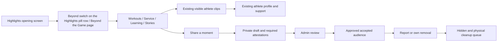

# Beyond the Game — dedicated discovery and safe contribution (BEYOND-01)

Owner approved implementation on 2026-10-15 Denver / October 16 UTC after selecting a dedicated bottom tab. Highlights remains the opening screen. Move Drip into Profile as recommended; preserve its route, feature switch and shop behavior.

**Placement revised by the owner on 2026-10-16 (supersedes the bottom tab):** Beyond moves to the Highlights pill row as `Home | Beyond | Local →`. The Beyond switch plays athletes' Train Like Me and Serve Like Me Highlights full-screen in the same pager (hype, Donate and Spotlight rules unchanged), with a link to the Beyond the Game page. Fan posts without an athlete stay on that page and are never mixed into Highlights. Upload ＋ asks "Highlight or Beyond moment?" while Beyond contributions are switched on (otherwise it opens the Highlight composer as before); Beyond moment opens the reviewed composer on the page (`/beyond?compose=1`, only after the server allows submitting). Bottom destinations: Highlights, Activity, Spotlight, Profile around Upload. Goal (owner): uploading any of these media types must be simple for every kind of user.

## Outcome and scope

Give eligible fans, athletes, families and friends a useful free participation path through Workouts, Service, Learning and Stories. Reuse existing publicly visible Train Like Me / Serve Like Me clips in the appropriate filters. New contributions accept a video or photo without an athlete tag and are separate from game Highlights. Show the creator accurately. No arbitrary athlete/payee association, donation button on a general fan post, messaging, spend-weighted award or new medical/fitness inference.

First build: dedicated discovery, four category filters, reviewed photo/video submissions, own submission status/removal, reports and admin queue/control/recovery. The existing CHAL-01a presets/invites/private badge are completed separately and used on eligible athlete workouts. Try videos remain CHAL-01b after Vault protection. No season billing or provider deployment in this build.

## New contribution contract

Use a separate private `beyond_posts`/media contract, not public photo-story storage. All new posts start as drafts, then pending review; only approved posts can reach their accepted audience. Uploader identity comes from the authenticated session. No athlete requirement. The category is exactly workout/service/learning/story; unknown categories fail. Caption is at most 240 characters. One short video (existing 45-second limit, at most 50 MiB) or up to three JPEG photos (at most 5 MiB each), with no mixed media. These are conservative first-pilot implementation bounds, not a verified usage/cost forecast. Media metadata and people/sound/rights/safety attestations accompany submission. Actual review must consider visible locations/schedules and depicted people; stripping metadata does not establish consent.

Accepted audiences: friends or everyone for eligible adults, friends only for teen/unknown accounts. Under13 and not_given (new account birth month/year not yet supplied) submissions are denied. Legacy unknown-age accounts remain friends-only. Existing account privacy, blocks, closed-account rules and youth guardian scopes remain enforced on every list/read/storage operation. Require PRIV-01 and MINOR-01 before enabling submission. Review cannot broaden a teen's audience. The feature switch starts off. A missing migration or disabled feature has an explicit unavailable state, never demo success or silent publishing.

Private Storage objects use immutable owner/post-scoped names and no upsert. Reserve the draft before uploading; finalize only exact owned files of supported type/size, never external URLs. Use existing image re-encoding and video compression APIs; refuse video when metadata-safe compression is unavailable. Server checks object ownership/association, and review remains responsible for content inspection. Read short-lived signed media only after the server returns an authorized exact post/file. Logout, account changes, disabled feature, removal or lost visibility clear client media and reject late results. Previously delivered bytes cannot be recalled instantly. Physical deletion and orphan cleanup need explicit owned admin controls and failures remain visible.

Rate-limit reservations/submissions on the server with durable counters independent of post removal; choose a bounded five-submission-per-24-hour first pilot. Posts are not ranked by exercise performance, body appearance, money or service hours. Recognition is separate CHAL-01a self-report, private and noncash; no new generic badges in this slice.

## Admin-first

Existing Highlights desk hosts Beyond the Game moderation: dependency-aware feature switch, bounded pending/approved/removed queue, preview, approve/remove with reason, report count, own deletion/object cleanup and draft retention. Closed admins are denied by new server entry points. Protected UI binds reads and actions to the current actual session/profile and request generation; errors clear prior queue data. Reports hide a post immediately pending review and can be corrected with a reason. Admin review cannot bypass audience/closed/rights rules.

Source owners: HIGHLIGHTS for content/data, ADMIN for protected controls, UPLOAD/STORAGE for media, PROFILE for Drip/settings. Independent Data/Privacy/RLS/Safety/QA reviews are required. Root owns shared metadata, schema integration, navigation, STATE/CHANGELOG and gates. New roles are not introduced.

## Workout repairs before participant integration

Close the five findings from the actual CHAL-01 reviews: audit identity redaction/account deletion, durable response quota, current viewer/athlete block checks, closed-admin RPC denial, and stale actor/request admin state. Preserve original action/time/audit evidence while narrowly permitting identity redaction; no arbitrary audit update. Add actual SQL regression probes and retained/deferred actor/action UI checks. Then record CHAL-01 admin-ready before adding ChallengeBar, Activity invites/mutes, athlete switch and private badge. Root mounts ChallengeBar on the dedicated legacy workout card; viewing/support stay on the established athlete profile. PLAY-01 files remain untouched.

## Discovery and growth

Keep Highlights and its eligible family support route visible. General posts offer viewing, creator context and report/removal; existing approved athlete clips lead to the athlete profile and its existing optional support flow. No checkout or recipient inference in a new post. A small selection of existing workout/service clips plus new approved learning/stories makes the tab useful without duplicating the whole Home feed.

Data-approved aggregate operational counts and voluntary feedback measure useful contributions/returns, athlete visits and settled family support alongside review time, cost and loading. No new behavioral collector, invented conversion target or autonomous ranking in this slice. Reassess category quality and support attention with the single Growth packet; operators can pause submissions/publication when review capacity is exceeded.

## Later Vault sequence

Complete authoritative entitlement/visibility, private originals/derivatives, legacy public-copy disposition, short-lived serving and current block/closed/removal checks before CHAL-01b. Reconcile cached/client-granted access and free-text subscriber requests with the approved policies. Only then implement explicit season start/end/no-auto-renew terms, settlement/refunds and eligible family accounting. Minor in-person times/places stay prohibited inside Vault too. Hosted SQL, providers, payment activation, legal clearance and launch are separate actions.

## Pilot growth decision and learning

The hypothesis is that free, reviewed participation helps fans return and learn athlete stories, while Highlights and existing athlete support remain easy to reach. There is no measured adoption, donation-lift, latency or cost baseline for this new tab. The local experiment is the dedicated destination, four plain filters and bounded contributions; it has no new vendor, background processor or behavioral collector. Alternatives considered were a Home entry and broadening the old Highlights uploader. The owner chose a bottom tab; separate private moderation is needed because existing photo stories require an athlete and use public storage.

Product/Growth use existing authorized reports and voluntary pilot feedback to assess navigation completion, confusing category choices, repeat participation and whether athlete discovery/support remain usable. Finance uses actual provider invoices/quotas once available. New telemetry needs its own privacy/Data review before collection. Stop/revise if moderation cannot keep up, privacy/remove controls fail, families cannot find support, or measured usage exceeds the approved infrastructure ceiling; these are review triggers, not fabricated targets or automatic shutdowns.

Fan/family path: watch a workout, share a service or learning moment after consent, see review status, and discover an athlete's existing profile from approved legacy content. Athlete path: existing workout and support profile plus optional preset challenges; teen audiences remain restricted. Administrator path: switch/dependency status, bounded queues, explicit reasoned review, reports and physical cleanup. Workflows avoid public performance/wealth/body rankings.

Independent local verification establishes source behavior, not law, school eligibility or provider certification. Human counsel and school/guardian rollout review remain within the Utah-first roadmap. Workouts are shared experiences, not medical advice or verified exercise completion. No automatic challenge prizes, workout payments or subscriber entitlements are added.
