# Main administration portal — ADM-02

Owner decision: 2026-10-12. The owner selected the report design shown at
`http://localhost:3033/` and asked for every administration function in that experience.
That address currently serves the local format preview; it is the visual reference,
not proof of a hosted admin session or production data.

## Architecture

Expo `/admin` becomes the main administration application. It inherits the selected
Next portal's report design and reporting models, alongside its existing editing desks.
This keeps one authenticated session and the existing administration controls.
The separate Next application remains a compatible read-only reporting client.

- Main report navigation: Home, Trends, Audience, Revenue, Health, Product;
  Analytics and Departments remain easy to reach.
- Product includes Features, Profile, Sign-in, People and Control map oversight, with links to
  the owning editing desks.
- Manage desks preserves Operations, Content, Commerce, Audience, Growth and System,
  plus QA and Studio in Tools. App setup joins Features/Look/Catalogs/Lab;
  Highlights & review joins Highlights/Moderation. Lenses filter desks; they grant no access. The legacy
  Reports address opens Analytics; it is not another entry in Manage desks.
- Reports use a static scrolling header, a 1680px maximum frame, jade underline
  navigation, open divider sections, complete chart summaries and Data disclosures.
  Native screens use React Native and the installed SVG package.
- Existing immediate edits, draft configuration, explicit Publish, confirmations,
  telemetry actions and Studio remain in their owning components.

## Reporting contract

Pure parsers, labels, measure catalogs, chart scales and dashboard builders live in
`packages/shared-types/admin/`. Next's server fetchers remain server-only. Expo reads
the same existing RPCs through its authenticated client, using the shared parsers.
Missing numbers and lists remain distinct from measured zero and measured empty lists.
Errors remain visible per data source; partial donation fallback is labelled.
Responses from an old identity must not populate a new account's screen.

The existing revenue summary RPC synchronizes ledger rows internally. No new SQL,
grants, credentials or dependency is required for this integration. The written
bigint/donation-band migration remains unapplied; missing bands display their update
notice. Wave 0 test payments, blocked payouts and the recorded custodial gaps retain
their current meaning.

## Execution and acceptance

1. Establish baseline checks and inventory every report and existing desk.
2. Extract platform-neutral models and test the authenticated adapter's read states.
3. Build universal report figures and every report page from the existing models.
4. Integrate the selected header/navigation into reports and existing tool chrome.
5. Add thin Expo routes without replacing any existing editing route.
6. Run the full repo gate, existing Next model tests, bundles and browser checks.
   Inspect 320px, tablet and desktop layouts, enlarged text, keyboard navigation,
   empty/error/zero states and links to every administration desk.
7. Update STATE, architecture, menu coverage and specialist handoffs with actual evidence.

No local test substitutes for hosted authorization, applied migrations or native
device interaction. The task tracker records those remaining checks explicitly.

## Ownership

Functional routing: CTO → ENGINEERING → ADMIN for integration, with PORTAL/DESIGN
for the report presentation, SHARED_CONTRACTS for reusable models, ANALYST for measure
meaning, COMMERCE for ledger meaning, and QA/ACCESSIBILITY for acceptance.
DOCUMENTATION synchronizes the same-turn handoff. Execution claims and evidence are
in [ADM-02.md](../../agents/ADM-02.md).

## Continued navigation polish — 2026-10-12

The owner requested further improvements to the main admin web portal after ADM-02.
This pass uses the accepted Home appearance and existing Expo `/admin` components.

1. **Home — usable overview.** The selected community hero and recorded totals remain intact. Refresh report is now available here and disabled during reads or unavailable access.
2. **Manage desks — browse before opening.** Group controls select their desk list without navigating. Labels distinguish the lens, group and desks; each editing link includes its existing description. Selecting the desk still opens its original editor.
3. **Find a desk — recoverable search.** Search matches labels, descriptions and groups across the chosen lens, plus QA/Lab. Result counts announce changes politely. Clear search restores the browsed group; empty results explain the next action. Lenses remain filters, not authorization.
4. **Long reports — direct section navigation.** “In this report” shortcuts scroll to and focus a section. Analytics includes both catalogs and the week view. Web targets are scoped to the current scroll owner because Expo retains earlier routes in the DOM; native targets use existing layout offsets.
5. **Revenue — readable chart.** A real web DOM test reproduced the SVG `transform-origin` warning. Standard SVG rotation preserves the ring geometry without the error banner.

### Verification

Local acceptance passed for this continuation. Evidence uses the actual mobile source
served through an isolated Metro preview at `http://localhost:3042/admin`, with only
a separate local synthetic backend. The ordinary main app remains at
`http://localhost:8081/admin`.

- Baseline: 89 suites / 529 tests. Final `pnpm check`: **89 suites / 535 tests**,
  both app typechecks and every documentation/copy/boundary/comment/agent/key guard passed.
  The six added regressions failed before implementation and passed afterward; the
  focused three suites passed 46 tests.
- **29 responsive reads passed:** all twelve reports at 1728px and 320px,
  Home/Revenue/Analytics at 768px, plus the open phone Manage menu and doubled CSS
  text on phone Home. No horizontal page overflow, hidden clipped money, invalid SVG
  origin attribute or chart error banner was found in those reads.
- **11 browser behavior checks passed:** browse without leaving Home, search across
  descriptions, empty/clear recovery, Revenue Streams and Analytics Ledger jumps,
  List catalog with all twelve rows, physical Tab focus to View Trends, and native
  mouse opening Home’s seven-row Data table with its source.
- Offline iOS and Android HBC exports passed from actual mobile source with localhost
  dummy configuration and dotenv disabled. The installed Hermes compiler required
  the documented narrow macOS quarantine cleanup after a SIGKILL.
- Before/after screenshots were inspected together. All eight touched source/test
  files retained their hashes from the passed gate through browser verification.
  Logs/results live under `.smoke/main-admin/improve-*`; the reviewed screenshots
  below live in `design-preview/` for ordinary workspace review.

This is local UI acceptance. Existing hosted admin-role/data/write acceptance,
physical Data Enter/Home/End and native device interaction remain open in ADM-02.
No commit, merge, deployment, SQL or live-money action was performed.

### Captured comparisons

The browser screenshots below were captured in this continuation with synthetic
records. Before is on the left and after on the right. The shared capture width is
1728 CSS pixels; only the bottom edge is cropped to their common viewport height.

**Home:** the community hero and complete figures retain the accepted design; the
new 44-point Refresh action adds one control to the read timestamp row.

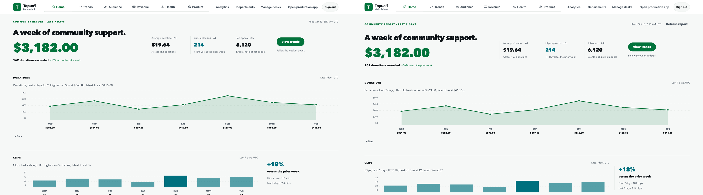

**Manage:** labelled navigation and described desk rows make the choices readable.
Both views show Operations; the described rows replace the widely spaced plain links. Browsing Commerce was separately verified to keep Home open.

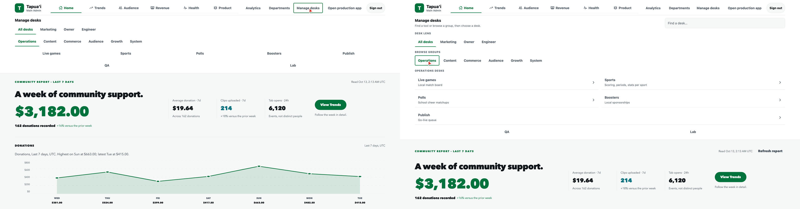

**Search:** “donations” finds the Money and Catalogs desks by their descriptions.
The selected lens continues to filter results; no route opens merely by searching.

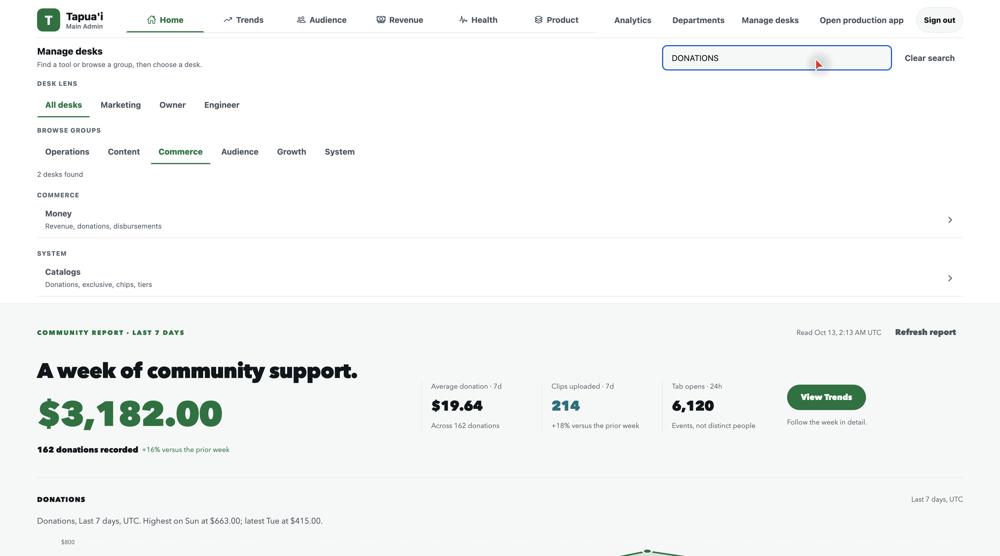

**Revenue:** section shortcuts sit above the report; the chart’s invalid DOM
property banner no longer covers the lower corner.

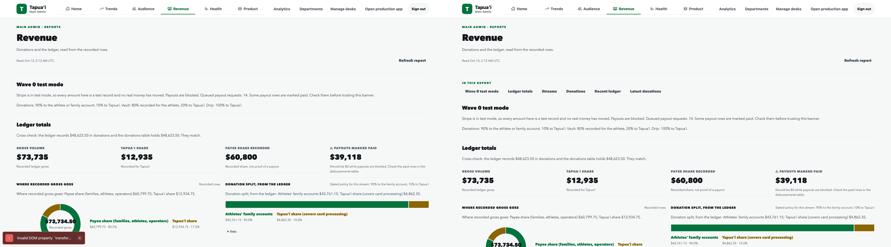

**Phone:** the same controls and hierarchy fit 320px. Manage remains a scrolling
menu; its later desk rows are below the natural viewport rather than removed.

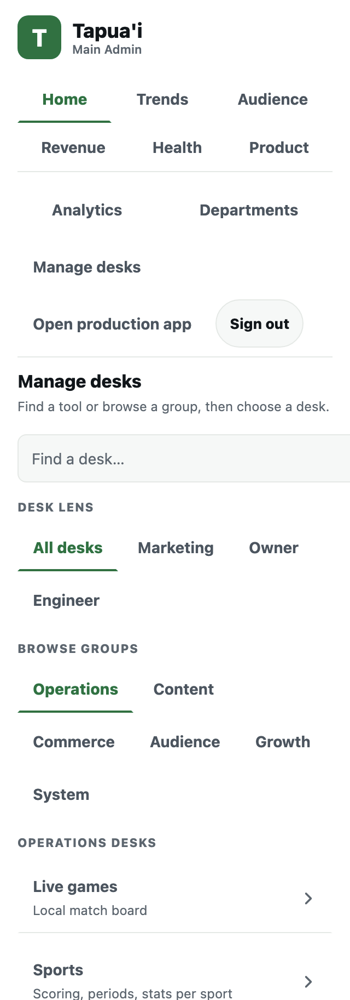

Final ordinary Home is open in the dedicated “Main admin finish” browser tab with
sample data, no QA iframe and no new console errors. The final Revenue ring capture
confirmed all three circles and the absence of the invalid origin attribute.

## Manage desks without duplicate dashboards — 2026-10-12

The owner requested further desk improvements and no repeated data. The accepted
Home palette and open divider format continue through this bounded change.

1. **Find a desk.** One View filter and one Group filter replace the repeated menu
   headings. Search covers the selected lens; QA/Lab live once in Tools.
2. **Choose a desk.** The menu opens on request, then closes on navigation or choosing
   the already-current desk. The editor appears immediately on arrival.
3. **Handle disbursements.** Money retains roster selection, amount presets, queue
   submission and confirmed paid/failed actions. It reads disbursements and roster,
   without four duplicate financial report reads. The queue's empty message waits
   until the read finishes. Generic catalog Save wording is removed from this desk.
4. **Read financial data.** Revenue owns ledger totals, stream splits, recent ledger,
   donation totals/history and origins. Money links to Revenue and Catalogs. Complete
   report chart summaries/Data disclosures remain available.
5. **Open saved Reports links.** `/admin/reports` opens Analytics, including its complete
   measure/list catalog, instead of a separate dashboard. Twenty-two editing/utility
   desks remain discoverable; the 23rd saved address is this compatibility entry.

| Information | Primary destination |
| --- | --- |
| Ledger totals, streams, transactions, donation history/origins | Revenue |
| Disbursement requests and status records | Money |
| Donation amount/exclusive price editing | Catalogs |
| Full reporting measure/list catalog | Analytics |
| Fan time, taps, issues and published menu status | Health |

### Verification

- Regression failures were reproduced before implementation: duplicate report reads,
  the legacy dashboard, premature empty queue and an already-selected desk staying open.
- Final `pnpm check`: **90 suites / 544 tests**, both app typechecks and all guards passed.
  Focused navigation/Money regressions: **40 tests**.
- **Ten browser behavior checks** passed: all 22 unique routes, one Tools group,
  lens/search ownership, closed desk arrival/current-desk selection, amount preset,
  Revenue navigation, the saved Reports redirect and physical Tab from search to
  the desk filter (visible focus at y=130).
- **Eight responsive checks** passed at 1728/768/320px, including doubled CSS text on
  phone for menu and Money. Screenshot review caught nested filter clipping that the
  initial page-width check missed. The corrected pass also measures every filter
  button against the viewport; all controls fit.
- Browser samples use an isolated local backend; payout fixtures reject writes and
  its log contains no financial writes. Actual confirmation/status callbacks are
  exercised in Jest. Realtime streaming is not part of this HTTP fixture.
- Same-viewport desktop comparisons are reviewed below. Phone screenshots show all
  filter choices wrapping and the editor using the same open sections as Home.
Hosted authorization/data acceptance and native-device interaction remain pending.
Previous physical Data Enter/Home/End limitations remain open.

### Reviewed comparisons

Before is on the left; after is on the right. Both capture the same 1728×906 desktop
viewport. Menu captures use Health, Marketing and Operations; Money is at its top
with Manage desks closed.

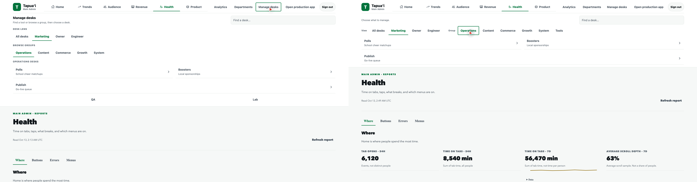

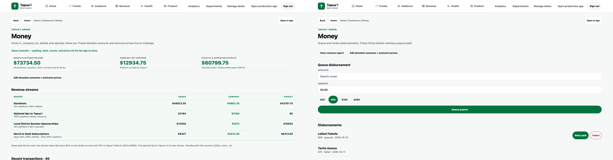

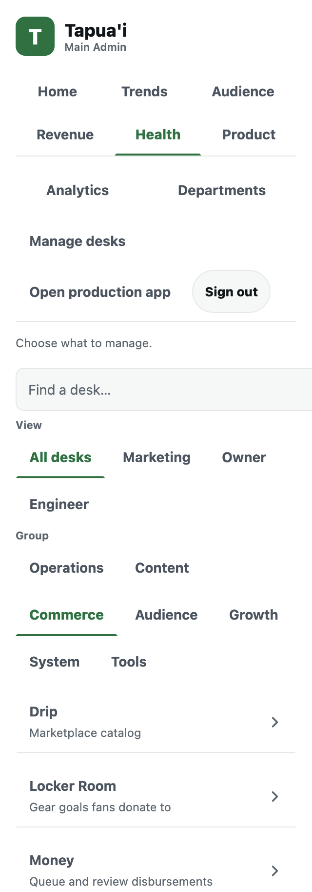

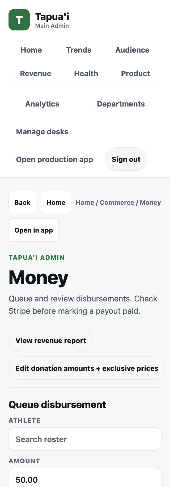

The final ordinary Home preview remains open at `http://localhost:3042/admin`, with
sample data, no test iframe and its heading visible at y=162. Eight source/test hashes
were stable through final verification. Aggregate local evidence:
`.smoke/main-admin/desks-verification.json`; full gate:
`.smoke/main-admin/desks-accepted-check.log`. No new hosted operation, dependency,
SQL, payment policy or native-device acceptance is claimed by this continuation.

## Data ownership and compact workspaces — 2026-10-12

The owner requested a cross-check across every desk/report and an admin-first process for
future features. The current directory has **18 entries**, reduced from 23 editing/utility
entries after concurrent Books integration. All **24 saved addresses** remain supported,
including Books and the Reports/Coverage compatibility redirects. Product now has the
thirteenth report, Control map. Detailed ownership: [ADMIN_DATA_CONSOLIDATION](ADMIN_DATA_CONSOLIDATION.md).

- App setup has Features, Look, Catalogs and Lab tabs. Highlights & review has Highlights
  and Moderation tabs. Searching an original editor name reaches its original route;
  searching the workspace name reaches the workspace. Each tool links its primary analysis.
- Revenue owns financial activity; Payouts owns requests/status actions; Books owns accounting.
  These have distinct purposes and data windows. No accounting/payments policy is changed here.
- Trends retains seven comparisons; Analytics selects one complete board at a time, preserving
  all eight boards, the 64-measure catalog, arbitrary returned numeric keys and four series.
  Revenue retains its fourteen-day source, count/window definitions, reconciliation, full
  ledger/history tables, privacy and bounded fallback.
- Health restores all thirteen operational checks and corrective actions. Inventory is an
  exact nullable count; runtime comparisons use the same normalized configuration as editors.
  Profile lists its six published settings once. Departments retains statuses/API inventory
  and links to the full reports. Lab keeps validated drafts/feedback; QA keeps incidents/queue.
- Control map keeps every registry row and editor/app link. Its Data table reports each
  telemetry key once, identifies shared surfaces and labels the top-eight/partial read.
  Missing flags/readings remain unknown. Moderation evidence wraps without truncation.
- Web report filters and Data use the same approved font/palette. Passing Health checks and
  raw catalogs open on request; wide tools use available columns and narrow tools use rows.
- [FEATURE_ADMIN_WORKFLOW](../FEATURE_ADMIN_WORKFLOW.md) requires future agents to enroll a
  source/admin/report/disable/access/app contract, verify admin handling before app
  implementation, and preserve evidence at both checkpoints. Agent/lead enrollment review
  remains essential: the CLI checks registered metadata/files/evidence and cannot discover
  omitted features or certify a release. Presentation-only changes have a reviewed exemption.

### Verification in this continuation

Fresh `pnpm check`: **96 suites / 611 mobile tests**, **13 workflow tests**, both typechecks
and every documentation/copy/boundary/comment/agent/key guard passed. Compatible Next
models: **86 tests passed** with the installed analytics resolver. Focused failures were
observed before the behavior fixes; final focused checks include the shared telemetry
attribution and Control map accessibility labels. Source reviewers found no remaining
analysis-preservation blocker. Browser layout/behavior acceptance passed: **56 responsive reads and 19 interactions**.
All 18 menu entries, workspace/editor search, eight complete boards/Data, physical arrow
selection, thirteen Health checks, all 129 controls / 33 Profile mappings, shared telemetry,
redirects, invalid JSON rejection and QA controls remain reachable. The harness was corrected
to scope app links to Control map and use fresh target markers after Bridge pointer misses;
a direct scoped Profile click was observed as trusted. Earlier physical Data Enter/Home/End
limitations remain open.

All visual/browser samples use the actual source through an isolated Metro instance at
`http://localhost:3042/admin` and a separate local synthetic backend. The ordinary app is
`http://localhost:8081/admin`. This is a source-contract and local-fixture cross-check; hosted
data reconciliation, native-device interaction and concurrent Books acceptance are pending.

### Reviewed captures

Before is on the left, after on the right, rendered at the same scale. Desktop captures
use the 1728px viewport (906/912px height; comparisons accommodate the small difference).
Moderation's synthetic fixture was strengthened after baseline capture to include three
reporters, a valid stored reason and a guardian match; those value changes are fixture
changes rather than a database/data migration. The local fixture also corrected browser
exposure of count headers; Profile count changes in these captures are synthetic readings,
not a hosted population audit.

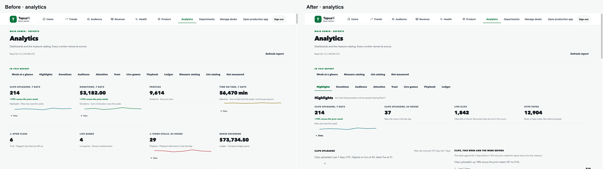

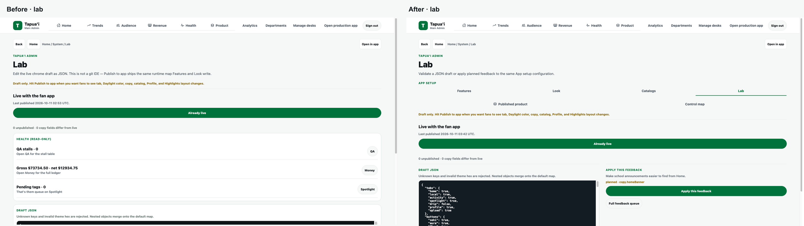

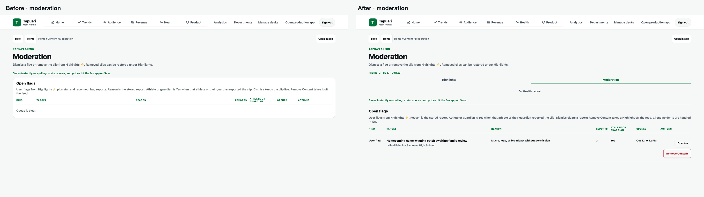

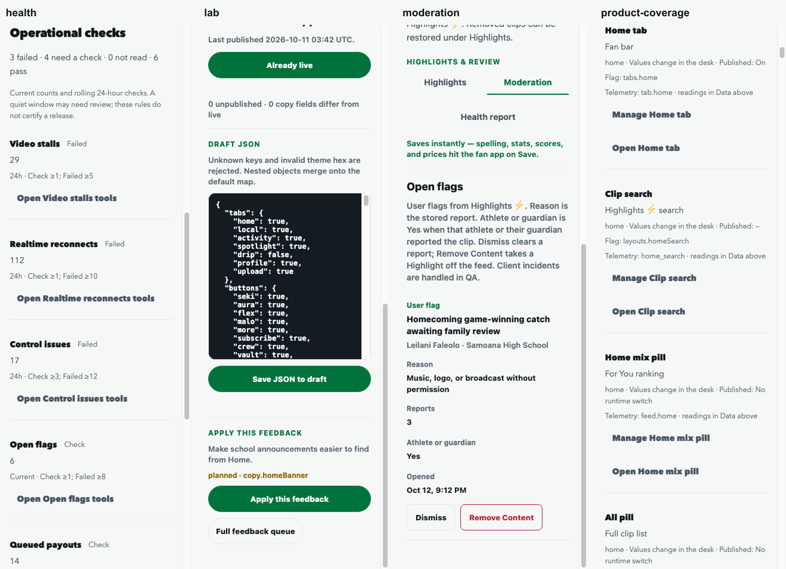

Additional comparisons for Trends, Health, Profile, QA and Control map are in
`design-preview/admin-consolidation-*-compare.png`. Browser evidence is in
`.smoke/main-admin/consolidate-layout-results.json` and
`.smoke/main-admin/consolidate-behavior-results.json`. The source snapshot covers
32 reviewed implementation files in `.smoke/main-admin/consolidate-source-hashes.json`.
Final phone/Home evidence and stable-source confirmation are recorded with the local
aggregate acceptance file. The HTTP fixture does not simulate Realtime; no hosted data,
financial/configuration/moderation write or native-device acceptance is claimed.

Final phone eye-test correction (2026-10-12): the JSON editor's `flex: 1` shrank its
column container and overlapped feedback despite passing width/clipping checks. A direct
sibling-position regression failed (feedback top 1506.5 before Save bottom 1560);
phone/tablet editors now keep natural height and do not shrink. The 320px regression
passes with feedback top 1621, 61px after Save. Desktop retains equal columns. The
complete project gate passes again (96 suites / 611 app tests, 13 workflow tests and
all guards). Additional desktop/tablet/phone/enlarged geometry evidence is saved in
`.smoke/main-admin/consolidate-lab-layout-final.json`. The first 56 responsive checks
remain width/control checks; sibling geometry and screenshot review complete the eye test.

Final local total: **60 responsive/geometry checks** (56 broad reads + four Lab
sibling-geometry checks), **19 interactions**, and **32 stable reviewed source hashes**.
Ordinary sample Home is restored with its heading at y=162 and no test iframe. Aggregate
evidence: `.smoke/main-admin/consolidate-acceptance.json`; reviewed captures are in
MAIN_ADMIN_PORTAL. This acceptance covers local source and fixtures.
