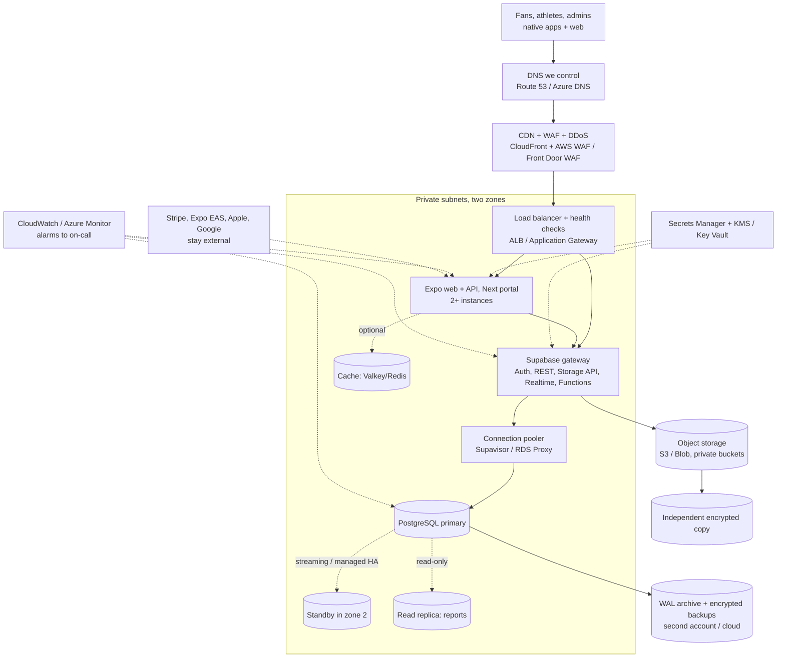

<!-- GENERATED by scripts/exit-map.mjs from the code and docs/engineering/exit/exit-map.json. Do not edit by hand. -->
# Exit infrastructure map — moving off Supabase to AWS or Azure

The build map for the redundant database plan: everything the app uses on Supabase today, what replaces it on AWS or Azure
(including load balancing, caching, CDN, firewall and database HA), how the data moves, how users are protected during the move,
who builds each part and in what order. It regenerates on every app change (Stop hook, `pnpm check`, CI), so it always describes
the current app. Team and protocol: [REDUNDANCY_TEAM](REDUNDANCY_TEAM.md). Operator commands: [CLOUD_MIGRATION_RUNBOOK](CLOUD_MIGRATION_RUNBOOK.md).
Nothing here is provisioned, priced or approved; cloud spend and cutover remain owner decisions.

## 1. Where the current version is

| Fact | Current |
| --- | --- |
| Exit plan version (what the app uses on Supabase) | `dd8f47417558` |
| Last announced plan | `dd8f47417558` — up to date |
| Mobile app version / runtime | 1.0.0 / {"policy":"appVersion"}; Expo SDK ~58.0.14 |
| Packages | `@tapuai/mobile@1.0.0`, `@tapuai/admin-portal@1.0.0`, `@tapuai/shared-types@1.0.0` |
| Latest migration | `20261022152000_no_cut_gifts_optional_tips.sql` (57 files) |
| Canonical schema hash | `9d964b7fe04c65af50aa75eebe6f5e84a2e387c405ed08ff58ac759e5f3771a6` (`schema.sql`) |
| Complete source/configuration content hash | `dd8f47417558a580ac48136350a696c5044e186c8e56c7ce397496f0cd450f7e` across 1338 files |
| Informational readiness planning note | local-drill, recorded for plan `14b092e40835` (**stale**: the app changed since), app source `99b03be48749814f`, commit `2f26caaf1c23` + uncommitted changes, by Claude Code session (owner-run) |

Live view (commit, branch, uncommitted files, app source hash, open notices, GO / NO-GO): `pnpm exit:status`.
Before executing the exit, `pnpm exit:preflight -- --evidence-config /secure/exit-readiness.json` must say **GO**: the independent
cutover evidence gate verifies the current release, exact artifacts, timed rehearsal and final frozen-backup acceptance (§13).
The planning note, clean release commit and reviewed notices are additional checks; a planning note alone proves no readiness.

## 2. Changes since the last announced plan

None. The plan matches the last announcement.

## 3. Two exits

- **Exit A (recommended).** Self-hosted Supabase on owned cloud servers (AWS EC2 or Azure VM). Same service interfaces; the app changes only its URL and keys. Recommended exit (PORTABILITY, HOSTING_DECISION_BRIEF).
- **Exit B.** Cloud-native services (managed PostgreSQL plus provider Auth, object storage, messaging and functions). New adapters behind lib/; a separate project, used only if exit A is ruled out.
- **Hybrid.** Exit A services pointed at a managed database (RDS / Azure Flexible Server) — the simplest way to get database HA without running it.

## 4. Target topology (production tier)

Tiers: **drill** — Needed to run an isolated restore drill or a like-for-like exit; **production** — Needed before real users move (availability, protection, operability); **scale** — Add when measured load requires it; the app must work without it.

## 5. Component map

| Component | Tier | Today | Exit A — AWS | Exit A — Azure | Exit B — AWS | Exit B — Azure | Owner (with) |
| --- | --- | --- | --- | --- | --- | --- | --- |
| **PostgreSQL database (tables, RLS, functions, triggers, sequences)** | drill | Supabase managed Postgres | Supabase Postgres image on EC2 with encrypted EBS gp3 data volume | Supabase Postgres image on a Linux VM with encrypted Premium SSD | Amazon RDS for PostgreSQL or Aurora PostgreSQL | Azure Database for PostgreSQL Flexible Server | `EXIT_DATABASE` (`DATABASE_MIGRATIONS`, `RLS_SECURITY`, `BACKEND`, `RECOVERY_SECURITY`) |
| **Data API (REST and RPC over the database)** | drill | Supabase PostgREST | PostgREST container in the self-hosted stack | PostgREST container in the self-hosted stack | PostgREST container on ECS Fargate, or an API layer behind lib/ | PostgREST container on Azure Container Apps, or an API layer behind lib/ | `EXIT_SERVICES` (`API`, `BACKEND`, `SHARED_CONTRACTS`, `RLS_SECURITY`, `SESSION_SECURITY`) |
| **Auth (email/password, email link, Apple/Google, TOTP MFA, sessions, JWT/JWKS)** | drill | Supabase Auth (GoTrue) | GoTrue container; SMTP through Amazon SES | GoTrue container; SMTP through Azure Communication Services | Amazon Cognito user pools (TOTP MFA, Apple/Google federation) with a token bridge that issues the role/sub claims RLS expects | Microsoft Entra External ID with the same token bridge | `EXIT_SERVICES` (`AUTH`, `SESSION_SECURITY`, `SECURITY`) |
| **File storage (public and private buckets, owner folders, storage.objects policies)** | drill | Supabase Storage | Supabase Storage API container backed by S3 | Supabase Storage API container backed by Azure Blob Storage | S3 with CloudFront signed URLs; bucket rules re-implemented in the API | Blob Storage with SAS URLs; bucket rules re-implemented in the API | `EXIT_SERVICES` (`STORAGE`, `UPLOAD`, `PLAYBACK`, `RLS_SECURITY`, `RECOVERY_SECURITY`) |
| **Live updates (postgres_changes, private Broadcast topics, realtime.messages policies)** | drill | Supabase Realtime | Realtime container in the self-hosted stack | Realtime container in the self-hosted stack | AWS AppSync Events or API Gateway WebSockets fed by database triggers | Azure Web PubSub fed by database triggers | `EXIT_SERVICES` (`REALTIME`, `LOCAL`, `RLS_SECURITY`, `SESSION_SECURITY`) |
| **Server functions (Stripe checkout and Connect)** | drill | Supabase Edge Functions (Deno) plus Expo API routes (Node) | Supabase edge-runtime container (allowlisted functions only) | Supabase edge-runtime container (allowlisted functions only) | AWS Lambda running the runtime-neutral money core | Azure Functions running the runtime-neutral money core | `EXIT_SERVICES` (`API`, `COMMERCE`, `CONNECT`, `SESSION_SECURITY`, `SUPPLY_CHAIN_SECURITY`) |
| **Expo web app and Node API routes; Next admin portal** | drill | Not hosted in production (local and preview only) | Containers from infrastructure/containers on the EC2 host | Containers from infrastructure/containers on the Azure VM | ECS Fargate services behind an Application Load Balancer | Azure Container Apps | `EXIT_CLOUD` (`RELEASE`, `CI`, `ADMIN`, `INFRA_SECURITY`, `SUPPLY_CHAIN_SECURITY`) |
| **TLS, gateway and DNS** | drill | Supabase project domain; no app domain in production | Caddy TLS on the host; Route 53 records | Caddy TLS on the VM; Azure DNS records | ALB with ACM certificates; Route 53 | Azure Front Door or Application Gateway; Azure DNS | `EXIT_CLOUD` (`SECURITY`, `RELEASE`, `INFRA_SECURITY`) |
| **Secrets and keys (service keys, JWT secret, Stripe, SMTP, OAuth)** | drill | Supabase project settings, EAS environment, local files outside the repo | AWS Secrets Manager with KMS; files under /etc/tapuai on the host | Azure Key Vault; files under /etc/tapuai on the VM | AWS Secrets Manager with KMS | Azure Key Vault | `EXIT_CLOUD` (`SECURITY`, `SESSION_SECURITY`, `INFRA_SECURITY`, `RECOVERY_SECURITY`) |
| **Backups, independent copies and point-in-time recovery** | drill | Supabase project backups; REDUNDANCY-01 encrypted archive tools prepared, not scheduled | infrastructure/backup to versioned S3 (second account or Azure copy); WAL archiving for PITR | infrastructure/backup to versioned Blob (second subscription or S3 copy); WAL archiving for PITR | RDS automated backups and PITR plus the same encrypted archives | Flexible Server backups and PITR plus the same encrypted archives | `RECOVERY` (`EXIT_DATABASE`, `RELIABILITY`, `RECOVERY_SECURITY`) |
| **Monitoring, alerts and logs** | production | Supabase dashboard; app telemetry table; no uptime monitor | CloudWatch agent, alarms and log groups | Azure Monitor agent, alerts and Log Analytics | CloudWatch | Azure Monitor | `EXIT_CLOUD` (`RELIABILITY`, `TELEMETRY`, `SUPPORT`, `THREAT_DETECTION`, `INFRA_SECURITY`) |
| **External providers that do not move (Stripe, Expo EAS, Apple, Google)** | drill | Stripe test mode, EAS builds/updates, App Store / Play accounts | Unchanged; update webhook/redirect URLs only | Unchanged; update webhook/redirect URLs only | Unchanged; update webhook/redirect URLs only | Unchanged; update webhook/redirect URLs only | `EXIT_CLOUD` (`COMMERCE`, `RELEASE`, `SESSION_SECURITY`, `INFRA_SECURITY`) |
| **Private network (two availability zones, private subnets, NAT, security rules)** | production | Supabase-managed | VPC with public subnets (load balancer only) and private subnets for hosts and database across 2 AZs; NAT gateway; security groups allow only LB → app → database | VNet with the same subnet split across 2 zones; NAT Gateway; NSGs | Same VPC layout; RDS in private subnets; VPC endpoints for S3 and Secrets Manager | Same VNet layout; Flexible Server with private access (VNet integration); private endpoints for Blob and Key Vault | `EXIT_CLOUD` (`SECURITY`, `RELIABILITY`, `INFRA_SECURITY`) |
| **Load balancer and health checks** | production | Supabase-managed (no app load balancer; app not hosted) | Application Load Balancer: HTTPS listener (ACM), target groups for Supabase gateway (Kong), Expo web/API and the Next portal, /health checks, 2+ instances in an Auto Scaling group | Application Gateway v2 (or Front Door) with the same backend pools and probes; VM Scale Set | ALB in front of ECS Fargate services | Container Apps built-in ingress behind Front Door | `EXIT_CLOUD` (`RELIABILITY`, `RELEASE`, `INFRA_SECURITY`) |
| **CDN for the web app and public media** | production | Supabase Storage CDN for public buckets; no app CDN | CloudFront: static web export, public bucket objects (avatars, public Highlights); signed URLs / origin access control for private buckets | Azure Front Door (Standard/Premium) caching the same paths; SAS for private objects | CloudFront in front of S3 | Front Door in front of Blob Storage | `EXIT_CLOUD` (`STORAGE`, `PLAYBACK`, `MOBILE_PERFORMANCE`, `INFRA_SECURITY`, `RLS_SECURITY`) |
| **Web application firewall, DDoS protection and rate limits** | production | Supabase-managed edge protections; app-level caps in SQL | AWS WAF on CloudFront and the ALB (managed rule groups, per-IP rate rules on /auth/v1 and guest RPCs); AWS Shield Standard (Advanced optional) | Front Door WAF policy with managed and rate-limit rules; Azure DDoS Network Protection on the VNet | Same | Same | `EXIT_CLOUD` (`SECURITY`, `TRUST_SAFETY`, `INFRA_SECURITY`, `THREAT_DETECTION`) |
| **Cache server (Redis-compatible)** | scale | None (the app reads the database directly; offline queue is on the device) | Amazon ElastiCache for Valkey/Redis in private subnets | Azure Cache for Redis in the VNet | ElastiCache Serverless | Azure Cache for Redis | `EXIT_SERVICES` (`MOBILE_PERFORMANCE`, `API`, `SECURITY`, `INFRA_SECURITY`, `RLS_SECURITY`) |
| **Database connection pooler** | drill | Supabase Supavisor / PgBouncer | Supavisor (part of the self-hosted stack) or PgBouncer on the database host | Supavisor or PgBouncer on the database host | RDS Proxy (or PgBouncer on ECS) | Flexible Server built-in PgBouncer | `EXIT_DATABASE` (`BACKEND`, `RELIABILITY`, `INFRA_SECURITY`, `RLS_SECURITY`) |
| **Database high availability, replicas and point-in-time recovery** | production | Supabase-managed backups (plan-dependent PITR) | Primary plus streaming standby in a second AZ (Patroni or repmgr), WAL archiving to S3 (wal-g / pgBackRest) for PITR; or move the database tier to exit B | Primary plus standby VM in a second zone, WAL archive to Blob; or move the database tier to exit B | RDS Multi-AZ (or Aurora) with automated backups/PITR; one read replica for reports | Flexible Server zone-redundant HA with PITR; read replica | `EXIT_DATABASE` (`RECOVERY`, `RELIABILITY`, `RECOVERY_SECURITY`, `INFRA_SECURITY`) |
| **Migration data movement (dump/restore or online replication)** | drill | Not applicable | Default: quiesced pg_dump → reviewed pg_restore → grant-sync → parity + access PASS. Online option: native logical replication (publication on Supabase → subscription on target) or AWS DMS | Same default; online option: logical replication or Azure Database Migration Service (online) | Same default; AWS DMS (full load + CDC) for online | Same default; Azure DMS online | `EXIT_DATABASE` (`RECOVERY`, `DATABASE_MIGRATIONS`, `STORAGE`, `RECOVERY_SECURITY`, `RLS_SECURITY`) |
| **DNS, client endpoint indirection and traffic switching** | production | Clients call the supabase.co project URL compiled into each build | Route 53 records with low TTL, health checks and weighted/failover routing between old and new endpoints | Azure DNS with Traffic Manager or Front Door routing | Same | Same | `EXIT_CLOUD` (`RELEASE`, `AUTH`, `INFRA_SECURITY`, `SESSION_SECURITY`) |
| **Operator access (no public SSH)** | production | Supabase dashboard | AWS Systems Manager Session Manager; no inbound SSH | Azure Bastion; no public SSH | Same | Same | `EXIT_CLOUD` (`SECURITY`, `INFRA_SECURITY`, `SESSION_SECURITY`) |
| **Build and deploy pipeline** | production | GitHub Actions checks; EAS builds; manual SQL | GitHub Actions → ECR images → deploy to the host/ASG with approval; migrations applied by a pipeline job (R3-03) | GitHub Actions → ACR → deploy with approval | GitHub Actions → ECR → ECS | GitHub Actions → ACR → Container Apps | `EXIT_CLOUD` (`CI`, `RELEASE`, `SUPPLY_CHAIN_SECURITY`) |
| **Budgets and cost alarms** | drill | Owner-reported $50/month infrastructure ceiling | AWS Budgets with alerts at 80% / 100% of the approved budget; tags per environment | Azure Cost Management budgets and alerts | Same | Same | `EXIT_CLOUD` (`COST_OPERATIONS`, `CFO`, `INFRA_SECURITY`, `THREAT_DETECTION`) |

**Notes per component**

- **database** — Exit B must recreate the Supabase roles (anon, authenticated, service_role), auth.uid()/auth.role()/auth.jwt() and the JWT-claims session settings RLS reads, or every policy fails closed. Repo: `apps/mobile/src/backend/db/schema.sql`, `supabase/migrations`, `infrastructure/migration`.
- **data-api** — Direct Supabase calls outside lib/ are the places an exit-B adapter change must touch (app:data-boundaries ratchet). Repo: `apps/mobile/src/frontend/lib`, `apps/admin-portal/lib`.
- **auth** — Password hashes move only to the same GoTrue (exit A). Exit B needs a password-reset or migration-on-login plan; MFA factors must be re-enrolled. Repo: `apps/mobile/src/frontend/lib/auth.ts`, `apps/mobile/src/frontend/context/AuthContext.tsx`, `apps/admin-portal/middleware.ts`.
- **storage** — 2026-10-21 local media transport: lib/mediaStorage.ts binds upload/public URL/sign/list/remove; lib/media.ts resolves public references and legacy URLs, with authorized Vault signing. MediaUploadService factories and photo cleanup accept bound adapters; current Supabase remains default. Full-URL writers/backfill remain gated. Alternate hosts must preserve actor authorization, exact object paths, Storage catalog/owner metadata, SQL cleanup protocol and physical byte removal; no hosted restore/parity/drill is established by local adapter tests. See design/MEDIA_SERVICE_PLAN.md. Repo: `apps/mobile/src/frontend/lib/media.ts`, `apps/mobile/src/frontend/services/MediaUploadService.ts`, `infrastructure/backup`, `apps/mobile/src/frontend/lib/mediaStorage.ts`, `apps/mobile/src/frontend/lib/photoStoryCleanup.ts`.
- **realtime** — Publication membership and realtime.messages policies are verified by parity after a restore. Repo: `apps/mobile/src/frontend/lib/liveScoreSync.ts`, `apps/mobile/src/frontend/lib/liveGames.ts`, `apps/mobile/src/frontend/lib/cheerPoll.ts`.
- **functions** — stripe-webhook stays undeployed until P1-05 (one authoritative credit path). Repo: `supabase/functions`, `apps/mobile/src/backend/api`, `infrastructure/supabase/configure.py`.
- **app-hosting** — Native apps keep compiled URLs/keys; old installs need a release plan before any endpoint move. Repo: `infrastructure/containers`.
- **edge-network** — Studio, database and admin ports stay private. Repo: `infrastructure/containers/Caddyfile`, `infrastructure/terraform`.
- **secrets** — Database dumps never contain project keys, signing keys, SMTP, OAuth or webhook settings: inventory them in the encrypted custody file. Repo: `infrastructure/backup/backup.env.example`, `infrastructure/containers/runtime.env.example`.
- **backup** — A restore onto a Supabase stack reopens revoked grants: grant-sync and a parity PASS are mandatory (CLOUD_MIGRATION_RUNBOOK). Repo: `infrastructure/backup`, `infrastructure/migration`.
- **monitoring** — Backup-age and failed-copy alarms are required before any cutover. Repo: `infrastructure/backup/status.py`.
- **external** — Provider accounts and their data are not in any database backup. Repo: `apps/mobile/eas.json`.
- **network** — Database, Studio, Realtime and admin ports never get public addresses. The current Terraform templates are a single-VM drill footprint; the two-zone layout is the production target. Repo: `infrastructure/terraform`.
- **load-balancer** — The drill uses Caddy on one host. Production needs at least two app instances behind the balancer so a host can be replaced without downtime; Realtime WebSockets need idle timeouts above 60 s and sticky-free reconnect. Repo: `infrastructure/containers`.
- **cdn** — Never cache private or Vault media publicly. Video delivery may move to the separately chosen video host (Mux / Bunny / Cloudflare Stream, HOSTING_DECISION_BRIEF §11) instead. Repo: `apps/mobile/src/frontend/lib/media.ts`.
- **waf-ddos** — Rate rules must cover sign-in, sign-up, password reset and the guest-callable cast_cheer_vote / increment_player_hype (known stuffing gap, WORK_QUEUE DATA-01-F11). Repo: `infrastructure/containers/Caddyfile`.
- **cache** — Not needed for a like-for-like move. First uses when load requires it: WAF-independent rate-limit counters, short-TTL caches of public reads (feed, leaderboards, live scores) behind the API layer, Realtime fan-out relief. Never cache RLS-scoped or private rows under a shared key; invalidate on writes; the app must behave identically with the cache empty. Repo: `apps/mobile/src/frontend/lib`.
- **pooler** — Transaction pooling breaks session-level settings; the app sets JWT claims per transaction (PostgREST), which is compatible. Admin/migration jobs connect directly. Repo: `infrastructure/supabase`.
- **db-ha** — Self-run HA is the hardest part of exit A; a managed database (exit B tier) with the self-hosted Supabase services pointed at it is a valid hybrid. Replicas must be read-only for app writes; reports can read them. Repo: `infrastructure/backup`.
- **migration-replication** — Logical replication does not carry DDL, sequences, auth/storage service schemas or large objects: freeze schema changes, setval sequences at cutover, and copy Storage objects separately (bulk pre-copy, delta during the freeze). Repo: `infrastructure/migration`, `infrastructure/backup`.
- **dns-traffic** — Do this well before any exit: give clients an endpoint we control (Supabase custom domain, or our own api domain proxying to Supabase) and ship builds that use it. Then cutover is a DNS change, not an app release, and old installs follow automatically. Owner decision (paid add-on or proxy). Repo: `apps/mobile/src/frontend/lib/supabase.ts`.
- **admin-access** — Every operator action logged; break-glass account with MFA kept offline. Repo: `infrastructure/terraform`.
- **ci-cd** — OIDC federation from GitHub to the cloud (no long-lived keys). Deploys require the owner's approval per environment (ENVIRONMENTS_AND_HOSTING §4). Repo: `.github/workflows/ci-checks.yml`.
- **cost-guard** — A production two-zone footprint will exceed $50/month; COST_OPERATIONS supplies dated quotes before any purchase. Repo: `infrastructure/terraform`.

## 6. Same app, same data — the app's data surface

Every call the app makes must answer the same way on the target. The code is not changed by exit A (only URLs and keys); these
are the calls whose answers the proofs below cover.

| What the app calls | Count | Items | How the target is proven to answer the same |
| --- | --- | --- | --- |
| Database functions the app calls | 234 | `accept_guardian_invite`, `add_user_aura`, `add_user_role`, `admin_approve_player_consent`, `admin_athlete_sport_usage`, `admin_beyond_cleanup_finish`, `admin_beyond_cleanup_targets`, `admin_beyond_erase_profile`, `admin_beyond_posts`, `admin_beyond_retention`, `admin_beyond_review`, `admin_beyond_set_enabled`, `admin_beyond_status`, `admin_challenge_erase`, `admin_challenge_nudge_senders`, `admin_challenge_post_counts`, `admin_challenge_retention`, `admin_challenge_status`, `admin_confirm_payee_check`, `admin_decide_payout_override`, `admin_decide_verification`, `admin_end_guardian_link`, `admin_get_highlight_sport`, `admin_get_privacy`, `admin_hold_challenge_sender` … (+209) | every one exists in `schema.sql` (checked here); parity compares body, settings, owner, execute rights |
| Tables/views the app reads or writes directly | 33 | `app_runtime_config`, `athlete_career_stats`, `athlete_game_logs`, `cheer_polls`, `crew_follows`, `crew_push_queue`, `custodial_accounts`, `disbursements`, `game_events`, `games`, `operator_checkins`, `players`, `profiles`, `profiles_public`, `reel_hype_votes`, `reel_photos`, `reel_photos_feed`, `reel_reports`, `reels`, `reels_feed`, `saved_reels`, `schools_and_teams`, `shop_orders`, `shop_products`, `sponsor_ads`, `sponsorships`, `spotlight_awards`, `subscriber_requests`, `subscriptions`, `telemetry_logs`, `tips`, `verification_requests`, `wishlist_items` | parity: rows and hashes; **access parity**: rows visible to a guest, signed-in users and an admin |
| Storage buckets the app calls | 4 | `beyond_game`, `fan_zone`, `reel_vault`, `reels` | restore.py re-downloads and hashes every object; parity checks storage.objects policies |
| Realtime channels the app opens | 1 | `scorer_games` | parity: realtime publication + realtime.messages policies; runbook Realtime smoke test |
| Server functions the app invokes | 2 | `create-payment-intent`, `create-stripe-account` | self-host allowlist (checked here); runbook checkout/Connect smoke test in Stripe test mode |
| Auth methods called | 17 | see §7 | GoTrue with restored users (exit A); capability map for exit B; runbook sign-in/MFA tests |

Access parity reads every application table as each kind of user through row level security and compares counts and row hashes; it
catches an Auth layer that evaluates `auth.uid()` or claims differently even when the schema is identical (proven locally).

## 7. What has to move (detected from the code)

Counts come from static statements in `schema.sql` and the source; the live database fingerprint (`parity.py`) is the complete list.

| Area | Count | Items |
| --- | --- | --- |
| Application schemas | 1 | `fan_zone_private` |
| Tables | 125 | covered by backup, restore list and parity automatically |
| Views | 3 | `public.profiles_public`, `public.reel_photos_feed`, `public.reels_feed` |
| Database functions | 614 | covered by parity (body, settings, owner, execute rights) |
| Row level security policies | 100 declared by name | policies created in DO blocks (for example per-table "Closed accounts") are not visible here; parity counts the live set, and extra or missing policies block cutover |
| Triggers | 69 | covered by parity |
| App policies/triggers on Supabase's own tables | 34 | `policy realtime.messages: Fans receive game score changes`, `policy realtime.messages: Fans receive game_events broadcast`, `policy realtime.messages: Operators send game_events broadcast`, `policy storage.objects: Beyond approved and inspection media`, `policy storage.objects: Beyond private delete guard`, `policy storage.objects: Beyond private insert guard`, `policy storage.objects: Beyond private read guard`, `policy storage.objects: Beyond private update guard`, `policy storage.objects: Beyond removed cleanup`, `policy storage.objects: Beyond reserved owner upload`, `policy storage.objects: Closed accounts`, `policy storage.objects: Delete claimed failed photo story objects`, `policy storage.objects: Owner delete avatars`, `policy storage.objects: Owner lists own public media`, `policy storage.objects: Public read avatars`, `policy storage.objects: Public read game highlights`, `policy storage.objects: Public read reels bucket`, `policy storage.objects: Public update avatars`, `policy storage.objects: Public update reels bucket`, `policy storage.objects: Public upload avatars`, `policy storage.objects: Public upload game highlights`, `policy storage.objects: Public upload reels bucket`, `policy storage.objects: Read entitled vault reel`, `policy storage.objects: Upload own vault reel`, `policy storage.objects: fan_zone_insert`, `policy storage.objects: fan_zone_insert_boundary`, `policy storage.objects: fan_zone_no_delete`, `policy storage.objects: fan_zone_no_read`, `policy storage.objects: fan_zone_no_update`, `trigger auth.users: on_auth_user_created`, `trigger auth.users: zz_notification_auth_activation`, `trigger storage.objects: beyond_storage_guard`, `trigger storage.objects: fan_zone_storage_guard`, `trigger storage.objects: guard_photo_story_storage_write` |
| Extensions | 1 | `pgcrypto` |
| Realtime publication tables | 4 | `public.app_runtime_config`, `public.cheer_polls`, `public.game_events`, `public.games` |
| Storage buckets | 6 | `avatars`, `beyond_game`, `fan_zone`, `game_highlights`, `reel_vault`, `reels` |
| Migration files | 57 | latest `20261022152000_no_cut_gifts_optional_tips.sql` |
| Edge Functions | 3 | `create-payment-intent` (self-host allowlist), `create-stripe-account` (self-host allowlist), `stripe-webhook` (excluded: Must not be deployed until P1-05 retires the client tips insert (STATE §0, §6 item 3).) |
| Expo API routes | 6 | `create-payment-intent`, `create-payout`, `create-stripe-account`, `fan-zone-media`, `fan-zone-remove`, `fan-zone-upload` |
| Auth methods called | 17 | `exchangeCodeForSession` (PKCE code exchange after a redirect), `getSession` (Read the local session), `getUser` (Validate the current session with the server), `mfa.challenge` (TOTP challenge), `mfa.enroll` (TOTP factor enrollment), `mfa.getAuthenticatorAssuranceLevel` (Read aal1 / aal2), `mfa.listFactors` (List MFA factors), `mfa.unenroll` (TOTP removal), `mfa.verify` (TOTP verification), `onAuthStateChange` (Session change events), `setSession` (Restore a session from tokens), `signInWithIdToken` (Native Apple / Google ID token), `signInWithOAuth` (OAuth redirect (Google)), `signInWithOtp` (Email link / one-time code), `signInWithPassword` (Email and password sign-in), `signOut` (Sign out), `signUp` (Email sign-up) |
| OAuth providers | 2 | `apple`, `google` |
| Realtime features | 3 | `broadcast`, `postgres_changes`, `private channels` |
| Public client environment names | 16 | `EXPO_PUBLIC_ADMIN_REQUIRE_MFA`, `EXPO_PUBLIC_API_ORIGIN`, `EXPO_PUBLIC_APP_ENV`, `EXPO_PUBLIC_DEMO_FAN_EMAIL`, `EXPO_PUBLIC_DEMO_FAN_PASSWORD`, `EXPO_PUBLIC_LIVE_SCORES_BROADCAST`, `EXPO_PUBLIC_STRIPE_PUBLISHABLE_KEY`, `EXPO_PUBLIC_SUPABASE_ANON_KEY`, `EXPO_PUBLIC_SUPABASE_URL`, `EXPO_PUBLIC_SUPPORT_ENVIRONMENT`, `EXPO_PUBLIC_SUPPORT_RELEASE`, `EXPO_PUBLIC_SUPPORT_SENSORS_ENABLED`, `EXPO_PUBLIC_WEB_ORIGIN`, `NEXT_PUBLIC_ADMIN_REQUIRE_MFA`, `NEXT_PUBLIC_SUPABASE_ANON_KEY`, `NEXT_PUBLIC_SUPABASE_URL` |
| Server environment names | 8 | `ANALYTICS_TEST_RESOLVER`, `STRIPE_SECRET_KEY`, `STRIPE_WEBHOOK_SECRET`, `SUPABASE_ANON_KEY`, `SUPABASE_SERVICE_ROLE_KEY`, `SUPABASE_URL`, `SUPPORT_ENVIRONMENT`, `SUPPORT_RELEASE_ID` |
| Direct Supabase calls outside `lib/` | 35 | places an exit B adapter change must touch (may only shrink, `pnpm app:data-boundaries`) |

### SDK callsite coverage

AST callsites: 1106; literal targets: 480; explicit owner-review candidates: 95.
The complete machine inventory (`node scripts/exit-map.mjs --json`) records each detected callsite path, line, column,
operation and literal target. Dynamic arguments and unresolved client origins require owner review. Syntax inspection
does not prove runtime/provider coverage; overloads, dynamic SQL and deployed drift require live catalog parity.

| Owner-review candidate | Operation | Target resolution | Reviewers |
| --- | --- | --- | --- |
| `apps/admin-portal/app/auth/callback/route.ts:36:11` | `auth.exchangeCodeForSession` | not-applicable; client unresolved | `EXIT_SERVICES`, `AUTH`, `SESSION_SECURITY` |
| `apps/admin-portal/lib/adminMfaClient.ts:26:24` | `auth.mfa.listFactors` | not-applicable; client unresolved | `EXIT_SERVICES`, `AUTH`, `SESSION_SECURITY` |
| `apps/admin-portal/lib/adminMfaClient.ts:29:27` | `auth.mfa.unenroll` | not-applicable; client unresolved | `EXIT_SERVICES`, `AUTH`, `SESSION_SECURITY` |
| `apps/admin-portal/lib/adminMfaClient.ts:32:33` | `auth.mfa.enroll` | not-applicable; client unresolved | `EXIT_SERVICES`, `AUTH`, `SESSION_SECURITY` |
| `apps/admin-portal/lib/adminMfaClient.ts:46:33` | `auth.mfa.listFactors` | not-applicable; client unresolved | `EXIT_SERVICES`, `AUTH`, `SESSION_SECURITY` |
| `apps/admin-portal/lib/adminMfaClient.ts:58:27` | `auth.mfa.challenge` | not-applicable; client unresolved | `EXIT_SERVICES`, `AUTH`, `SESSION_SECURITY` |
| `apps/admin-portal/lib/adminMfaClient.ts:60:26` | `auth.mfa.verify` | not-applicable; client unresolved | `EXIT_SERVICES`, `AUTH`, `SESSION_SECURITY` |
| `apps/admin-portal/lib/reports.ts:20:33` | `database.rpc` | literal; client unresolved | `EXIT_DATABASE`, `DATABASE_MIGRATIONS`, `RLS_SECURITY` |
| `apps/admin-portal/lib/reports.ts:26:33` | `database.rpc` | literal; client unresolved | `EXIT_DATABASE`, `DATABASE_MIGRATIONS`, `RLS_SECURITY` |
| `apps/admin-portal/lib/reports.ts:32:21` | `database.rpc` | literal; client unresolved | `EXIT_DATABASE`, `DATABASE_MIGRATIONS`, `RLS_SECURITY` |
| `apps/admin-portal/lib/reports.ts:34:24` | `database.from` | literal; client unresolved | `EXIT_DATABASE`, `DATABASE_MIGRATIONS`, `RLS_SECURITY` |
| `apps/admin-portal/lib/softWall.ts:63:5` | `database.from` | literal; client unresolved | `EXIT_DATABASE`, `DATABASE_MIGRATIONS`, `RLS_SECURITY` |
| `apps/admin-portal/lib/softWall.ts:64:5` | `database.from` | literal; client unresolved | `EXIT_DATABASE`, `DATABASE_MIGRATIONS`, `RLS_SECURITY` |
| `apps/admin-portal/lib/softWall.ts:68:5` | `database.from` | literal; client unresolved | `EXIT_DATABASE`, `DATABASE_MIGRATIONS`, `RLS_SECURITY` |
| `apps/admin-portal/lib/softWall.ts:113:22` | `database.from` | literal; client unresolved | `EXIT_DATABASE`, `DATABASE_MIGRATIONS`, `RLS_SECURITY` |
| `apps/admin-portal/lib/softWall.ts:122:15` | `database.from` | literal; client unresolved | `EXIT_DATABASE`, `DATABASE_MIGRATIONS`, `RLS_SECURITY` |
| `apps/admin-portal/lib/softWall.ts:175:33` | `database.from` | literal; client unresolved | `EXIT_DATABASE`, `DATABASE_MIGRATIONS`, `RLS_SECURITY` |
| `apps/admin-portal/middleware.ts:62:13` | `auth.getUser` | not-applicable; client unresolved | `EXIT_SERVICES`, `AUTH`, `SESSION_SECURITY` |
| `apps/mobile/src/backend/api/createPaymentIntent.ts:57:11` | `database.rpc` | literal; client unresolved | `EXIT_DATABASE`, `DATABASE_MIGRATIONS`, `RLS_SECURITY` |
| `apps/mobile/src/backend/api/createPaymentIntent.ts:64:29` | `database.rpc` | dynamic; client resolved | `EXIT_DATABASE`, `DATABASE_MIGRATIONS`, `RLS_SECURITY` |
| `apps/mobile/src/backend/api/createPayout.ts:51:37` | `database.from` | literal; client unresolved | `EXIT_DATABASE`, `DATABASE_MIGRATIONS`, `RLS_SECURITY` |
| `apps/mobile/src/backend/api/createStripeAccount.ts:94:41` | `database.rpc` | literal; client unresolved | `EXIT_DATABASE`, `DATABASE_MIGRATIONS`, `RLS_SECURITY` |
| `apps/mobile/src/backend/api/createStripeAccount.ts:102:41` | `database.rpc` | literal; client unresolved | `EXIT_DATABASE`, `DATABASE_MIGRATIONS`, `RLS_SECURITY` |
| `apps/mobile/src/backend/api/createStripeAccount.ts:110:51` | `database.rpc` | literal; client unresolved | `EXIT_DATABASE`, `DATABASE_MIGRATIONS`, `RLS_SECURITY` |
| `apps/mobile/src/backend/api/fanZoneMedia.ts:81:42` | `storage.from` | literal; client unresolved | `EXIT_SERVICES`, `STORAGE`, `RECOVERY` |
| `apps/mobile/src/backend/api/fanZoneMedia.ts:81:42` | `storage.upload` | not-applicable; client unresolved | `EXIT_SERVICES`, `STORAGE`, `RECOVERY` |
| `apps/mobile/src/backend/api/fanZoneMedia.ts:83:35` | `database.rpc` | literal; client unresolved | `EXIT_DATABASE`, `DATABASE_MIGRATIONS`, `RLS_SECURITY` |
| `apps/mobile/src/backend/api/fanZoneMedia.ts:95:42` | `storage.from` | literal; client unresolved | `EXIT_SERVICES`, `STORAGE`, `RECOVERY` |
| `apps/mobile/src/backend/api/fanZoneMedia.ts:95:42` | `storage.remove` | not-applicable; client unresolved | `EXIT_SERVICES`, `STORAGE`, `RECOVERY` |
| `apps/mobile/src/backend/api/fanZoneMedia.ts:97:35` | `database.rpc` | literal; client unresolved | `EXIT_DATABASE`, `DATABASE_MIGRATIONS`, `RLS_SECURITY` |
| `apps/mobile/src/backend/services/fanZoneMedia.ts:32:33` | `database.rpc` | literal; client unresolved | `EXIT_DATABASE`, `DATABASE_MIGRATIONS`, `RLS_SECURITY` |
| `apps/mobile/src/backend/services/fanZoneMedia.ts:44:33` | `storage.download` | not-applicable; client unresolved | `EXIT_SERVICES`, `STORAGE`, `RECOVERY` |
| `apps/mobile/src/backend/services/fanZoneMedia.ts:44:33` | `storage.from` | literal; client unresolved | `EXIT_SERVICES`, `STORAGE`, `RECOVERY` |
| `apps/mobile/src/frontend/components/Admin/UnappliedControlsCard.tsx:19:31` | `database.rpc` | dynamic; client resolved | `EXIT_DATABASE`, `DATABASE_MIGRATIONS`, `RLS_SECURITY` |
| `apps/mobile/src/frontend/context/AppRuntimeContext.tsx:62:21` | `realtime.channel` | dynamic; client resolved | `EXIT_SERVICES`, `REALTIME` |
| `apps/mobile/src/frontend/hooks/useGameEventBroadcast.ts:51:21` | `realtime.channel` | dynamic; client resolved | `EXIT_SERVICES`, `REALTIME` |
| `apps/mobile/src/frontend/lib/adminReports.ts:108:26` | `database.rpc` | dynamic; client resolved | `EXIT_DATABASE`, `DATABASE_MIGRATIONS`, `RLS_SECURITY` |
| `apps/mobile/src/frontend/lib/beyondGame.ts:70:29` | `storage.upload` | not-applicable; client unresolved | `EXIT_SERVICES`, `STORAGE`, `RECOVERY` |
| `apps/mobile/src/frontend/lib/beyondGame.ts:89:35` | `storage.createSignedUrl` | not-applicable; client unresolved | `EXIT_SERVICES`, `STORAGE`, `RECOVERY` |
| `apps/mobile/src/frontend/lib/beyondGame.ts:126:30` | `storage.remove` | not-applicable; client unresolved | `EXIT_SERVICES`, `STORAGE`, `RECOVERY` |
| `apps/mobile/src/frontend/lib/bookkeeping.ts:126:19` | `database.from` | dynamic; client resolved | `EXIT_DATABASE`, `DATABASE_MIGRATIONS`, `RLS_SECURITY` |
| `apps/mobile/src/frontend/lib/cheerPoll.ts:48:19` | `realtime.channel` | dynamic; client resolved | `EXIT_SERVICES`, `REALTIME` |
| `apps/mobile/src/frontend/lib/custodial.ts:253:27` | `database.rpc` | dynamic; client resolved | `EXIT_DATABASE`, `DATABASE_MIGRATIONS`, `RLS_SECURITY` |
| `apps/mobile/src/frontend/lib/fanZone.ts:195:39` | `database.rpc` | dynamic; client resolved | `EXIT_DATABASE`, `DATABASE_MIGRATIONS`, `RLS_SECURITY` |
| `apps/mobile/src/frontend/lib/guestGames.ts:75:19` | `realtime.channel` | dynamic; client resolved | `EXIT_SERVICES`, `REALTIME` |
| `apps/mobile/src/frontend/lib/liveGames.ts:82:19` | `realtime.channel` | dynamic; client resolved | `EXIT_SERVICES`, `REALTIME` |
| `apps/mobile/src/frontend/lib/liveGames.ts:120:23` | `realtime.channel` | dynamic; client resolved | `EXIT_SERVICES`, `REALTIME` |
| `apps/mobile/src/frontend/lib/liveGames.ts:165:19` | `realtime.channel` | dynamic; client resolved | `EXIT_SERVICES`, `REALTIME` |
| `apps/mobile/src/frontend/lib/media.ts:79:12` | `storage.from` | dynamic; client resolved | `EXIT_SERVICES`, `STORAGE`, `RECOVERY` |
| `apps/mobile/src/frontend/lib/mediaStorage.ts:37:20` | `storage.from` | dynamic; client unresolved | `EXIT_SERVICES`, `STORAGE`, `RECOVERY` |
| `apps/mobile/src/frontend/lib/mediaStorage.ts:37:20` | `storage.getPublicUrl` | not-applicable; client unresolved | `EXIT_SERVICES`, `STORAGE`, `RECOVERY` |
| `apps/mobile/src/frontend/lib/mediaStorage.ts:41:31` | `storage.from` | dynamic; client unresolved | `EXIT_SERVICES`, `STORAGE`, `RECOVERY` |
| `apps/mobile/src/frontend/lib/mediaStorage.ts:41:31` | `storage.upload` | not-applicable; client unresolved | `EXIT_SERVICES`, `STORAGE`, `RECOVERY` |
| `apps/mobile/src/frontend/lib/mediaStorage.ts:45:37` | `storage.createSignedUrl` | not-applicable; client unresolved | `EXIT_SERVICES`, `STORAGE`, `RECOVERY` |
| `apps/mobile/src/frontend/lib/mediaStorage.ts:45:37` | `storage.from` | dynamic; client unresolved | `EXIT_SERVICES`, `STORAGE`, `RECOVERY` |
| `apps/mobile/src/frontend/lib/mediaStorage.ts:49:37` | `storage.from` | dynamic; client unresolved | `EXIT_SERVICES`, `STORAGE`, `RECOVERY` |
| `apps/mobile/src/frontend/lib/mediaStorage.ts:49:37` | `storage.list` | not-applicable; client unresolved | `EXIT_SERVICES`, `STORAGE`, `RECOVERY` |
| `apps/mobile/src/frontend/lib/mediaStorage.ts:53:31` | `storage.from` | dynamic; client unresolved | `EXIT_SERVICES`, `STORAGE`, `RECOVERY` |
| `apps/mobile/src/frontend/lib/mediaStorage.ts:53:31` | `storage.remove` | not-applicable; client unresolved | `EXIT_SERVICES`, `STORAGE`, `RECOVERY` |
| `apps/mobile/src/frontend/lib/notifications.ts:49:35` | `database.rpc` | dynamic; client resolved | `EXIT_DATABASE`, `DATABASE_MIGRATIONS`, `RLS_SECURITY` |
| `apps/mobile/src/frontend/lib/notifications.ts:82:33` | `database.rpc` | literal; client unresolved | `EXIT_DATABASE`, `DATABASE_MIGRATIONS`, `RLS_SECURITY` |
| `apps/mobile/src/frontend/lib/notifications.ts:88:40` | `database.rpc` | literal; client unresolved | `EXIT_DATABASE`, `DATABASE_MIGRATIONS`, `RLS_SECURITY` |
| `apps/mobile/src/frontend/lib/notifications.ts:95:34` | `database.rpc` | literal; client unresolved | `EXIT_DATABASE`, `DATABASE_MIGRATIONS`, `RLS_SECURITY` |
| `apps/mobile/src/frontend/lib/notifications.ts:110:28` | `database.rpc` | literal; client unresolved | `EXIT_DATABASE`, `DATABASE_MIGRATIONS`, `RLS_SECURITY` |
| `apps/mobile/src/frontend/lib/notifications.ts:116:13` | `database.rpc` | dynamic; client unresolved | `EXIT_DATABASE`, `DATABASE_MIGRATIONS`, `RLS_SECURITY` |
| `apps/mobile/src/frontend/lib/notifications.ts:124:22` | `database.rpc` | literal; client unresolved | `EXIT_DATABASE`, `DATABASE_MIGRATIONS`, `RLS_SECURITY` |
| `apps/mobile/src/frontend/lib/notifications.ts:133:28` | `database.rpc` | literal; client unresolved | `EXIT_DATABASE`, `DATABASE_MIGRATIONS`, `RLS_SECURITY` |
| `apps/mobile/src/frontend/lib/notifications.ts:138:35` | `database.rpc` | literal; client unresolved | `EXIT_DATABASE`, `DATABASE_MIGRATIONS`, `RLS_SECURITY` |
| `apps/mobile/src/frontend/lib/notifications.ts:145:28` | `database.rpc` | literal; client unresolved | `EXIT_DATABASE`, `DATABASE_MIGRATIONS`, `RLS_SECURITY` |
| `apps/mobile/src/frontend/lib/notifications.ts:163:28` | `database.rpc` | literal; client unresolved | `EXIT_DATABASE`, `DATABASE_MIGRATIONS`, `RLS_SECURITY` |
| `apps/mobile/src/frontend/lib/operator.ts:203:19` | `realtime.channel` | dynamic; client resolved | `EXIT_SERVICES`, `REALTIME` |
| `apps/mobile/src/frontend/lib/operator.ts:209:7` | `realtime.subscribe` | not-applicable; client unresolved | `EXIT_SERVICES`, `REALTIME` |
| `apps/mobile/src/frontend/lib/operator.ts:216:11` | `realtime.send` | not-applicable; client unresolved | `EXIT_SERVICES`, `REALTIME` |
| `apps/mobile/src/frontend/lib/operator.ts:558:19` | `realtime.channel` | dynamic; client resolved | `EXIT_SERVICES`, `REALTIME` |
| `apps/mobile/src/frontend/lib/operator.ts:601:19` | `realtime.channel` | dynamic; client resolved | `EXIT_SERVICES`, `REALTIME` |
| `apps/mobile/src/frontend/lib/operator.ts:631:19` | `realtime.channel` | dynamic; client resolved | `EXIT_SERVICES`, `REALTIME` |
| `apps/mobile/src/frontend/lib/operator.ts:634:3` | `realtime.subscribe` | not-applicable; client unresolved | `EXIT_SERVICES`, `REALTIME` |
| `apps/mobile/src/frontend/lib/operator.ts:636:24` | `realtime.send` | not-applicable; client unresolved | `EXIT_SERVICES`, `REALTIME` |
| `apps/mobile/src/frontend/lib/photoStoryCleanup.ts:70:33` | `database.rpc` | dynamic; client resolved | `EXIT_DATABASE`, `DATABASE_MIGRATIONS`, `RLS_SECURITY` |
| `apps/mobile/src/frontend/lib/sponsorships.ts:66:29` | `storage.from` | dynamic; client resolved | `EXIT_SERVICES`, `STORAGE`, `RECOVERY` |
| `apps/mobile/src/frontend/services/MediaUploadService.ts:204:29` | `storage.from` | dynamic; client resolved | `EXIT_SERVICES`, `STORAGE`, `RECOVERY` |
| `apps/mobile/src/frontend/services/MediaUploadService.ts:209:25` | `storage.from` | dynamic; client resolved | `EXIT_SERVICES`, `STORAGE`, `RECOVERY` |
| `packages/shared-types/admin/financeFilters.ts:78:28` | `realtime.startsWith` | not-applicable; client unresolved | `EXIT_SERVICES`, `REALTIME` |
| `packages/shared-types/admin/financeFilters.ts:78:28` | `realtime.toLowerCase` | not-applicable; client unresolved | `EXIT_SERVICES`, `REALTIME` |
| `packages/shared-types/admin/financeFilters.ts:78:65` | `realtime.toLowerCase` | not-applicable; client unresolved | `EXIT_SERVICES`, `REALTIME` |
| `packages/shared-types/admin/financeFilters.ts:101:43` | `realtime.split` | not-applicable; client unresolved | `EXIT_SERVICES`, `REALTIME` |
| `packages/shared-types/admin/financeFilters.ts:125:66` | `realtime.split` | not-applicable; client unresolved | `EXIT_SERVICES`, `REALTIME` |
| `packages/shared-types/admin/teamFlow.ts:13:16` | `functions.find` | not-applicable; client unresolved | `EXIT_SERVICES`, `API`, `SECURITY` |
| `supabase/functions/_shared/money/serverDonationContext.ts:11:28` | `database.rpc` | literal; client unresolved | `EXIT_DATABASE`, `DATABASE_MIGRATIONS`, `RLS_SECURITY` |
| `supabase/functions/_shared/money/serverDonationContext.ts:20:20` | `database.rpc` | literal; client unresolved | `EXIT_DATABASE`, `DATABASE_MIGRATIONS`, `RLS_SECURITY` |
| `supabase/functions/_shared/notifications/worker.ts:182:26` | `database.rpc` | dynamic; client unresolved | `EXIT_DATABASE`, `DATABASE_MIGRATIONS`, `RLS_SECURITY` |
| `supabase/functions/create-payment-intent/index.ts:106:29` | `database.rpc` | dynamic; client resolved | `EXIT_DATABASE`, `DATABASE_MIGRATIONS`, `RLS_SECURITY` |
| `supabase/functions/create-stripe-account/index.ts:98:41` | `database.rpc` | literal; client unresolved | `EXIT_DATABASE`, `DATABASE_MIGRATIONS`, `RLS_SECURITY` |
| `supabase/functions/create-stripe-account/index.ts:106:41` | `database.rpc` | literal; client unresolved | `EXIT_DATABASE`, `DATABASE_MIGRATIONS`, `RLS_SECURITY` |
| `supabase/functions/create-stripe-account/index.ts:114:51` | `database.rpc` | literal; client unresolved | `EXIT_DATABASE`, `DATABASE_MIGRATIONS`, `RLS_SECURITY` |

## 8. How the data moves

| Strategy | How | Downtime | Rollback | When |
| --- | --- | --- | --- | --- |
| **Freeze and restore (default at current size)** | Freeze all writers → final quiesced encrypted backup → reviewed Auth data preload if required → historical Storage bytes before app guards → owner reconciliation → reviewed main DB restore → grant-sync → complete database/Storage/service/client/finance parity → one owned gateway route → reopen | Owner target2–3hours on a prepared target; unmeasured. Complete warm rehearsal≤180minutes required | Keep source frozen; route owned stable gateway back through independently tested session/client policy. Reconcile all target writes before reopening either side | Default while the database is small |
| **Online replication (near-zero downtime)** | Initial copy + continuous change capture from Supabase (native logical replication or AWS DMS / Azure DMS) while the app keeps running; short freeze only to drain the last changes, set sequences, verify parity + access, switch DNS | Minutes (the final drain and checks) | Reverse replication target → Supabase prepared before cutover, or freeze-and-restore back | When the database is too large to dump within an acceptable window; needs schema-change freeze, primary keys or replica identity on every replicated table, and separate handling of auth/storage schemas, sequences and Storage objects |

Storage bytes move separately from the database. Historical Beyond/Fan Zone bytes require isolated preload before app guards,
reviewed owner reconciliation and final database guard restoration; see `EXIT_READY_RUNBOOK.md` and `storage_reconcile.py`.
Bulk/delta synchronization is a proposed operator strategy, not an implemented continuous replicator. Measure final transfer/readback.

## 9. Cutover plan and rollback

**T-30 days · Decide** — owner `REDUNDANCY_LEAD`; gate: Owner approval recorded; COST_OPERATIONS quote

1. Owner approves provider, region, budget, exit A/B/hybrid and data handling
2. Endpoint indirection shipped to every supported build (dns-traffic component)
3. Production-tier components built from Terraform in an isolated account

**T-14 days · Rehearse** — owner `EXIT_DATABASE`; gate: Current private original evidence accepted; hosted/data/owner decisions retained independently

1. Hosted isolated compatible-stack drill with approved data; current exact source and image archive prepared
2. Measure complete freeze, transfer/restore, logical rows/functions/access, Storage bytes/owners, Auth/MFA, clients, finance and rollback≤180minutes
3. Capture original release/target/endpoint-bound attachments and independent acceptance via infrastructure/exit/readiness.py --phase prepared; legacy record-readiness is informational

**T-2 days · Prepare** — owner `EXIT_SYNC`; gate: Prepared evidence acceptance; final-cutover evidence still required after final capture

1. Review owned stable API route, supported deployed-client origins and TTL/cache transition
2. Freeze schema changes and app releases; regenerate release if source changes
3. Run strict prepared evidence gate and review actual target/custody/rollback readiness
4. Prepare support/status communication through authorized operator

**T-0 · Execute** — owner `REDUNDANCY_LEAD`; gate: Strict current final evidence and independent owner/domain acceptance; otherwise rollback

1. Execute independently tested all-writer freeze, drain jobs/uploads/financial activity and retain provider events; role settings alone do not prove a freeze
2. Final quiesced backup with protected original SHA and independent copies; source fingerprint/custody
3. Prepare reviewed complete Auth/main TOC split if owner FKs need Auth preload; restore historical bytes before guards and reconcile target owner fields
4. Database-only continuation → grant-sync → complete database/function/Auth/Storage/access acceptance, service and installed-client tests
5. Apply tested signing-key/session transition and provider callback/SMTP policy; no untested key rotation
6. pnpm exit:preflight --evidence-config PRIVATE_CONFIG requires final backup-bound/postcapture evidence and quiesced writers
7. Switch the one owned stable API route; smoke guest/sign-in/MFA/upload/test donation/live/admin; reconcile provider events and reopen one target writer

**T+1 to T+7 days · Watch** — owner `RECOVERY`; gate: Rollback window closed by the owner; Supabase decommission is a separate decision

1. Supabase kept read-only as the rollback point
2. Alarms on errors, latency, backup age; reconcile every Stripe event since the freeze
3. Backups and the independent copy running on the target

**Roll back immediately if:** Parity or access check not PASS; Sign-in, upload or donation smoke test fails; Error rate or latency above the agreed threshold for 15 minutes; Data loss or a security exposure suspected.

## 10. Protection during and after the migration

| Control | AWS | Azure | Why |
| --- | --- | --- | --- |
| **Encryption at rest** | KMS for EBS/RDS/S3; backups age-encrypted | Key Vault-managed keys for disks/Postgres/Blob; backups age-encrypted | Minor, guardian, Auth and finance data |
| **Encryption in transit** | TLS 1.2+ at CloudFront/ALB; verify-full to the database | TLS 1.2+ at Front Door/App Gateway; verify-full to the database | No plaintext on any hop |
| **Private data tier** | Private subnets, security groups, VPC endpoints | Private access, NSGs, private endpoints | Database and admin ports unreachable from the internet |
| **Edge protection** | AWS WAF managed + rate rules, Shield | Front Door WAF, DDoS Network Protection | Auth abuse, scraping, guest vote stuffing, floods |
| **Least privilege** | IAM roles per service, GitHub OIDC, no long-lived keys | Managed identities, RBAC, GitHub OIDC | A leaked credential cannot reach everything |
| **Secrets** | Secrets Manager; rotate after cutover | Key Vault; rotate after cutover | Keys known to the old provider are retired |
| **Same access rules** | grant-sync + parity + access PASS | grant-sync + parity + access PASS | A raw restore reopened 2,059 revoked rights; access parity proves each user sees the same rows |
| **Write freeze** | Database read-only roles on Supabase during the final copy | Same | No write lost between snapshot and switch |
| **Two backups before cutover** | Encrypted archive in two accounts/clouds; readback verified | Same | Rollback and disaster recovery do not depend on the migration succeeding |
| **Audit and monitoring** | CloudTrail, CloudWatch alarms to on-call | Activity Log, Azure Monitor alerts | Every operator action and failure is visible |
| **Rollback point** | Supabase frozen, intact, DNS switch-back rehearsed | Same | A failed cutover returns users to the known-good system |

## 11. Build order

| # | Step | Owner | Tool | Status |
| --- | --- | --- | --- | --- |
| 1 | Approve provider, region, budget, exit A / B / hybrid and whether real data may be used in a drill | `REDUNDANCY_LEAD` | Owner decision through CTO (ENVIRONMENTS_AND_HOSTING §9); COST_OPERATIONS dated quote | open (owner) |
| 2 | Capture exact checked source release and immutable complete runtime image archives for the target architecture | `EXIT_SYNC` | infrastructure/exit/release.mjs and runtime_images.py; source-only CI workflow | local tools/tested source integrity; actual runtime capture pending |
| 3 | Give clients an endpoint we control and ship it in every supported build (so cutover is a DNS change) | `EXIT_CLOUD` | infrastructure/containers/compose.gateway.yml optional gateway; RELEASE must deploy owned-origin compatible builds | gateway source prepared; Caddy/installed clients not tested or deployed |
| 4 | Provision the network: two zones, private subnets, NAT, security rules, operator access without SSH | `EXIT_CLOUD` | infrastructure/terraform/aws or azure (extend the single-VM drill templates) | drill templates prepared; production layout not written |
| 5 | Start the database tier with extensions, Supabase roles, pooler, HA standby, PITR and backups | `EXIT_DATABASE` | infrastructure/supabase (exit A) or RDS / Flexible Server (exit B / hybrid) | exit A bootstrap prepared; upstream pin unresolved |
| 6 | Start Auth, Data API, Storage (S3 / Blob), Realtime and functions; set SMTP, OAuth and keys | `EXIT_SERVICES` | infrastructure/supabase/bootstrap.py and configure.py | prepared; not run |
| 7 | Put the load balancer, CDN, WAF / DDoS and rate rules in front; TLS certificates; health checks | `EXIT_CLOUD` | Terraform (ALB / Application Gateway, CloudFront / Front Door, WAF policies) | designed in this map; not written |
| 8 | Build and start app and admin containers (2+ instances) with target URLs and runtime secrets | `EXIT_CLOUD` | infrastructure/containers; GitHub Actions → ECR / ACR | local builds pass; images unbuilt |
| 9 | Turn on monitoring, alarms, budgets, backups and the independent copy on the target | `RECOVERY` | infrastructure/backup/job.py, status.py; CloudWatch / Azure Monitor; budgets | prepared; not installed |
| 10 | Fingerprint the bare target, propose and review the restore list | `EXIT_DATABASE` | infrastructure/migration/parity.py fingerprint; toc_review.py | locally proven (REDUNDANCY-01 drill) |
| 11 | Hosted drill: restore database and Storage, grant-sync, parity + access PASS, app smoke tests, timed | `EXIT_DATABASE` | CLOUD_MIGRATION_RUNBOOK6A–6E historical Storage + reviewed Auth/DB/owner/grant restore; complete parity/readiness | earlier synthetic DB/grant drill only; new catalog SQL/actual Supabase/hosted timing pending |
| 12 | Record readiness on the release commit and pass the execution gate | `EXIT_SYNC` | infrastructure/exit/readiness.py; pnpm exit:preflight --evidence-config PRIVATE_CONFIG | strict gate implemented locally; no hosted GO |
| 13 | Cutover in an approved window: freeze, final copy, verify, switch DNS, reopen; watch and keep rollback | `REDUNDANCY_LEAD` | EXIT_READY_RUNBOOK complete180-minute warm rehearsal and final accepted cutover evidence | not started (owner approval) |

## 12. Who takes care of it

**Redundancy & Exit team** (reports to `ENGINEERING` → `CTO`; the owner decides spend and cutover):

| Agent | Department | Lead | Primary duty | Definition |
| --- | --- | --- | --- | --- |
| `REDUNDANCY_LEAD` | Engineering | `ENGINEERING` | Lead the Redundancy & Exit team: keep the redundant database plan and the move off Supabase to AWS or Azure ready as the app changes (REDUNDANCY_TEAM, EXIT_INFRASTRUCTURE_MAP) | [redundancy-lead.md](../../../.claude/agents/redundancy-lead.md) |
| `EXIT_SYNC` | Engineering | `REDUNDANCY_LEAD` | Keep the backup version and the redundant database plan in step with every app change: the exit map regenerates automatically (Stop hook, pnpm check, CI) and its plan version follows the code | [exit-sync.md](../../../.claude/agents/exit-sync.md) |
| `EXIT_DATABASE` | Engineering | `REDUNDANCY_LEAD` | Work on the different database: keep a target PostgreSQL (self-hosted Supabase Postgres or RDS / Aurora / Azure Flexible Server) able to take the schema and data at any time | [exit-database.md](../../../.claude/agents/exit-database.md) |
| `EXIT_SERVICES` | Engineering | `REDUNDANCY_LEAD` | Keep a working replacement for every Supabase service the app uses (Auth, Data API, Storage, Realtime, functions, email) for exit A and exit B on AWS and Azure | [exit-services.md](../../../.claude/agents/exit-services.md) |
| `EXIT_CLOUD` | Engineering | `REDUNDANCY_LEAD` | Keep the AWS and Azure build ready: infrastructure as code, hosts or managed services, containers, network and TLS, secrets, monitoring and backup stores | [exit-cloud.md](../../../.claude/agents/exit-cloud.md) |

**Partner agents named in the component map:**

| Agent | Department | Lead | Primary duty | Definition |
| --- | --- | --- | --- | --- |
| `ADMIN` | Engineering | `ENGINEERING` | Expo write control plane and read-only Next oversight; Next Trends (/reports) and lib/reports.ts | [admin.md](../../../.claude/agents/admin.md) |
| `API` | Engineering | `ENGINEERING` | Own request validation, JWT verification, authorization, typed responses and server error boundaries. | [api.md](../../../.claude/agents/api.md) |
| `AUTH` | Engineering | `ENGINEERING` | Guest browse, sign-in and role flow integration | [auth.md](../../../.claude/agents/auth.md) |
| `BACKEND` | Database | `CTO` | Database architecture, migrations, RPCs, Storage layout and pairing with Security | [backend.md](../../../.claude/agents/backend.md) |
| `CFO` | Finance and Accounting | `FACILITATOR` | Run the Finance and Accounting department: CONTROLLER, TAX, TREASURY and FPA report here; owner decisions go up to FACILITATOR | [cfo.md](../../../.claude/agents/cfo.md) |
| `CI` | IT infrastructure | `OPERATIONS` | Own reproducible local/CI gates, workspace dependency consistency and agent/doc validation. | [ci.md](../../../.claude/agents/ci.md) |
| `COMMERCE` | Finance | `CTO` | Financial design and payment specialist integration; Next Revenue (/money) and its components/revenue | [commerce.md](../../../.claude/agents/commerce.md) |
| `CONNECT` | Finance | `COMMERCE` | Own JWT-gated Express links, bank onboarding state and verification/payout readiness. | [connect.md](../../../.claude/agents/connect.md) |
| `COST_OPERATIONS` | IT infrastructure | `OPERATIONS` | Wave budgets, free quotas, media bandwidth and vendor cost evidence | [cost-operations.md](../../../.claude/agents/cost-operations.md) |
| `DATABASE_MIGRATIONS` | Database | `BACKEND` | Keep canonical schema, append-only migration order, rollback notes and schema documentation consistent. | [database-migrations.md](../../../.claude/agents/database-migrations.md) |
| `INFRA_SECURITY` | Security | `SECURITY` | Review network exposure, least-privilege IAM, TLS/upstream routing and host hardening; own complete governed-infrastructure security control/report coverage without equating source checks with deployed acceptance. | [infra-security.md](../../../.claude/agents/infra-security.md) |
| `LOCAL` | Engineering | `ENGINEERING` | Game-day fan surfaces and live engagement integration | [local.md](../../../.claude/agents/local.md) |
| `MOBILE_PERFORMANCE` | Engineering | `ENGINEERING` | Feed rendering, media memory, startup and measured interaction performance | [mobile-performance.md](../../../.claude/agents/mobile-performance.md) |
| `PLAYBACK` | Engineering | `HIGHLIGHTS` | Own expo-video playback lifecycle, pager resource use, signed URL resolution and 3-second view counting. | [playback.md](../../../.claude/agents/playback.md) |
| `REALTIME` | Engineering | `ENGINEERING` | Own subscription lifecycle, live score/event consistency and reconnect behavior. | [realtime.md](../../../.claude/agents/realtime.md) |
| `RECOVERY` | IT infrastructure | `OPERATIONS` | Migration rollback, backup/restore evidence and data recovery runbooks | [recovery.md](../../../.claude/agents/recovery.md) |
| `RECOVERY_SECURITY` | Security | `SECURITY` | Review private backup/retrieval/restore isolation and integrity, target/config/archive binding, original snapshot age, key rotation and independently held custody evidence. | [recovery-security.md](../../../.claude/agents/recovery-security.md) |
| `RELEASE` | IT infrastructure | `OPERATIONS` | Own preview profiles, environment binding, signing/device eligibility and rollback artifact evidence. | [release.md](../../../.claude/agents/release.md) |
| `RELIABILITY` | Engineering support | `SUPPORT` | Build local detection scans, failure/recovery checks and root-cause repairs together with domain developers. | [reliability.md](../../../.claude/agents/reliability.md) |
| `RLS_SECURITY` | Security | `SECURITY` | Audit grants, RLS, security-definer RPCs, storage policies and ownership boundaries. | [rls-security.md](../../../.claude/agents/rls-security.md) |
| `SECURITY` | Security | `CTO` | Critical review of RLS, sessions, secrets and storage authorization | [security.md](../../../.claude/agents/security.md) |
| `SESSION_SECURITY` | Security | `SECURITY` | Own JWT/session handling, role boundaries, OAuth redirect integrity and server identity checks. | [session-security.md](../../../.claude/agents/session-security.md) |
| `SHARED_CONTRACTS` | Engineering | `ENGINEERING` | Shared RPC/domain types, generated database type provenance and mobile/admin contract parity | [shared-contracts.md](../../../.claude/agents/shared-contracts.md) |
| `STORAGE` | Database | `BACKEND` | Public versus private bucket policies, MIME/size controls, signed URLs and deletion lifecycle | [storage.md](../../../.claude/agents/storage.md) |
| `SUPPLY_CHAIN_SECURITY` | Security | `SECURITY` | Review locked dependencies/build scripts, pinned upstream/image provenance, least-privilege CI trust, source-only artifact boundaries and offline installation material. | [supply-chain-security.md](../../../.claude/agents/supply-chain-security.md) |
| `SUPPORT` | Engineering support | `ENGINEERING` | Own cross-system detection coverage, incident/fix coordination, safe support intake and Dev reporting. | [support.md](../../../.claude/agents/support.md) |
| `TELEMETRY` | Engineering support | `SUPPORT` | Build cross-system runtime sensors, safe bounded logs, correlation, delivery health and honest coverage gaps. | [telemetry.md](../../../.claude/agents/telemetry.md) |
| `THREAT_DETECTION` | Security | `SECURITY` | Review trusted security signals, false positives, audit integrity and safe recovery with Engineering Support and Dev. | [threat-detection.md](../../../.claude/agents/threat-detection.md) |
| `TRUST_SAFETY` | Trust and Safety | `CTO` | Coordinate moderation, identity, minor safety and rights safeguards as independent release gates. | [trust-safety.md](../../../.claude/agents/trust-safety.md) |
| `UPLOAD` | Engineering | `HIGHLIGHTS` | Own staged video selection, details, review and optional settings; preserve required rights, draft navigation and safe publishing. | [upload.md](../../../.claude/agents/upload.md) |

## 13. Coverage rules and the execution gate

- Edge Functions outside the self-host allowlist and not excluded: none.
- Auth methods without a capability mapping: none.
- Database functions the app calls that `schema.sql` lacks: none; tables: none.
- Tables, functions, policies, triggers, sequences, grants, realtime membership, migration history and app attachments are carried by
  the backup (full dump + every Storage object) and verified after restore by `parity.py` (structure, rows, access as each user).
- **Execution gate (`pnpm exit:preflight`)** is GO only when: this map is current; no change is unannounced; every routed notice is
  reviewed; the release commit is clean; the informational hosted-drill note matches this plan/source/commit and records the owner
  approval reference; and `infrastructure/exit/readiness.py --phase cutover` independently verifies private original evidence,
  runtime images, current source and final frozen-backup-specific database/Storage/writer acceptance. Supply `--evidence-config`.
  Anything else is NO-GO with the reason. Prepared evidence alone does not authorize traffic or production writes.
